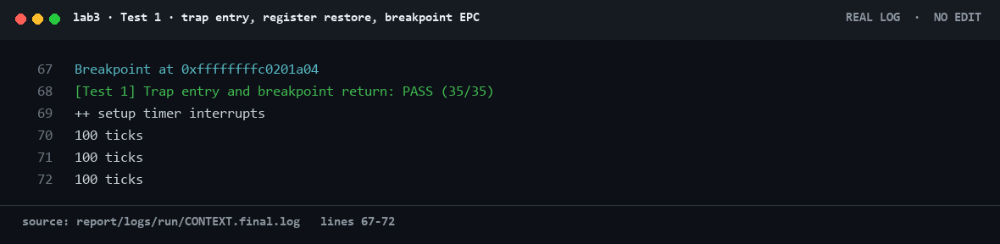
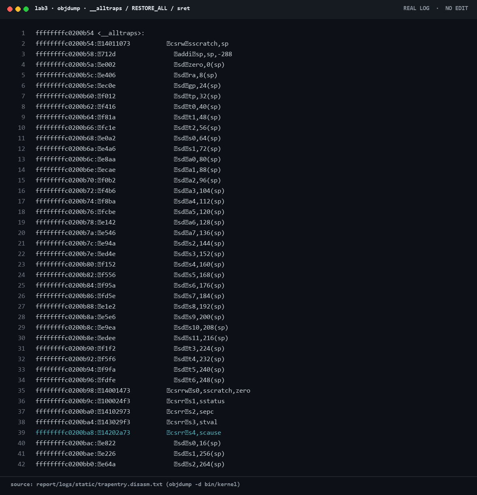
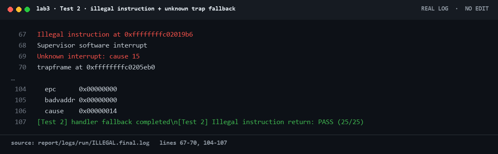
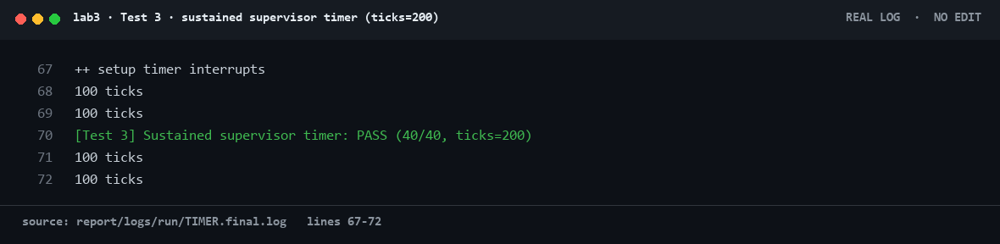
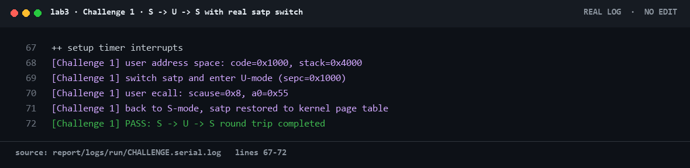
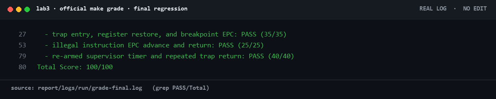

# 操作系统实验报告 · 实验 3：断，都可以断

本次实验我们围绕 RISC-V 的 Trap 机制，把 ucore 从“能够产生 Trap”推进到“能够保存现场、进入 C 处理函数、处理中断与异常、恢复现场并返回原执行流”。最终交付的默认构建在 `make grade` 中拿到 **100/100**：Trap 入口与断点返回 35/35、非法指令 EPC 推进 25/25、持续时钟中断 40/40。Challenge 1 的用户态/内核态往返演示也单独跑通，输出 `PASS: S -> U -> S round trip completed`，且不影响默认评分路径。

这份报告以我们实际跑出来的日志为准。正文里出现的地址、分值、tick 数都来自 `report/logs/` 下的原始输出；没有跑到的内容不写成“已完成”，推断出来的结论会明确标注。

## 实验基本信息

| 项目 | 内容 |
|---|---|
| 实验名称 | 实验 3 · 中断与异常（ucore / riscv64 版） |
| 指导材料 | `lab3指导书.docx`（正式要求）+ `lab3缺页机制.pptx`（旧版背景材料） |
| 代码基线 | `os源码/lab3/lab3_new`，工作副本为 `lab3/code` |
| 交付代码 | `lab3/code/`：`kern/`、`libs/`、`tools/`、`Makefile` |
| 运行环境 | Windows 主机 + WSL2 Ubuntu 22.04 |
| 交叉工具链 | `riscv64-unknown-elf-gcc 16.1.0` |
| 模拟器 | `qemu-system-riscv64 7.0.0`，OpenSBI `fw_dynamic` |
| 调试器 | `riscv64-unknown-elf-gdb 10.1` |
| 小组成员 | 2410665 殷佳仪（组长）· 2410749 宋秋实 · 2412090 兰雨杉 |
| 报告与证据 | `report/report.md`、`report/prompt.md`、`report/logs/`、`report/images/` |

### 本报告的写法

1. “实测”与“推断”分开写。实测数字给出日志文件，按源码逻辑推出来的结论明确写“推断”。
2. 截图全部由真实终端输出切片渲染，未手打、未改写；每张图下面注明来源文件和行号。
3. 指导书对应 QEMU 4.1.1 的 `fw_jump`，我们本机是 QEMU 7.0 的 `fw_dynamic`。两者行为不同的地方单独说明。
4. 没有做的内容不补写。PPT 里的缺页/换页没有出现在本次代码骨架和评分脚本中，我们只把它作为背景知识，不冒充本次实验成果。

---

## 目录

- [实验基本信息](#实验基本信息)
- [小组分工](#小组分工)
- [一、实验目的与材料判定](#一实验目的与材料判定)
- [二、实验环境与可复现命令](#二实验环境与可复现命令)
- [三、实验整体逻辑](#三实验整体逻辑)
- [四、实验内容与实现](#四实验内容与实现)
- [五、测试与验证](#五测试与验证)
- [六、Prompt、spec 与 AI 协作](#六promptspec-与-ai-协作)
- [七、重要知识点与 OS 原理对照](#七重要知识点与-os-原理对照)
- [八、OS 原理中重要但本实验未覆盖的内容](#八os-原理中重要但本实验未覆盖的内容)
- [九、总结与收获](#九总结与收获)
- [附录：证据索引](#附录证据索引)

---

## 小组分工

我们按“代码所有权、运行所有权、报告所有权”拆开，避免三个人同时改同一份文件，也避免运行结论出现两套口径。

| 成员 | 负责内容 | 交付边界 |
|---|---|---|
| 2410665 殷佳仪（组长） | 总体架构、模块 A `trapentry.S`、报告统稿、最终交付审核 | 不承担 `make`/QEMU/GDB/`make grade` 等运行任务；对模块 A 的寄存器顺序、`sp` 恢复和 `sret` 语义负责 |
| 2410749 宋秋实 | 模块 B `trap.c`、中断/异常分类、评分字符串对齐；**全组唯一运行与验证负责人** | 统一执行 `make`、QEMU、GDB、`objdump`、`make grade`，保存三组官方用例与 Challenge 的原始日志 |
| 2412090 兰雨杉 | Lab2 依赖移植、QEMU 7.0 启动适配、Challenge 1、仓库整理 | 保证默认评分路径不受 Challenge 影响；Challenge 只通过 `-DLAB3_CHALLENGE_SWITCH` 打开 |

一句话：**殷佳仪不做运行，宋秋实统一跑，兰雨杉保证扩展隔离。** 报告里所有运行数字都来自宋秋实这条统一验证链。

---

## 一、实验目的与材料判定

### 1.1 本次实验到底做什么

指导书的标题是“断，都可以断”，核心不是缺页，而是 **Trap 闭环**：

```text
异常/中断发生
  -> 硬件保存 sepc/scause/sstatus，跳到 stvec
  -> __alltraps 用 SAVE_ALL 在栈上构造 trapframe
  -> 以 trapframe* 调用 trap()
  -> interrupt_handler() / exception_handler() 分类处理
  -> __trapret 用 RESTORE_ALL 恢复现场
  -> sret 回到被打断的指令
```

必须实现的两个功能模块是：

1. `kern/trap/trapentry.S`：`RESTORE_ALL` 与 `__alltraps`。
2. `kern/trap/trap.c`：`interrupt_handler()` 与 `exception_handler()`。

### 1.2 PPT 与 docx 不是同一版实验

我们先把两份材料对齐，避免三个人做错方向：

| 维度 | `lab3缺页机制.pptx` | `lab3指导书.docx` + 当前代码 |
|---|---|---|
| 主题 | 缺页异常、VMA、页换入换出 | RISC-V Trap 入口、上下文保存/恢复、时钟中断、非法指令、断点 |
| 关键结构 | `vma_struct`、`mm_struct` | `struct trapframe`、`struct pushregs` |
| 关键文件 | `vmm.c`、`swap.c`、`swap_fifo.c` | `trapentry.S`、`trap.c` |
| 评分 | PPT 中的缺页流程 | `tools/grade.sh`：35 + 25 + 40 分 |

我们的处理是：**以 docx、当前代码骨架和 `grade.sh` 为准**。PPT 只作为“中断/异常在 OS 中处于什么位置”的背景。当前骨架没有 VMA、swap、页表换入换出接口，如果硬做缺页，只会得到一套无法被评分脚本验证的代码；这不是本次实验的要求。

---

## 二、实验环境与可复现命令

### 2.1 实测环境

```text
WSL2 Ubuntu 22.04
riscv64-unknown-elf-gcc (g6afcc4f6d) 16.1.0
qemu-system-riscv64 7.0.0
OpenSBI fw_dynamic
```

`grade.sh` 的三组用例分别用 8s、8s、30s 超时运行；最终总分由 `tools/grade.sh` 输出。

### 2.2 构建、运行、评分

在 WSL 中进入 `lab3/code`：

```bash
make clean
make                 # 生成 bin/kernel、bin/ucore.img
make grade           # 官方三组用例，目标 100/100
```

Challenge 1 是独立构建，不进入默认评分：

```bash
make clean
make DEFS=-DLAB3_CHALLENGE_SWITCH
qemu-system-riscv64 -machine virt -nographic -bios default \
  -kernel bin/ucore.img -serial file:challenge.log \
  -monitor none -no-reboot
```

### 2.3 一个真实的环境坑：QEMU 7.0 的 `-kernel`

第一次跑 `make grade` 得到 0/100，串口里 OpenSBI 打印：

```text
Domain0 Next Address : 0x0000000000000000
```

内核根本没有执行。根因不是 Trap 代码，而是 QEMU 7.0 的 `fw_dynamic` 不认 `-device loader,file=bin/ucore.img,addr=0x80200000` 这条加载路径。我们把评分脚本改成：

```bash
qemu-system-riscv64 -machine virt -nographic -bios default \
  -kernel bin/ucore.img ...
```

之后 OpenSBI 打印 `Domain0 Next Address : 0x0000000080200000`，内核正常启动。这个修复只改变加载方式，没有改评分用例、分值和匹配字符串。

---

## 三、实验整体逻辑

### 3.1 本章的逻辑主线

本章不是孤立地“写两个函数”，而是沿着一条自底向上的链：

```text
Lab2 物理内存管理
  -> 内核能分配页、能建立启动页表
  -> 设置 stvec，让 Trap 有入口
  -> SAVE_ALL 保存现场
  -> RESTORE_ALL 恢复现场
  -> __alltraps 把 trapframe* 传给 C
  -> trap_dispatch 分流中断/异常
  -> 定时器续订、异常 EPC 推进
  -> sret 返回原执行流
```

这条链里任何一环断了，后面的现象都会“看起来像别的地方错了”。例如：

- `stvec` 没设对：第一次 Trap 就跳飞。
- `RESTORE_ALL` 的 `sp` 提前恢复：后面的 `ld` 全部读错位置。
- 定时器不续订：只看到一次 `100 ticks`。
- `epc` 不推进：断点/非法指令会无限重复。
- `sstatus.SPP` 不对：`sret` 回到错误的特权级。

### 3.2 Trapframe 的布局契约

`struct trapframe` 在 64 位下是 36 个 `uintptr_t`，共 288 字节（`0x120`）：

| 偏移 | 内容 |
|---:|---|
| `0x000` – `0x0F8` | `x0` – `x31`，共 32 个通用寄存器 |
| `0x100` | `sstatus` |
| `0x108` | `sepc` |
| `0x110` | `badvaddr`（`stval`） |
| `0x118` | `scause` |

`SAVE_ALL` 先 `csrw sscratch, sp`，再把 `sp` 减 `0x120`，然后按这个布局写入。`x2(sp)` 不在通用寄存器循环里直接存，而是最后从 `sscratch` 取回原始 `sp` 再写到 `2*REGBYTES(sp)`。这就是 `RESTORE_ALL` 不能“所有寄存器一视同仁”的原因。

### 3.3 为什么 `sp` 必须最后恢复

`RESTORE_ALL` 的每一条 `ld` 都要用当前 `sp` 作为 trapframe 基址。如果先恢复 `sp`，后面的 `ld` 就会从“原来的栈指针”附近读数据，而不是从 trapframe 读。正确顺序是：

1. 先用 `t0` 恢复 `sstatus`、`sepc`；
2. 恢复 `x1`、`x3`–`x31`；
3. 最后 `ld sp, 2*REGBYTES(sp)`；
4. `sret`。

`x0` 是硬连线零寄存器，不能恢复；写 `x0` 没有意义，读 trapframe 里的 `x0` 也不应该覆盖它。

---

## 四、实验内容与实现

### 4.1 功能模块零：Lab2 依赖移植

Lab3 骨架本身不带完整的 Lab2 内存管理。我们做了三件事：

1. 把 Lab2 的 `best_fit_pmm.c` 移植到 `kern/mm/`，保留 `free_area`、`nr_free` 和四个管理函数。
2. 在 `pmm.c` 中补回 `page_init()`：用 DTB 探测物理内存，建立 `pages[]`，把内核镜像和页描述符数组占用的页保留，再把剩余连续空闲页交给 `init_memmap()`。
3. 在 `entry.S` 中保留启动期低地址恒等映射。QEMU 7.0 在执行 `csrw satp` 后，紧接着的取指仍然是低地址 PC；只有高半区映射时会在第二条指令就 instruction page fault。项 2 的低 1 GiB 恒等映射和项 511 的高半区映射一起，保证内核能活到 `kern_init()`。

这一部分不是本次报告的主角，但它是 Trap 能跑起来的前提：没有 `pmm_init()`，`page_init()` 走不到，后面的 `idt_init()`、`clock_init()` 都无从谈起。

### 4.2 模块 A：`RESTORE_ALL` 与 `__alltraps`（负责人：2410665 殷佳仪）

#### 实现

`RESTORE_ALL` 的关键代码如下（节选，完整代码在 `lab3/code/kern/trap/trapentry.S`）：

```asm
.macro RESTORE_ALL
    ld t0, 32*REGBYTES(sp)
    csrw sstatus, t0
    ld t0, 33*REGBYTES(sp)
    csrw sepc, t0

    ld x1, 1*REGBYTES(sp)
    ld x3, 3*REGBYTES(sp)
    ...
    ld x31, 31*REGBYTES(sp)
    ld sp, 2*REGBYTES(sp)
.endm

__alltraps:
    SAVE_ALL
    mv a0, sp
    jal trap
    j __trapret

__trapret:
    RESTORE_ALL
    sret
```

`__alltraps` 只做三件事：保存现场、把当前 `sp` 作为 `trapframe *` 传给 `trap()`、返回后走统一的 `__trapret`。它不直接处理任何中断/异常，也不修改 `trap()` 的签名。

#### 我们是怎么验证的

官方 Test 1 会检查大量通用寄存器是否原样恢复，并在断点异常后继续执行。最终日志：

```text
Breakpoint at 0xffffffffc0201a04
[Test 1] Trap entry and breakpoint return: PASS (35/35)
```



这张图来自 `report/logs/run/CONTEXT.final.log` 第 67–72 行。断点地址是真实运行地址；`PASS (35/35)` 是评分脚本自己打印的，不是我们手写的。

#### 静态证据

`objdump -d bin/kernel` 可以看到 `RESTORE_ALL` 的实际指令序列，最后一条是 `ld sp,16(sp)`，紧接着 `sret`：



这张图来自 `report/logs/static/trapentry.disasm.txt`。它证明“`sp` 最后恢复”不是报告里的口头描述，而是编译结果。

#### 新版 binutils 的 `sbadaddr` 兼容问题

我们在最终回归时遇到一个真实编译错误：

```text
Error: unknown CSR `sbadaddr'
```

`SAVE_ALL` 里写的是 `csrr s3, sbadaddr`。`sbadaddr` 是旧工具链对 `stval` 的别名，新版 binutils 已经删掉了这个名字。指导书要求“不得修改 `SAVE_ALL`”，所以我们的修复不是改 `SAVE_ALL`，而是在文件级加一行数值别名：

```asm
.equ sbadaddr, 0x143
```

`0x143` 就是 `stval` 的 CSR 编号。汇编结果与旧工具链完全一致，`SAVE_ALL` 原文一个字没动。

### 4.3 模块 B：`interrupt_handler()` 与 `exception_handler()`（负责人：2410749 宋秋实）

#### `trap_dispatch` 的分流

```c
if ((intptr_t)tf->cause < 0) {
    interrupt_handler(tf);
} else {
    exception_handler(tf);
}
```

RISC-V 的 `scause` 最高位为 1 表示异步中断，为 0 表示同步异常。这里用有符号数判断最高位，和 `cause & (1UL << 63)` 是等价的。

#### `interrupt_handler()`

```c
switch (tf->cause & INTERRUPT_CAUSE_MASK) {
case IRQ_S_SOFT:
    cprintf("Supervisor software interrupt\n");
    break;
case IRQ_S_TIMER:
    clock_set_next_event();
    ticks++;
    if (ticks % TICK_NUM == 0) print_ticks();
    if (ticks >= SHUTDOWN_AFTER) sbi_shutdown();
    break;
case IRQ_S_EXT:
    cprintf("Supervisor external interrupt\n");
    break;
default:
    cprintf("Unknown interrupt: cause %d\n",
            (int)(tf->cause & INTERRUPT_CAUSE_MASK));
    break;
}
```

三个细节：

1. **先续订下一次时钟事件**。OpenSBI 的 `sbi_set_timer()` 一次只设置一个事件；不续订就只能收到一次中断。
2. `ticks` 每进一次定时器中断加一，`TICK_NUM=100` 时打印一行。
3. `SHUTDOWN_AFTER=1000`，给官方 200 tick 用例留出足够余量；不能把它改到 200 附近，否则测试可能提前关机。

#### `exception_handler()`

```c
switch (tf->cause) {
case CAUSE_BREAKPOINT:
    cprintf("Breakpoint at 0x%016lx\n", tf->epc);
    tf->epc += instruction_length(tf->epc);
    break;
case CAUSE_ILLEGAL_INSTRUCTION:
    cprintf("Illegal instruction at 0x%016lx\n", tf->epc);
    tf->epc += instruction_length(tf->epc);
    break;
case CAUSE_USER_ECALL:
    cprintf("User ecall at 0x%016lx\n", tf->epc);
    tf->epc += 4;
    break;
case CAUSE_SUPERVISOR_ECALL:
    cprintf("Supervisor ecall at 0x%016lx\n", tf->epc);
    tf->epc += 4;
    break;
default:
    print_trapframe(tf);
    break;
}
```

关键点是 `instruction_length()`：

```c
static uintptr_t instruction_length(uintptr_t epc) {
    uint16_t insn = *(volatile uint16_t *)epc;
    return (insn & 0x3) == 0x3 ? 4 : 2;
}
```

RISC-V 的 32 位指令低两位是 `11`，16 位压缩指令不是。测试里的 `ebreak` 是 2 字节，`.word 0x7b` 是 4 字节；如果统一 `+4`，断点测试会跳过一条正常指令，非法指令测试也可能落到错误位置。

#### 最终输出

Test 2 的日志同时覆盖了非法指令、软件中断、未知中断和未知异常兜底：

```text
Illegal instruction at 0xffffffffc02019b6
Supervisor software interrupt
Unknown interrupt: cause 15
  cause    0x00000014
[Test 2] handler fallback completed\n[Test 2] Illegal instruction return: PASS (25/25)
```



这张图来自 `report/logs/run/ILLEGAL.final.log` 第 67–70、104–107 行。第 107 行里的 `\n` 是评分脚本自身输出里的字面量，不是我们的代码换行。

Test 3 覆盖持续时钟：

```text
100 ticks
100 ticks
[Test 3] Sustained supervisor timer: PASS (40/40, ticks=200)
```



这张图来自 `report/logs/run/TIMER.final.log` 第 67–72 行。最终日志里 `100 ticks` 出现 10 次，`ticks=200` 出现在 PASS 行，说明定时器被持续续订。

### 4.4 Challenge 1：S → U → S 的完整往返（负责人：2412090 兰雨杉）

#### 设计目标

指导书在 `init.c` 里留了一句：

```c
// LAB3: CAHLLENGE 1 If you try to do it, uncomment lab3_switch_test()
// lab3_switch_test();
```

我们把它做成一个**真正的地址空间切换**，而不是只改 `sstatus.SPP` 跳一下：

1. 建一份独立的 Sv39 根页表 `user_root`，复制内核高半区（entry 511）和启动期恒等映射（entry 2）。
2. 给 `user_root[0]` 建三级页表链 `L1 -> L0`，映射：
   - VA `0x1000` → 用户代码页，`U|R|W|X|A|D`；
   - VA `0x2000`、`0x3000` → 用户栈两页，`U|R|W|A|D`。
3. 用户代码页写入三条指令：`addi a0, x0, 0x55`、`ecall`、`j .`。
4. 设置 `sstatus.SPP=0`、`SPIE=0`、`SIE=0`、`SUM=1`，把 `satp` 切到 `user_root`，`sret` 进入 U 模式。
5. 用户态执行 `ecall`，`scause=8`；`lab3_switch_back()` 把 `sstatus.SPP` 置 1、`sp` 换成挑战专用内核栈、`epc` 指向恢复桩。
6. 恢复桩先建立可信内核栈，再清 `SUM`，把 `satp` 切回内核页表，`sfence.vma`，打印 PASS。

#### 为什么返回时要切内核栈

本实验的 `SAVE_ALL` 没有用 `sscratch` 切换内核栈：它直接在“当前 sp”上构造 trapframe。U 模式进来时，当前 sp 是用户栈，所以 trapframe 也在用户栈上。返回 S 模式时，如果我们继续用用户栈，就把用户可控的指针带回了内核。Challenge 里显式切到 `switch_stack`，是比“沿用用户 sp”更正确的做法。

#### 一个很有价值的 bug：SUM 清得太早

第一版 Challenge 在 `lab3_switch_back()` 里就把 `tf->status` 的 `SUM` 清掉了。结果 `RESTORE_ALL` 的第一条 `csrw sstatus, t0` 把 `SUM=0` 写进 CSR，紧接着的 `ld t0, 264(sp)` 还要从**用户栈上的 trapframe** 读 `sepc`，于是触发：

```text
scause = 0xd   # load page fault
```

然后递归 Trap，栈一路往下掉，最后看到 `scause=0xf` 的 store page fault。这个现象很容易误判成“栈指针恢复错了”，但 GDB 在 `__trapret` 看到的 trapframe 是完全正确的，真正的问题是 **S 模式在 `SUM=0` 时不能读用户页**。

修复：

- `lab3_switch_back()` 不再清 `SUM`；
- 恢复桩先 `sp = switch_stack_top`，再 `csrc sstatus, SUM`；
- 最后恢复 `satp`。

这也解释了一个容易被忽略的顺序：**先离开用户栈，再关 SUM**。

#### 最终输出

```text
[Challenge 1] user address space: code=0x1000, stack=0x4000
[Challenge 1] switch satp and enter U-mode (sepc=0x1000)
[Challenge 1] user ecall: scause=0x8, a0=0x55
[Challenge 1] back to S-mode, satp restored to kernel page table
[Challenge 1] PASS: S -> U -> S round trip completed
```



这张图来自 `report/logs/run/CHALLENGE.serial.log` 第 67–72 行。`a0=0x55` 是用户代码写进去的值，证明 U 模式确实执行了；`scause=0x8` 是 U-mode ecall；最后一行是恢复桩打印的。

Challenge 只在 `-DLAB3_CHALLENGE_SWITCH` 下编译，默认 `make grade` 不包含它。最终默认评分仍是 100/100，说明扩展隔离成立。

---

## 五、测试与验证

### 5.1 官方评分

| 用例 | 分值 | 最终结果 | 原始日志 |
|---|---:|---|---|
| Trap 入口、寄存器恢复、断点 EPC | 35 | PASS (35/35) | `logs/run/CONTEXT.final.log` |
| 非法指令 EPC 推进与返回 | 25 | PASS (25/25) | `logs/run/ILLEGAL.final.log` |
| 持续时钟与重复 Trap 返回 | 40 | PASS (40/40) | `logs/run/TIMER.final.log` |
| 总分 | 100 | **100/100** | `logs/run/grade-final.log` |



这张图来自 `report/logs/run/grade-final.log` 第 27、53、79、80 行。三条 PASS 和总分是 `grade.sh` 的原始输出。

### 5.2 我们实际检查的边界

除了官方用例，我们在实现和复核时重点检查了这些边界：

| 边界 | 现象 | 结论 |
|---|---|---|
| 16 位 vs 32 位指令 | `ebreak` 是 2 字节，`.word` 是 4 字节 | `instruction_length()` 按低两位判断，不能写死 `+4` |
| `sp` 恢复顺序 | 先恢复 `sp` 会让后续 `ld` 读错基址 | `sp` 必须最后恢复 |
| `x0` | 写 `x0` 无效 | `RESTORE_ALL` 跳过 `x0` |
| 定时器只响一次 | 不调用 `clock_set_next_event()` 只有一次 `100 ticks` | 定时器分支第一件事就是续订 |
| 未知中断 `cause=15` | 默认分支必须输出现有格式 | 用 `cause & ~(1<<63)` 后打印 `15` |
| 未知异常 `cause=20` | 不能只打印一行 | 调用 `print_trapframe(tf)` 兜底 |
| Challenge 的 `SUM` | 清早了会 load page fault | 切内核栈后再清 |
| QEMU 7.0 启动 | `-device loader` 下 OpenSBI 跳到 0 | 改用 `-kernel` |

### 5.3 可重跑性

所有关键结果都可以用下面的命令复现：

```bash
cd lab3/code
make clean
make grade
```

Challenge：

```bash
make clean
make DEFS=-DLAB3_CHALLENGE_SWITCH
qemu-system-riscv64 -machine virt -nographic -bios default \
  -kernel bin/ucore.img -serial file:challenge.log \
  -monitor none -no-reboot
```

静态证据：

```bash
riscv64-unknown-elf-objdump -d bin/kernel > report/logs/static/kernel.asm
riscv64-unknown-elf-nm -n bin/kernel > report/logs/static/symbols.txt
riscv64-unknown-elf-objdump -d bin/kernel | sed -n '/<__alltraps>:/,/^$/p' \
  > report/logs/static/trapentry.disasm.txt
```

---

## 六、Prompt、spec 与 AI 协作

这一节按课程要求写清楚：每个练习的 `spec` 是什么、`prompt` 是怎么写的、AI 生成后我们怎么审。

### 6.1 模块 A 的 spec

**输入**：一个已经由 `SAVE_ALL` 构造好的 `struct trapframe`，位于当前内核栈顶。

**输出**：`RESTORE_ALL` 把 trapframe 中的通用寄存器和 CSR 恢复到处理器；`__alltraps` 把 `trapframe *` 作为第一个参数传给 `trap()`，`trap()` 返回后进入 `__trapret`，最终 `sret`。

**约束**：

- 不得修改 `SAVE_ALL`、`struct trapframe`、`trap()` 签名；
- `x0` 不恢复；
- `sp` 最后恢复；
- `sstatus`、`sepc` 要在恢复通用寄存器之前写回；
- `sret` 是唯一的返回指令。

### 6.2 模块 A 的 prompt

我们给 AI 的 prompt 不是“帮我写 RESTORE_ALL”，而是把布局、约束和验收一次说清：

```text
你在 ucore/riscv64 的 kern/trap/trapentry.S 中工作。
已有 SAVE_ALL 把 32 个通用寄存器和 sstatus/sepc/badvaddr/scause
按 struct trapframe 的 36 个 uintptr_t 槽位保存在当前栈顶。

请只实现 RESTORE_ALL 和 __alltraps，要求：
1. 先恢复 sstatus、sepc，用 t0 做临时寄存器；
2. 恢复 x1、x3..x31，不恢复 x0；
3. sp 必须最后从 2*REGBYTES(sp) 恢复；
4. __alltraps 中 SAVE_ALL 后把 sp 放进 a0，jal trap，返回后 j __trapret；
5. 不修改 SAVE_ALL、struct trapframe、trap() 签名；
6. 输出 unified diff，不要重写整个文件。

验收：make grade 的 Test 1 必须 PASS (35/35)，且 objdump 中
最后一条恢复指令必须是 ld sp,16(sp)，下一条是 sret。
```

这个 prompt 的重点是 **把“不能做什么”写在“要做什么”旁边**。AI 很容易“顺手”把 `SAVE_ALL` 也改了，或者把 `sp` 和别的寄存器一起恢复；约束写清楚，返工就少。

### 6.3 模块 B 的 spec

**输入**：`trapframe *tf`，其中 `tf->cause` 是 `scause`，`tf->epc` 是 `sepc`。

**输出**：

- 定时器中断：续订下一次事件、`ticks++`、每 `TICK_NUM` 打印、达到 `SHUTDOWN_AFTER` 关机；
- 软件中断：打印 `Supervisor software interrupt`；
- 未知中断：打印 `Unknown interrupt: cause N`；
- 断点/非法指令：打印规定格式，按指令长度推进 `epc`；
- 未知异常：`print_trapframe(tf)`。

**约束**：

- 不改函数签名；
- 不改 `trap_dispatch`；
- 中断原因要先清最高位再 switch；
- `epc` 推进不能写死 `+4`；
- 官方匹配字符串必须逐字保留。

### 6.4 模块 B 的 prompt

```text
你在 ucore/riscv64 的 kern/trap/trap.c 中实现两个函数：
void interrupt_handler(struct trapframe *tf);
void exception_handler(struct trapframe *tf);

背景：trap_dispatch 已经用 (intptr_t)tf->cause < 0 区分中断/异常。
要求：
1. 中断分支先 mask 掉 scause 最高位，再按 IRQ_S_TIMER/IRQ_S_SOFT/
   IRQ_S_EXT/default 处理；
2. 定时器分支第一行调用 clock_set_next_event()，然后 ticks++，
   ticks % TICK_NUM == 0 时 print_ticks()，ticks >= SHUTDOWN_AFTER
   时 sbi_shutdown()；
3. 异常分支处理 CAUSE_BREAKPOINT、CAUSE_ILLEGAL_INSTRUCTION、
   CAUSE_USER_ECALL、CAUSE_SUPERVISOR_ECALL，其余 print_trapframe(tf)；
4. 断点和非法指令的 epc 推进必须按指令长度：低两位为 11 是 4 字节，
   否则是 2 字节；不要固定 +4；
5. 输出格式严格用：
   "Breakpoint at 0x%016lx\n"
   "Illegal instruction at 0x%016lx\n"
   "Supervisor software interrupt\n"
   "Unknown interrupt: cause %d\n"
6. 只输出 diff，不要改 trap_dispatch 和函数签名。

验收：make grade 的 Test 2/Test 3 必须 PASS，日志里要有
"cause    0x00000014" 和 "ticks=200"。
```

### 6.5 Challenge 的 spec 与 prompt

**spec**：在 `-DLAB3_CHALLENGE_SWITCH` 下，从 S 模式进入 U 模式执行一条 `ecall`，再回到 S 模式；默认构建不受影响。

**prompt 要点**：

```text
设计一个不依赖进程系统的 S->U->S 演示：
- 独立 Sv39 根页表，复制内核高半区映射；
- 用户代码页和用户栈页加 PTE_U；
- sret 前设置 SPP=0、SUM=1；
- U 模式执行 ecall，trap 处理里把 SPP 置 1、sp 换内核栈、epc 指向恢复桩；
- 恢复桩先切内核栈，再清 SUM，再恢复 satp；
- 用 LAB3_CHALLENGE_SWITCH 宏隔离，默认 make grade 不变。
```

这个 prompt 里最关键的一句是“**先切内核栈，再清 SUM**”。我们第一版没有这句话，就踩了 `scause=0xd` 的坑；把顺序写进 prompt，是把调试经验沉淀成约束。

### 6.6 AI 生成后我们怎么审

我们的审查顺序是固定的：

1. **看 diff 范围**：有没有改到不允许改的 `SAVE_ALL`、`trap_dispatch`、函数签名。
2. **对布局**：每个 `ld` 的偏移是否和 `struct trapframe` 一致。
3. **对顺序**：`sstatus`/`sepc` 是否在通用寄存器之前；`sp` 是否最后。
4. **对字符串**：官方匹配的字符串是否逐字一致。
5. **跑回归**：`make grade` 必须 100/100；Challenge 必须单独 PASS。

### 6.7 实际遇到的 bug 与解决

| 现象 | 根因 | 修复 | 回归 |
|---|---|---|---|
| `make grade` 0/100，OpenSBI 打印 `Next Address : 0` | QEMU 7.0 `fw_dynamic` 不认 `-device loader` | 改用 `-kernel bin/ucore.img` | 100/100 |
| `unknown CSR sbadaddr` | 新版 binutils 删除旧别名 | `.equ sbadaddr, 0x143`，不改 `SAVE_ALL` | 编译通过 |
| Challenge `scause=0xd` 循环 | `RESTORE_ALL` 先写 `sstatus`，提前清 `SUM` 后读不了用户栈上的 trapframe | 保持 `SUM` 到恢复完成；切内核栈后再清 | Challenge PASS |
| 只出现一次 `100 ticks` | 定时器没有续订 | 定时器分支第一行 `clock_set_next_event()` | `ticks=200` |
| 断点返回位置不对 | 把 `ebreak` 固定当 4 字节 | 按指令低两位判断 2/4 字节 | Test 1 PASS |
| 恢复后寄存器不对 | `sp` 提前恢复 / 漏寄存器 | `sp` 最后恢复，逐槽核对 | Test 1 PASS |

---

## 七、重要知识点与 OS 原理对照

| 本实验知识点 | OS 原理对应 | 含义、关系与差异 |
|---|---|---|
| `struct trapframe` 保存通用寄存器 | 上下文（context） | 本实验保存的是同一执行流的 Trap 现场；进程切换还要保存地址空间、调度状态、打开文件等，范围更大 |
| `sstatus.SPP/SIE/SPIE` | 特权级与中断使能 | 硬件用 CSR 记录 Trap 来源和中断状态；`sret` 根据 SPP 决定回到 U 还是 S |
| `scause` 最高位 | 中断/异常分类 | 最高位 1 是异步中断，0 是同步异常；这是 RISC-V 的具体编码，不是所有架构都一样 |
| `sepc` 推进 | 异常返回/指令重启 | 断点/非法指令要跳过触发指令；时钟中断通常保留原 `sepc`，因为要回到被打断的指令继续执行 |
| `stvec` | 中断向量 | Direct 模式下所有 Trap 都进 `__alltraps`；更复杂的系统会用向量表按 cause 分流 |
| `sscratch` | 内核栈/用户栈切换 | 本实验只用它暂存原始 `sp`；真正的用户态内核栈切换需要额外的 per-hart 状态 |
| `sbi_set_timer()` | 时钟中断/时间片 | OpenSBI 在 M 模式操作定时器；OS 每次中断续订下一次，形成周期节拍 |
| `ticks` | 系统时钟计数 | 本实验只做统计打印；调度器会用它更新时间片、触发抢占 |
| `SUM` | S 模式访问用户页 | `SUM=0` 时 S 模式不能读写 U 页；trapframe 在用户栈上时，恢复阶段必须保持 `SUM=1` |
| `PTE_U` | 用户/内核地址空间隔离 | 用户页必须带 U 位；内核高半区映射不带 U，U 模式不能执行内核代码 |
| `satp`/`sfence.vma` | 地址空间切换/TLB 刷新 | 改页表或切 `satp` 后必须刷新 TLB；Challenge 用它们做真正的地址空间切换 |
| `print_trapframe()` | 内核调试/故障兜底 | 未知异常不能静默返回，否则会无限重复；打印完整现场是最后一道诊断手段 |

### 7.1 与通用 OS 原理的差异

- **本实验的“上下文切换”不是“进程切换”**。我们保存/恢复的是同一个执行流的寄存器，没有切换页表、没有调度、没有 PCB。
- **本实验的“中断处理”没有下半部/中断线程化**。所有处理都在 Trap 上下文里完成，定时器只做计数和打印。
- **本实验的“系统调用”只有 ecall 的返回路径**，没有参数传递、返回值、用户指针校验和系统调用表。
- **本实验的“地址空间隔离”只在 Challenge 里演示了一页用户代码和两页用户栈**，没有完整的用户进程、ELF 加载和缺页处理。

---

## 八、OS 原理中重要但本实验未覆盖的内容

下面这些是操作系统原理里很重要、但本次 Lab3 的代码骨架和评分脚本没有对应的部分。我们列出来，是为了说明“本实验的边界在哪里”，而不是为了凑字数。

1. **进程与线程调度**：没有 PCB/TCB、就绪队列、时间片轮转、优先级和抢占。定时器只增加 `ticks`，不会触发 `schedule()`。
2. **系统调用的完整实现**：只有 `ecall` 的 EPC 推进；没有系统调用号分发、参数寄存器约定、用户指针合法性检查、返回值写回。
3. **缺页异常与页替换**：PPT 里的 VMA、swap、FIFO/Clock 没有出现在当前骨架；没有页表项 Present 位检查、没有 swap in/out。
4. **完整的用户进程**：Challenge 只跑了一段裸指令，没有 ELF 加载、用户栈初始化、`argv/envp`、退出码和 `wait`。
5. **文件系统与 I/O**：没有 inode、目录、文件描述符、块设备驱动和缓存。
6. **同步与并发**：没有锁、信号量、条件变量；本实验是单 hart，定时器中断也不会与进程并发。
7. **多核启动与 per-hart 状态**：没有 hart 间中断、自旋锁、每核栈和每核调度器。
8. **中断下半部/延迟处理**：所有工作都在 Trap 上下文完成，没有软中断、tasklet、工作队列。
9. **权限与安全**：没有用户指针校验、`SUM` 的细粒度控制、SMAP/SMEP 类似机制；Challenge 只是一次受控演示。

这些内容不是本次实验“漏做”，而是后续虚拟内存、进程管理、文件系统实验的主线。

---

## 九、总结与收获

这次实验给我印象最深的有三点。

第一，**Trap 不是一个函数，而是一条链**。`SAVE_ALL` 的布局、`RESTORE_ALL` 的顺序、`sstatus` 的 SPP、`sepc` 的推进、`sret` 的特权级返回，任何一处不一致，现象都可能跑到别的模块去。我们最后用“布局表 + 反汇编 + 官方用例”三条证据对齐，才敢说这条链是闭合的。

第二，**环境差异必须写进报告**。QEMU 7.0 的 `fw_dynamic` 不认 `-device loader`，新版 binutils 不认 `sbadaddr`，这些都不是指导书里的“知识点”，但它们是真实交付的一部分。把它们写清楚，比只贴一个 100/100 的截图更有价值。

第三，**Challenge 的坑最有教学意义**。`SUM` 清早了一位，表面看是“栈指针坏了”，实际是“S 模式不能再读用户页”。GDB 在 `__trapret` 看到的 trapframe 完全正确，逼着我们从“寄存器值”回到“特权级和页权限”去找原因。这个 bug 让我们真正理解了 `SUM`、`sret` 和 trapframe 三者的关系。

最终，默认构建 `make grade` 为 **100/100**，Challenge 1 为 **PASS**。我们没有把 PPT 的缺页内容写成本次成果，也没有把没跑过的测试写成“应该通过”。这份报告里的每个数字，都能在 `report/logs/` 里找到原文。

---

## 附录：证据索引

| 证据 | 文件 |
|---|---|
| 官方最终评分 | `logs/run/grade-final.log` |
| Test 1 串口 | `logs/run/CONTEXT.final.log` |
| Test 2 串口 | `logs/run/ILLEGAL.final.log` |
| Test 3 串口 | `logs/run/TIMER.final.log` |
| Challenge 串口 | `logs/run/CHALLENGE.serial.log` |
| 默认构建 | `logs/build/build-default.log` |
| Test 1/2/3 构建 | `logs/build/build-CONTEXT.final.log` 等 |
| Challenge 构建 | `logs/build/build-CHALLENGE.log` |
| 内核反汇编 | `logs/static/kernel.asm` |
| 符号表 | `logs/static/symbols.txt` |
| `__alltraps` 反汇编 | `logs/static/trapentry.disasm.txt` |
| 异常/中断处理反汇编 | `logs/static/exception_handler.disasm.txt`、`interrupt_handler.disasm.txt` |
| 截图 | `images/shot-L3-01` ~ `shot-L3-06` |
| 分工与架构 | `分工与架构设计.md` |
| Prompt 全文 | `prompt.md` |
