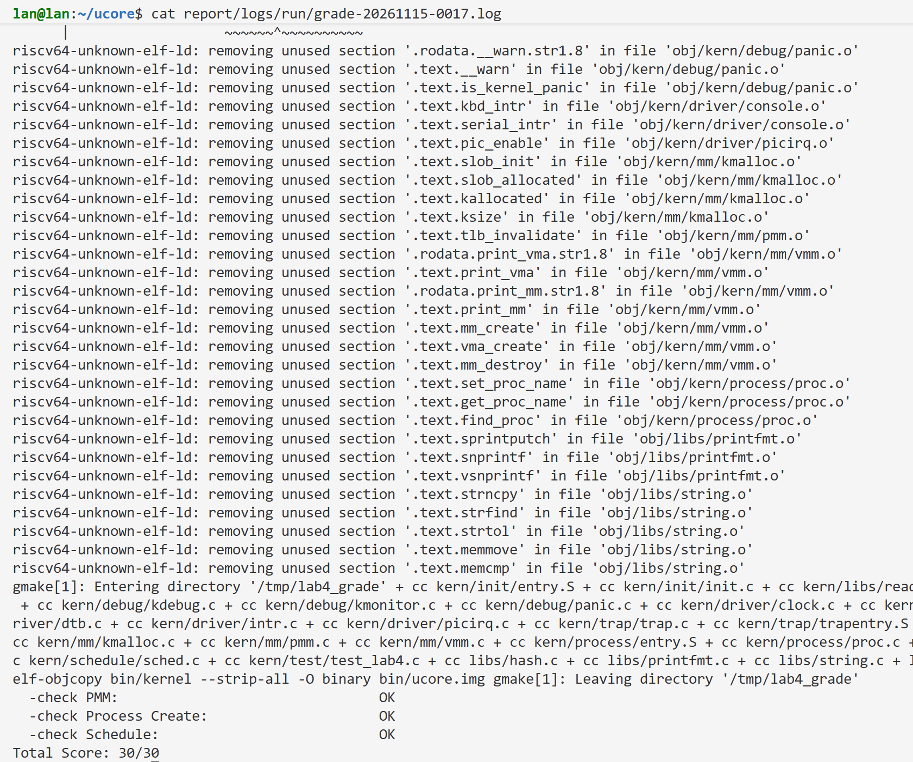

# 操作系统实验报告 · Lab 4：进程管理（内核线程与进程调度）

## 实验基本信息

| 项目 | 内容 |
|------|------|
| 实验名称 | Lab 4：进程管理（内核线程与进程调度） |
| 交付代码 | `code/`：`kern/`、`libs/`、`tools/`、`Makefile` |
| 运行环境 | WSL2 Ubuntu 22.04.5；riscv64 交叉工具链；QEMU 7.0.0（OpenSBI `fw_dynamic`）；riscv64 GDB |
| 小组成员 | 2410665 殷佳仪（组长）、2410749 宋秋实、2412090 兰雨杉 |

### 小组分工

| 成员 | 代码 | 文档与证据 |
|------|------|-----------|
| 2410665 殷佳仪（组长） | 模块一 `page_insert()`、`page_remove()` | 分工与架构、模块一 spec/prompt、Challenge 2 主笔、报告统稿 |
| 2410749 宋秋实 | 模块二 `alloc_proc()`、`proc_init()`、`kernel_thread()`、`do_fork()`、`copy_thread()`、`copy_mm()` | 模块二 spec/prompt、bug 记录、构建/运行/GDB/评分日志 |
| 2412090 兰雨杉 | 模块三 `switch_to()`、`schedule()`、`cpu_idle()`、`proc_run()`，Lab2/Lab3 依赖回填 | 模块三 spec/prompt、Challenge 1 主笔、依赖移植说明 |

## 一、实验目的

1. 理解内核线程与进程的核心数据结构（`struct proc_struct`、`struct context`、`struct trapframe`）和生命周期。
2. 掌握进程创建链路（`alloc_proc` → `do_fork` → `copy_thread` → `copy_mm`）以及新线程首次被调度的现场构造。
3. 掌握进程调度与上下文切换（`schedule` → `proc_run` → `switch_to`），理解为什么只切换 callee-saved 寄存器。
4. 理解用 `local_intr_save/restore` 保护临界区的原理，以及它和自旋锁的边界。
5. 练习用 AI 辅助开发操作系统核心功能。

## 二、AI 工具

| 成员 | AI 工具 | 底层模型 |
|------|---------|---------|
| 全组 | dsh（DeepSeek Harness）Web 界面 | DeepSeek-V4-Flash |

## 三、实验整体逻辑分析

本章主线是进程管理。Lab2 完成了物理页管理、Lab3 完成了陷阱处理之后，Lab4 要解决的问题是如何让一个 CPU 在多个内核线程之间切换。整体按依赖顺序分三步：

1. **先补依赖**：进程的 PCB 和内核栈要 `kmalloc`，新线程首次被调度要走陷阱返回链，所以先回填 Lab2 的物理页分配器和 Lab3 的陷阱恢复（见依赖移植说明）。
2. **再创建进程**（模块二）：`alloc_proc` 建 PCB → `do_fork` 复制并登记 → `copy_thread` 摆好新线程首次运行的现场（`context.ra = forkret`）。
3. **最后调度**（模块三）：`schedule` 选出下一个可运行线程 → `proc_run` 换页表根 → `switch_to` 换 callee-saved 寄存器现场。

其中首次运行链是理解本章的关键：新线程不是从 `kernel_thread_entry` 直接开始，而是 `switch_to` 的 `ret` 跳到 `forkret`，再走 `forkrets → __trapret → sret`，用陷阱返回机制把栈上预置的 `trapframe` 装回寄存器、跳到 `kernel_thread_entry`。

## 四、实验内容与实现

### 功能模块一：虚拟内存页操作（负责人：殷佳仪）

修改 `kern/mm/pmm.c`，实现 `page_insert()` 和 `page_remove()`，负责把虚拟地址映射到物理页、以及撤销映射。

关键点：

- `page_insert` 对同一地址映射同一物理页时走同页快速路径，只更新权限，**不能先 `page_ref_dec` 再 `page_ref_inc`**，否则单引用页会被瞬间释放。
- 同一地址改映射到另一物理页时，先 `page_remove` 撤销旧映射，再对新页加一次引用。
- `page_remove` 必须幂等：页表不存在或叶项无效时静默返回。
- `page_remove` 不回收空的中间页表页；`check_pgdir()` 在删除叶映射后仍断言 `boot_pgdir_va[0]` 指向的页表页引用为 1，回收会破坏既有生命周期。
- 两个函数改完页表项都调 `tlb_invalidate`，防止 CPU 命中旧翻译。

完整的 spec、不变量和最终提示词见 [prompts/module1.md](prompts/module1.md)。

### 功能模块二：进程创建与初始化（负责人：宋秋实）

修改 `kern/process/proc.c` 的 function2 区域，实现 `alloc_proc`、`proc_init`、`kernel_thread`、`do_fork`、`copy_thread`、`copy_mm`，完成内核线程的创建。

关键点：

- `alloc_proc` 把 PCB 所有字段清零初始化，`pgdir` 存**物理地址** `boot_pgdir_pa`（供 `satp` 使用），不是内核虚拟地址。
- `idleproc` 不是 fork 出来的：它复用当前执行现场和 `bootstack`，`context` 保持清零（`context.ra == 0`），官方测试断言这一点。
- `do_fork` 严格七步，每步失败回滚：`alloc_proc` → `setup_kstack` → `copy_mm` → `copy_thread` → `get_pid` 后挂链表 → `wakeup_proc` → 返回 pid。**必须先 `get_pid` 再挂链表**，否则 `get_pid` 会把自己当冲突源。
- `kernel_thread` 的 `s0 = fn`、`s1 = arg` 与 `kernel_thread_entry` 的 `move a0, s1; jalr s0` 严格对应。
- `copy_thread` 的 `context.ra` 指向 `forkret`（不是 `kernel_thread_entry`），`context.sp` 指向 `proc->tf`，子线程 `trapframe.gpr.a0 = 0`、`gpr.sp` 有效。

完整的 spec、不变量和最终提示词见 [prompts/module2.md](prompts/module2.md)。

### 功能模块三：进程调度与上下文切换（负责人：兰雨杉）

修改 `kern/process/switch.S`、`kern/schedule/sched.c` 和 `kern/process/proc.c` 的 function3 区域，实现 `switch_to`、`schedule`、`cpu_idle`、`proc_run`。

关键点：

- `switch_to` 只保存/恢复 callee-saved 寄存器 `ra, sp, s0~s11` 共 14 个，字段顺序与 `struct context` 严格一致，最后 `ret` 跳到 `to->context.ra`（首次是 `forkret`）。
- `schedule` 全程关中断（`local_intr_save/restore`），Round-Robin 从当前线程的下一个节点开始环形扫描 `proc_list` 找 `PROC_RUNNABLE`，一圈没有则回退 `idleproc`。
- `proc_run` 必须先设 `current` 和 `satp`、再 `switch_to`——`switch_to` 返回时已经站在新线程栈上。
- `satp` 用 Sv39 编码 `0x8000000000000000`，和 `pmm.c` 的 `enable_paging()` 一致，绕开 `libs/riscv.h` 里那个 SATP32 的 `lsatp()`（骨架实际是三级页表，见 Challenge 2）。

完整的 spec、不变量和最终提示词见 [prompts/module3.md](prompts/module3.md)。

### 依赖移植说明（Lab2/Lab3 回填）

Lab4 的进程调度依赖物理内存管理和陷阱处理，但骨架只给了 Lab4 的文件，缺 Lab2/Lab3 的部分，需要回填：

- **物理页分配器**（`kern/mm/default_pmm.c` + `kern/mm/pmm.c` 的 `page_init`）：补 best-fit 分配器和 `page_init`（从设备树拿物理内存起止，建 `pages[]` 描述符数组、标保留、把空闲区交给分配器）。用 best-fit 是因为官方测试 `best_fit_check` 的断言（`p0+4 == p1`）只有 best-fit 能满足。
- **陷阱恢复与处理**（`kern/trap/trapentry.S` + `kern/trap/trap.c`）：补 `RESTORE_ALL` 宏、`__alltraps` 入口（`mv a0, sp; jal trap; j __trapret`），以及 `interrupt_handler`/`exception_handler`（定时器中断续订下一次事件、计数、到点关机）。

回填保持旧实验语义，但按新骨架接口调整（分配器函数统一成 `default_*`、注册成 `default_pmm_manager`），没有用旧实验整文件覆盖新骨架。

### spec 与提示词的组织

每个练习都先写 spec，再写 prompt，最后才让 AI 生成代码。spec 固定回答四件事：输入是什么、成功语义是什么、失败语义是什么、必须保持哪些不变量。prompt 固定写死三件事：只改哪些文件、哪些函数、哪些既有接口不能动。这样做的目的不是让提示词更长，而是把评分点和禁止事项提前变成可检查的条款。

| 任务 | spec 的重点 | prompt 的硬约束 | 记录 |
|------|-------------|-----------------|------|
| 模块一 | 同页、异页、未映射三条路径；引用计数不先减后加；TLB 必须失效；失败返回 `-E_NO_MEM` 且不写叶项 | 只改 `pmm.c` 的 function1；不改 `get_pte()`；不回收空页表页；保留注释并把 `YOUR CODE` 换成学号 | `module1.md` |
| 模块二 | PCB 字段、`idleproc` 特殊语义、`do_fork` 七步回滚、`copy_thread` 首次现场 | 只改 `proc.c` 的 function2；先 `get_pid` 再挂链表；不碰 function3 | `module2.md` |
| 模块三 | `switch_to` 只存 14 个 callee-saved；`schedule` 环形扫描；`proc_run` 先 `current`/`satp` 再 `switch_to` | 只改 `switch.S`、`sched.c` 和 function3；`satp` 用 Sv39；不碰模块二 | `module3.md` |
| Challenge 1 | 宏展开、`SIE` 读写、嵌套归还、与自旋锁的边界 | 只读不改；必须给出 `schedule -> proc_run` 的嵌套状态 | `challenge1.md` |
| Challenge 2 | 三种模式的级数和位宽、`get_pte()` 两段分配、合并与拆分 | 先按宏反推，不信注释；只分析，不改评分路径 | `challenge2.md` |

提示词不是一次成型的。模块一第一版没有区分同页和异页，模块二第一版把 `idleproc` 当普通线程处理，Challenge 2 第一版直接相信了 `mmu.h` 的旧注释。我们都是在对照骨架接口、官方测试断言和实际宏定义之后，把约束补进下一版 prompt。具体偏差见各记录文件的实现记录一节。

### Challenge 1：`local_intr_save/restore` 如何实现开关中断（主笔：兰雨杉）

`local_intr_save(intr_flag)` 展开为 `intr_flag = __intr_save()`。`__intr_save()` 先读 `sstatus.SIE`：如果为 1，调用 `clear_csr(sstatus, SSTATUS_SIE)` 关中断并返回 `true`；如果为 0，直接返回 `false`。`local_intr_restore(intr_flag)` 展开为 `__intr_restore(intr_flag)`，只在 `intr_flag` 为真时调用 `set_csr(sstatus, SSTATUS_SIE)` 重新开中断。

因此它保存的是调用点的中断使能状态，不是进来就关、出去就开。嵌套调用时这个区别才显现：`schedule()` 先保存 `true` 并关中断，随后调用 `proc_run()`；`proc_run()` 再次保存时读到 `SIE=0`，得到 `false`，退出时保持关中断；回到 `schedule()` 后，外层用 `true` 恢复开中断。内层不会把外层关闭的中断提前打开，中断状态是逐层归还的。

它只操作当前 hart 的 `sstatus.SIE`，不改 `sie`（中断源使能）和 `sip`（挂起位）；也不提供多核间的原子互斥。单核上它防止异步陷阱打断临界区，多核上仍然需要自旋锁或原子指令。把 `local_intr_save/restore` 当成自旋锁是概念错误。

还有一个实现细节：`read_csr(sstatus)` 和 `clear_csr` 是两条 CSR 指令。如果中断恰好落在两者之间，硬件进入陷阱时会清 `SIE`、把原值存入 `SPIE`，`sret` 返回后 `SIE` 恢复为 1，随后 `clear_csr` 再关中断，保存的 `true` 仍然与调用点状态一致。这个窗口不改变语义，但说明它依赖 RISC-V 的陷阱返回规则，不能照搬到没有等价 CSR 语义的架构上。

完整 spec、prompt 和第一版偏差见 [prompts/challenge1.md](prompts/challenge1.md)。

### Challenge 2：分页模式与 `get_pte()` 的拆分（主笔：殷佳仪）

#### 1. 三种模式的异同

| 模式 | 虚拟地址 | 物理地址 | 级数 | 每级索引 | 页内偏移 | PTE 宽度 | 物理页号 | 大页 |
|------|---------|---------|------|---------|---------|---------|---------|------|
| Sv32 | 32 位 | 34 位 | 2 | 10 + 10 | 12 位 | 4 B | 22 位 | 4 MB |
| Sv39 | 39 位 | 56 位 | 3 | 9 + 9 + 9 | 12 位 | 8 B | 44 位 | 2 MB / 1 GB |
| Sv48 | 48 位 | 56 位 | 4 | 9 + 9 + 9 + 9 | 12 位 | 8 B | 44 位 | 2 MB / 1 GB / 512 GB |

三者都使用 4KB 页，页表项都包含 V/R/W/X/U/G/A/D 和 PPN 字段，地址翻译都是基数树式多级页表。区别在级数和地址位宽：Sv32 的页表项是 4 字节，一页 1024 项，所以每级索引 10 位；Sv39/Sv48 的页表项是 8 字节，一页 512 项，所以每级索引 9 位。级数增加不是页表项变复杂，而是虚拟地址变宽后需要更多索引位。

#### 2. 两段代码为什么如此相像

`get_pte()` 的第一段用 `PDX1(la)` 查顶层，缺表时分配一个物理页、`set_page_ref(page, 1)`、`memset` 清零、用 `ptd_create(page2ppn(page))` 写入；第二段用 `PDX0(la)` 查中间层，做同样的分配；最后用 `PTX(la)` 返回叶项，不再分配。

Sv39 有三层，前两层是非叶层，所以正好两段分配；Sv32 只有两层，只需要一段；Sv48 有四层，会有三段。两段代码相似，是因为 RISC-V 每一级都采用同一套基数树结构，走一步的动作完全相同：取索引、读 PTE、缺表则分配并清零、写入下一级页表号。变化的只有索引宏和 PTE 的位宽。代码没有写成循环，是因为层数在编译期固定，且最后一步要返回叶项而不是继续分配；展开写更直白，但重复也由此而来。

#### 3. 合并查找与分配的取舍

`get_pte(pgdir, la, create)` 把查找和分配合在一起，调用者少写遍历，映射建立集中在一个函数里。但 `create` 让同一个函数承担两种语义：`create=0` 是只查，`create=1` 是查加建。调用点只要把参数写错，只读路径就会触发分配。

更具体的问题是失败原子性：如果第一级页表刚分配成功，第二级分配失败，`get_pte()` 返回 `NULL`，但第一级页表页已经以引用 1 留在页表中；`page_insert()` 只能返回 `-E_NO_MEM`，无法回收它。指导书要求失败时不能留下半完成映射，严格说这里没有叶映射，但确实留下了一个空的中间页表页和一次引用。另一个问题是可测试性：想单独验证遍历逻辑，必须绕过分配器；想注入第二级失败，又要先让第一级成功，测试成本高。

我们的建议是拆成 `walk_pte(pgdir, la)` 和 `alloc_pte_table(pgdir, la)`：前者只遍历、不分配，后者在缺表时逐级建立并能在失败时回滚；`get_pte()` 保留为兼容包装。页表遍历是热路径，但拆出的函数可以被内联，真正的成本是接口复杂度和错误路径，不是函数调用本身。本实验为兼容骨架和评分路径保留合并接口，这是工程折中，不是唯一正确写法。

#### 4. 本骨架的核实

`kern/mm/mmu.h` 的 `PDX1/PDX0/PTX` 都使用 `0x1FF` 掩码，移位是 30/21/12，确定为 Sv39；`get_pte()` 也确实只有两段分配代码，最后返回 `&((pte_t *)KADDR(PDE_ADDR(*pdep0)))[PTX(la)]`。我们在核对时发现文件顶部还留着 Sv32 的 10+10+12 旧注释，与宏定义和指导书的 39 位/56 位说明矛盾；本次把注释改回 Sv39 的四段布局，只改注释，不动评分路径。

`libs/riscv.h` 的 `lsatp()` 仍写 `SATP32_MODE`，参数是 `unsigned int`，当前没有调用点；`proc_run()` 直接用 `0x8000000000000000 | (next->pgdir >> RISCV_PGSHIFT)`，模式字段 8 对应 Sv39，和 `enable_paging()` 一致。`lsatp()` 当前没有调用点，本次不把它纳入运行路径；后续如果复用它，必须先把它改成 Sv39 编码。

完整 spec、prompt 和第一版偏差见 [prompts/challenge2.md](prompts/challenge2.md)。

Challenge 1/2 都不修改默认评分路径，不把答案代码塞进 `pmm.c` 或 `proc.c`。

## 五、测试与验证

`make grade` 原始输出（见 [logs/run/grade-20261115-0017.log](logs/run/grade-20261115-0017.log)）末尾的检查项和总分：

```text
  -check PMM:                                OK
  -check Process Create:                     OK
  -check Schedule:                           OK
Total Score: 30/30
```

首次运行链由 GDB 证明（见 [logs/static/gdb-switch.log](logs/static/gdb-switch.log)）：

```text
===== [switch_to]  pc=0xffffffffc0203778 =====
  from(prev->context)=0xffffffffc040e040  to(next->context)=0xffffffffc040e140
  to->context.ra = 0xffffffffc020326c
  to->context.sp = 0xffffffffc0411ee0
===== [forkret]  pc=0xffffffffc020326c =====
===== [forkrets]  pc=0xffffffffc0200da2  a0(tf)=0xffffffffc0411ee0 =====
===== [kernel_thread_entry]  pc=0xffffffffc02031f2 =====
  s0(fn)=0xffffffffc020327a  s1(arg)=0xffffffffc0205390
```

断点依次命中 `switch_to → forkret → forkrets → kernel_thread_entry`，`to->context.ra` 指向 `forkret`，证明新线程经 `forkret → forkrets → __trapret` 恢复现场、跳到 `kernel_thread_entry`。反汇编见 [logs/static/kernel.disasm.txt](logs/static/kernel.disasm.txt)。

T1–T8 边界测试结论见 [tests/boundary_summary.md](tests/boundary_summary.md)。

截图：




截图为组内复核时在终端读取原始日志，实验运行与日志生成按分工由宋秋实统一执行。

## 六、实验总结与收获

### 对操作系统的理解

1. **进程同时承载资源与执行流**：PCB 和页表描述资源，`context` 和 `trapframe` 描述执行流。创建进程时两者分别由 `copy_mm`（本实验占位）和 `copy_thread` 准备。
2. **上下文切换只需存 callee-saved**：caller-saved 寄存器由调用约定保证调用者自己保存，所以 `switch_to` 只切 `ra, sp, s0~s11`，对应理论课上的进程现场。
3. **调度分成选择和换现场两步**：`schedule` 只负责选，`proc_run`/`switch_to` 负责换。换页表根（`satp`）是进程隔离的基础，即使本实验所有内核线程共享同一 boot 页表，这个动作也不能省。
4. **临界区保护有层级**：关中断是单核上防止异步打断，自旋锁是多核间互斥，两者不能混为一谈。

### 与 OS 课程知识点的对照

| 实验中的落点 | OS 课上的概念 | 含义 | 关系与差异 |
|---|---|---|---|
| `page_insert`/`page_remove`、引用计数、`tlb_invalidate` | 页表、地址转换、TLB | 虚拟地址经多级页表映射到物理页，TLB 缓存最近的翻译 | 课上把改页表要失效 TLB 当结论，实验里漏写 `tlb_invalidate` 就会读到旧翻译；课上页表由硬件走，实验里页表页要自己分配 |
| `get_pte(...,1)` 建中间级 | 多级页表的空间换时间 | 只为用到的地址建中间页表，省内存 | 课上强调省空间，实验暴露代价：一次可能失败的分配和回滚 |
| `proc_struct`、`kstack` | 进程控制块、内核栈 | PCB 是进程存在的唯一标志 | 课上 PCB 是一个整体，实验里 PCB 与内核栈分开分配，`kstack` 只记基址，栈溢出会踩坏别的数据 |
| `switch_to` 只存 `ra,sp,s0~s11` | 上下文切换、进程现场 | 切换时保存/恢复执行现场 | 课上不限定现场的范围，实验证明范围由调用约定决定：caller-saved 由调用者自己保存 |
| `kernel_thread` 伪造 trapframe + `sret` | 中断/异常、特权级切换 | 硬件在陷阱入口隐式保存现场，返回时恢复 | 首次运行是伪造一次陷阱返回，`sstatus`/`sepc` 必须提前备好，否则 `sret` 跳错地方 |
| `schedule` 环形扫描 + `need_resched` | 调度算法、调度点 | 按策略选出下一个可运行实体 | 课上讲 FIFO/RR/优先级，实验只有显式调度点加 FIFO，没有时钟抢占，时间片根本不存在 |
| `local_intr_save/restore` | 临界区、互斥 | 关中断让一段代码不被打断 | 课上讲关中断和开中断，实验揭示它保存的是调用点状态以支持嵌套，且只保护单核 |
| `copy_mm` 返回 0 | 进程地址空间、fork | 进程有独立地址空间，fork 复制它 | 课上 fork 复制地址空间，实验里内核线程共享 boot 页表，`copy_mm` 只是接口占位——这正是线程与进程的分界 |

我们最大的感受是：课上的顺序是抽象、策略、实现，实验的顺序是机制、约束、验证。同一个名词在课上是一句话，在实验里是一组必须同时成立的不变量：页表项、引用计数、TLB 三者一致；PCB、内核栈、trapframe 三者对齐；`current`、`satp`、`sp` 三者同步。差异最大的两点：课上讨论该不该抢占，实验连抢占的入口都没有；课上把并发当默认背景，实验只有单核关中断。

### 本实验未覆盖的 OS 原理知识点

抢占式调度与时间片、多核同步（自旋锁/原子指令）、完整的用户态进程与 `wait/exit`、地址空间复制（`copy_mm` 目前是占位）、缺页异常与换页。这些留待后续实验。

### AI 协作开发的经验

1. **spec 先行**：每个函数先写清输入、成功语义、失败语义、不变量，再让 AI 生成代码，比直接描述实现页表插入少走弯路。三个模块都按这个格式落地（见 `report/prompts/`）。
2. **prompt 里写死禁止项**：明确只改哪个文件、哪些函数、用哪些既有接口，比只写要做什么更能防住 AI 顺手改了别人的模块。
3. **AI 给的第一版不能直接信**：本实验最典型的是 `satp` 编码——骨架给的 `lsatp()` 写死 Sv32 模式，但页表实际是 Sv39，照抄会把 CPU 切进错误的地址翻译模式。这类看起来能跑、语义不对的问题不报错，只能查手册、对反汇编才能发现。
4. **bug 用五行归档**：现象、根因、修复、回归、反思，不写改好了。本实验真正影响系统行为的问题集中在页表引用计数、TLB、`status` 位、`switch_to` 字段偏移、调度起点这几类。

### 典型 bug 复盘

| 问题 | 现象 | 根因 | 修复 | 验证 |
|------|------|------|------|------|
| 同页重映射的引用计数 | 先 `page_ref_dec` 再 `page_ref_inc` 会让单引用页瞬间归零并释放 | 同页路径没有和异页路径分开 | 同页只更新权限和 PTE，不动引用计数 | T1 |
| 改映射后的 TLB | 页表已经指向新页，CPU 仍读到旧页内容 | 只改 PTE，没有失效对应 TLB 项 | `page_insert`/`page_remove` 结束时调 `tlb_invalidate` | T4 |
| `kernel_thread` 形参类型 | 构建日志报 `-Wincompatible-pointer-types` | 官方测试线程是 `void (*)(void *)`，骨架声明是 `int (*)(void *)` | 不改内核 ABI，告警如实留在日志里，行为由调用约定保证 | 30/30 |
| `do_fork` 半登记 | 故障注入时可能出现计数已增加、链表没有节点 | `get_pid`、`hash_proc`、`list_add`、`nr_process++` 分开执行 | 四步收进同一临界区，失败只回收已拿到的资源 | T8 |
| `idleproc` 的 `context.ra` | 官方断言 `idleproc->context.ra == 0` 失败 | 照 `copy_thread` 给它写了 `forkret` | 保持 `alloc_proc` 的清零状态，只补必要字段 | T5 |
| `satp` 模式 | 照抄 `lsatp()` 会把 CPU 切进 Sv32，取指异常 | 骨架 `lsatp()` 写死 SATP32，实际页表是 Sv39 | `proc_run` 直接写 Sv39 编码 `0x8000000000000000` | 30/30、GDB |
| `switch_to` 字段偏移 | 恢复出的栈或返回地址错位 | 汇编存取顺序和 `struct context` 不一致 | 按 `ra, sp, s0~s11` 顺序存取，反汇编核对偏移 | T7 |
