# 操作系统实验报告 · 实验 2：物理内存管理与页表

本次实验我们围绕 ucore/riscv64 的物理内存管理展开，把lab2探测可用物理内存 → 建立页描述符数组
`pages[]` → 把空闲页交给页级分配器 → 在其上再叠一层任意大小对象分配器这条自底向上的链路
完整走了一遍。组长负责的功能模块一（`page_init()`）和两个 Challenge（Buddy System、SLUB）
都由我们实现并通过了自测，默认构建走 Best-Fit。

在此基础上，我们还用 GDB 加 QEMU 单步复现了一条真实访存指令的 VA→PA 三级页表翻译，并在
QEMU 4.1.1 的源码里定位了软件 TLB 的查找代码。过程中遇到一个让我们很意外的现象：`csrw satp`
会把 QEMU 的翻译块切断，导致紧随其后的取指仍然以低地址 PC 发出。正是这个现象让我们意识到，
引导页表除了高半区映射之外，还必须额外提供一条低地址恒等映射——这是我们在本次实验里收获最大的
一次排障。

## 实验基本信息

| 项目 | 内容 |
|------|------|
| **实验名称** | Lab 2: 物理内存和页表（ucore / riscv64 版） |
| **小组成员** | 2410665-殷佳仪（组长）、2410749-宋秋实、2412090-兰雨杉 |
| **完成日期** | 2026-10-19 |
---

## 目录

- [实验基本信息](#实验基本信息)
- [本报告的写法和阅读说明](#本报告的写法和阅读说明)
- [小组分工](#小组分工)
- [表一：练习与功能模块分工](#表一练习与功能模块分工)
- [表二：撰写与交叉复核](#表二撰写与交叉复核)
- [一、实验目的](#一实验目的)
- [课程报告 7 条要求的落点](#课程报告-7-条要求的落点)
- [二、实验环境](#二实验环境)
- [1. 使用的 AI 工具](#1-使用的-ai-工具)
- [2. 运行环境（实测）](#2-运行环境实测)
- [3. 内存布局与地址契约（实测）](#3-内存布局与地址契约实测)
- [4. 构建命令与验收链（实测）](#4-构建命令与验收链实测)
- [三、实验整体逻辑分析](#三实验整体逻辑分析)
- [3.1 本章节的逻辑主线](#31-本章节的逻辑主线)
- [3.2 功能的逐步实现](#32-功能的逐步实现)
- [四、实验内容与实现](#四实验内容与实现)
- [功能模块零：lab2 源码逐模块讲解](#功能模块零lab2-源码逐模块讲解)
- [功能模块一：物理内存探测与页描述符初始化](#功能模块一物理内存探测与页描述符初始化)
- [练习：Challenge 硬件的可用物理内存范围获取](#练习challenge-硬件的可用物理内存范围获取)
- [练习：任务一 First-Fit 连续物理内存分配理解](#练习任务一-first-fit-连续物理内存分配理解)
- [功能模块二：Best-Fit 连续物理内存分配](#功能模块二best-fit-连续物理内存分配)
- [功能模块三：Buddy System 伙伴系统](#功能模块三buddy-system-伙伴系统)
- [功能模块四：SLUB 任意大小内存分配](#功能模块四slub-任意大小内存分配)
- [分支任务：GDB 调试页表查询过程](#分支任务gdb-调试页表查询过程)
- [五、测试与验证](#五测试与验证)
- [5.1 验收命令与判据](#51-验收命令与判据)
- [5.2 自测判据表（Challenge 部分）](#52-自测判据表challenge-部分)
- [5.3 可重跑性](#53-可重跑性)
- [六、实验总结与收获](#六实验总结与收获)
- [6.1 对操作系统的理解：知识点对照与未覆盖清单](#61-对操作系统的理解知识点对照与未覆盖清单)
- [6.2 一些对 gitbook 内容的理解与思考](#62-一些对-gitbook-内容的理解与思考)
- [6.3 提示词工程：可复用的方法论](#63-提示词工程可复用的方法论)
- [6.4 对思考题的延伸思考](#64-对思考题的延伸思考)
- [6.5 小组内 AI 协作开发的经验](#65-小组内-ai-协作开发的经验)

## 小组分工

### 表一：练习与功能模块分工

| 成员 | 负责的练习 / 模块 | 具体交付 |
|---|---|---|
| **2410665 殷佳仪（组长）** | **功能模块一**：`page_init()` 物理内存探测与页描述符初始化 | 实现 + `spec`/`prompt` 全文 + 迭代过程 + 反例实验 |
| | **Challenge 1-2**：硬件的可用物理内存范围获取方法（思考题） | 4 条途径逐条实测 + 通俗作答 |
| | **功能模块五**：GDB 调试页表查询过程 | 双重 GDB 环境 + 真实 VA→PA 三级翻译演示 + 6 问逐条作答 |
| | **全文统稿与终审、代码总集成与提交** | 本报告 + `prompt.md` + 截图归档 |
| **2410749 宋秋实** | **练习 2-1**：First-Fit 四个函数理解与思考题 | 逐函数拆解 + 改进空间 |
| | **练习 2-2**：Best-Fit 实现 + `init_pmm_manager()` 切换 | 实现 + prompt + 迭代 + 改进空间 |
| | **§五 测试与验证** | 验收命令原文 + 判据表 + 复跑记录 |
| **2412090 兰雨杉** | **Challenge 2-3**：Buddy System 伙伴系统 | 两份 prompt + 模块 + 自测 B1~B7 + 覆盖说明 |
| | **Challenge 2-4**：SLUB 任意大小内存分配 | 两份 prompt + 两层架构 + 自测 S1~S12 + 覆盖说明 |
| | **§六 实验总结与收获、仓库整理与截图归档** | 知识点对照表 + 未覆盖知识点表 |

### 表二：撰写与交叉复核

| 成员 | 撰写章节 | 必须完成的交叉复核动作 |
|---|---|---|
| 2410665 殷佳仪 | 基本信息、§一、§二、§三、模块零、模块一、Challenge 1-2、分支任务（GDB）、统稿 | 复核知识点对照表：逐行检查"差异"列是否有实测支撑；凡出现"应该/通常/大概"一律打回 |
| 2410749 宋秋实 | 2-1、2-2、§五 | 用 GDB 复现 `va_pa_offset`/`npage`/`pages` 三个关键值；复核 buddy/slub 自测可重跑性 |
| 2412090 兰雨杉 | 2-3、2-4、§六、仓库 | 逐条重跑 `[Test 2]` 与 `grading:` 计分输出，不能复现的结论一律删除 |

> **分工说明**：按**交付物**切分，每件交付物只有一位负责人，但三人共用同一份原始证据
> （`lab2/logs/`）与同一套验收命令（`make`、`make grade`、`make DEFS=-DUSE_BUDDY_PMM`、
> `make DEFS=-DCHALLENGE_SLUB_TEST`）。延续 lab1 的三层责任：**谁写 / 谁验 / 谁能现场答**，
> 只写不验的章节不予定稿。

---

## 一、实验目的

下面三条逐字取自指导书的「实验目的」。

1. 理解**页表的建立和使用**方法；
2. 理解**物理内存的管理**方法；
3. 理解**页面分配算法**（First-Fit / Best-Fit，以及 Challenge 的 Buddy System 与 SLUB）。

我们在本次实验中真正要建立的能力，就是把上面三句话落到一条完整链路上：一段 128 MiB 的 DRAM，
从裸机状态开始，一步步被描述、被切分、被分配、被回收，最后还能被一个页表翻译成虚拟地址。

### 课程报告 7 条要求的落点

指导书对 lab2 报告列了 7 条硬性要求（下文记作 R1~R7）。为了复核时能直接对着条目查，先把它们和本报告的位置一一对上：

| 编号 | 报告要求（指导书原文要点） | 本报告的落点 | 状态 |
|---|---|---|---|
| R1 | 用 markdown 完成，以文本说明为主 | 本文件即 markdown 全文；正文以文字说明为主，截图只承担“证据”角色 | ✅ |
| R2 | 说明对本章整体逻辑的理解：按什么顺序、围绕哪些功能逐步实现 | §三（`3.1` 逻辑主线 + `3.2` 功能逐步实现表） | ✅ |
| R3 | 说明对每个功能的核心函数 / 功能模块的理解 | §四 模块零（源码逐模块）→ 模块一 → 2-1 → 2-2 → Challenge 2-3 / 2-4 → 分支任务 | ✅ |
| R4 | 说明每个练习的 `spec` 与 `prompt` 是怎么写的 | §四 各模块的 `[RELY]` / `[GUARANTEE]` / `[SPECIFICATION]` / `[PROMPT]` 四段式小节 + §6.3 提示词工程方法论；全量原文见 `prompt.md` | ✅ |
| R5 | 说明用提示词让 AI 生成代码时出现的 bug 及解决过程 | §四 各模块的「迭代过程」+ §五 R5 专栏（3 个真实缺陷汇总） | ✅ |
| R6 | 列出本实验重要知识点与 OS 原理知识点的对应，说明含义、关系和差异 | §6.1.1 知识点对照表（含“关系 / 差异”列） | ✅ |
| R7 | 列出 OS 原理中很重要、但本实验没有对应上的知识点 | §6.1.2 未覆盖清单（依据 `logs/static/r7-keyword-scan.txt` 的全源码关键词扫描） | ✅ |
| 代码要求 | 保留框架 `lab2` 注释、把 `YOUR CODE` 换成负责人的学号、补全所有标记处 | §四 模块零 `0.8` 写明本组约定；交付代码内 `YOUR CODE` 残留 **0** 处 | ✅ |


---

## 二、实验环境

### 1. 使用的 AI 工具

| 工具 | 用途 |
|---|---|
| Deepseek Harness| 按 `spec` + `prompt` 生成功能模块代码初稿；解释 QEMU/规范行为；协助阅读指导书与往届材料；生成报告骨架与自查清单 |
| 提示词工程方式 | 四段式：先写 `[RELY]`（能依赖什么）/ `[GUARANTEE]`（必须交付什么，含禁止改动项）/ `[SPECIFICATION]`（每个函数行为规格与不变式），再写 `[PROMPT]` 引用前三段全文；AI 产出后**逐条对照不变式自测**，失败的写进"迭代过程" |

> 我们对 AI 的使用原则是：**AI 只负责"写第一稿"，正确性由测试与 GDB 现场证据裁定**。
> 本实验里 AI 至少留下了 3 个真实缺陷（见 §四 各模块的"迭代过程"与 §五 R5 专栏），
> 全部由我们自己定位并修复——这部分反而成了报告里信息量最大的内容。

### 2. 运行环境

```
$ riscv64-unknown-elf-gcc --version | head -1
riscv64-unknown-elf-gcc (g6afcc4f6d) 16.1.0
$ /opt/riscv/bin/riscv64-unknown-elf-gdb --version | head -1
GNU gdb (SiFive GDB-Metal 10.1.0-2020.12.7) 10.1
$ /opt/qemu/bin/qemu-system-riscv64 --version
QEMU emulator version 7.0.0
$ uname -srmo
Linux 6.6.87.2-microsoft-standard-WSL2 x86_64 GNU/Linux
```

### 3. 内存布局与地址契约

本机 QEMU `virt` 机型 DRAM 为 `[0x80000000, 0x88000000)` 共 **128 MiB**，其中低 2 MiB 被
OpenSBI 占用。以下全部是**运行期实测值**（出处：`logs/run/default-run.txt`、
`logs/gdb/gdb-memory-numbers.log`）：

| 量 | 值 | 出处 / 含义 |
|---|---|---|
| `PGSIZE` | `4096` | `libs/riscv.h` |
| `DRAM_BASE` | `0x80000000` | `libs/riscv.h` |
| `PHYSICAL_MEMORY_OFFSET` | `0xFFFFFFFF40000000` | `kern/mm/memlayout.h`，va − pa |
| `KERNBASE` | `0xFFFFFFFFC0200000` | `= 0x80200000 + 0xFFFFFFFF40000000` |
| DTB 探测内存 | `Base 0x80000000, Size 0x8000000 (128 MB), End 0x87ffffff` | `dtb_init()` 打印 |
| 内核 `entry` | `0xffffffffc0200000` | 链接脚本 `tools/kernel.ld` |
| 内核 `end` | `0xffffffffc0206078`（PA `0x80206078`） | 实测（`end` 符号） |
| 内核镜像占用 | 默认构建 **24 KB**；Buddy 构建 **25 KB**；SLUB 构建 **29 KB** | `logs/run/default-run.txt`、`buddy-run.txt`、`slub-run.txt` 的 `Kernel executable memory footprint: NKB` |
| **`nbase`** | **524288**（`= 0x80000 = DRAM_BASE / PGSIZE`） | 实测 |
| **`npage`** | **557056**（`= 0x88000 = PPN(0x88000000)`） | 实测 |
| **`sizeof(struct Page)`** | **40 字节** | 实测（GDB `sizeof`） |
| **`pages[]`** | VA `0xffffffffc0207000` / PA `0x80207000`，**32768 项**，1310720 B ≈ **1.25 MiB** | 实测 |
| **空闲页数 `nr_free`** | **31929** | 实测 |
| 空闲区起点 PA | `0x80347000` | `= pages[] 末尾`；`(0x88000000 − 0x80347000)/4096 = 31929` ✔ |
| `satp` | `0x8000000000080205` → PPN `0x80205` → 根页表 PA **`0x80205000`** | GDB 实测 |

**两条地址契约**

1. `va_pa_offset = PHYSICAL_MEMORY_OFFSET = 0xFFFFFFFF40000000`，于是 `PADDR(x) = x − va_pa_offset`，
   `KADDR(pa) = pa + va_pa_offset`（本 lab 的 `pmm.h` 把 `KADDR` 注释掉了，需要时用
   `(uintptr_t)page2pa(page) + va_pa_offset` 手动换算）。
2. `page2ppn(page) = page − pages + nbase`，即 **`pages[i]` 描述物理页号 `nbase + i`**，
   对应物理地址 `(nbase + i) << 12`。所以 `pages[]` 恰好覆盖整个 `[0x80000000, 0x88000000)`。

> 这里有一个我们踩过的坑：`pages[]` **覆盖整个 128 MiB**，包括 OpenSBI 区、内核镜像区、
> **以及 `pages[]` 自己**。这三段都必须在 `page_init()` 里被标成 `Reserved`，
> 否则分配器会把内核或者页表本身当成空闲页发出去，内核会当场自己把自己毁掉。


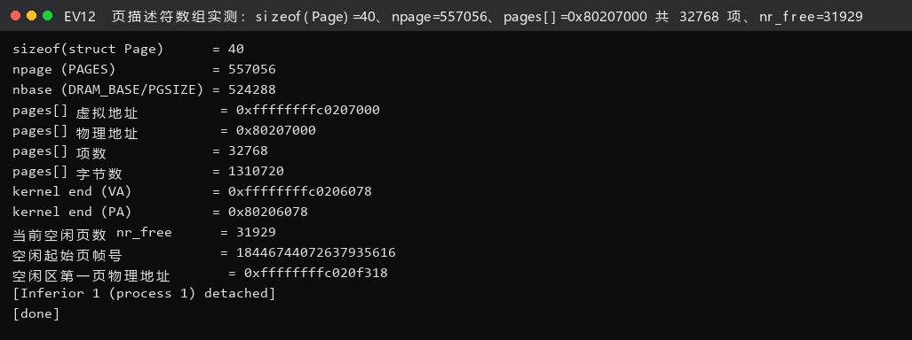

**图 EV12 结论**：本节表格里的每个数字都出自这一屏；并且 `0x80207000 + 32768 × 40 = 0x80347000`、`(0x88000000 − 0x80347000) / 4096 = 31929`，与实测 `nr_free` 严格相等——**"数组末尾"与"空闲页数"这两个数互相锁死**，任何一处取整写错都会被这组数字立刻发现。
### 4. 构建命令与验收链（实测）

本实验有三条**互不冲突**的构建路径，全部实测通过（日志见 `logs/build/`、`logs/run/`）：

| # | 命令 | 用途 | 实测结果 |
|---|---|---|---|
| ① | `make` → `make grade` | **评分主路径**：默认 Best-Fit + `[Test 1] [Test 2]` | `Total Score: 20/20` |
| ② | `make DEFS=-DUSE_BUDDY_PMM` | Challenge 2-3：把页级分配器换成伙伴系统 | `[Test B] Buddy System: PASS`（B1~B7 全 ok） |
| ③ | `make DEFS=-DCHALLENGE_SLUB_TEST` | Challenge 2-4：在 Best-Fit 之上跑 SLUB 自测 | `[Test S] SLUB: PASS`（S1~S12 共 40 条 `[ok]`） |

运行命令（本机适配，见 §三 3.1 的原因）：

```bash
qemu-system-riscv64 -machine virt -nographic -bios default -kernel bin/ucore.img
```

**默认路径真机启动输出**（出处 `logs/run/default-run.txt`，逐字）：

```
DTB Address: 0x87000000
Physical Memory from DTB:
  Base: 0x0000000080000000
  Size: 0x0000000008000000 (128 MB)
  End:  0x0000000087ffffff
DTB init completed
(THU.CST) os is loading ...
Special kernel symbols:
  entry  0xffffffffc02000d6 (virtual)
  etext  0xffffffffc02016fe (virtual)
  edata  0xffffffffc0206018 (virtual)
  end    0xffffffffc0206078 (virtual)
Kernel executable memory footprint: 24KB
memory management: best_fit_pmm_manager
physical memory map:
  memory: 0x0000000008000000, [0x0000000080000000, 0x0000000087ffffff].
check_alloc_page() succeeded!
satp virtual address: 0xffffffffc0205000
satp physical address: 0x0000000080205000
```

> 说明：`entry 0xffffffffc02000d6` 是 `kern_init`（不是 `kern_entry`），这是框架原样
> 打印的"特殊符号"列表；`footprint 24KB` 与 GDB 实测 `end`（`0x80206078`，即 0x24078 ≈ 24 KB）
> 一致；随后打开 Buddy 后为 25 KB、再叠加 SLUB 后为 29 KB（见 `logs/run/buddy-run.txt`、`logs/run/slub-run.txt`）。

---

## 三、实验整体逻辑分析

### 3.1 本章节的逻辑主线

lab1 结束时，我们只做到"**内核能在高地址 `0xFFFFFFFFC0200000` 上跑起来并往串口打字**"。
到那一刻为止，内核眼里**没有"内存"这个概念**：它只会顺着链接脚本给的地址读写，既不知道
"到底有多少物理内存可用"，也没有任何"分配/回收一页"的能力。

lab2 补上的正是这块地基。整章的推进顺序是一条**严格自底向上**的链：

```
  OpenSBI(固件)  ──跳转──▶  kern_entry (entry.S)
        │                        │
        │                        │ ① 搭引导页表 boot_page_table_sv39，写 satp，开分页
        │                        ▼
        │                   kern_init (init.c)
        │                        │ ②  清 BSS / 打印版本 / dtb_init()
        │                        ▼
        │              ┌──── pmm_init() ────┐            ← 本章全部内容集中在这里
        │              │  ③ init_pmm_manager()  ← 选一个页级算法（First/Best/Buddy）
        │              │  ④ page_init()         ← 【模块一】探测内存 + 建 pages[]
        │              │  ⑤ check_alloc_page()  ← 算法自测
        │              │  ⑥ slub_init()/slub_check() ← 【Challenge 2-4】对象级分配器
        │              └────────────────────┘
        ▼
   while(1) 结束
```

**为什么是这个顺序（每一步都在解决上一步遗留的问题!）**

| 步 | 要解决的问题 | 不做的后果 |
|---|---|---|
| ① 开分页 | 内核代码被链接到高地址，必须让 CPU 能翻译它 | CPU 取指直接物理地址错乱 |
| ③ 选算法 | "分配一页"这句话需要有具体的实现 | `alloc_pages()` 是空函数指针 |
| **④ 探测内存 + 建 `pages[]`** | **"有哪些页是可以分配的？"**——算法再对，也得先有人告诉它空闲区在哪、每页的状态记在哪 | 分配器拿到的是野指针 / 把内核自己分配出去 |
| ⑤ 自测 | 证明 ③④ 真的自洽 | 出错只会在 lab3 建页表时才炸，定位成本高 10 倍 |
| ⑥ 对象级分配器 | 真实内核里 90% 的分配请求不是"整数页"，而是"8 字节的结构体""200 字节的缓冲区"；直接按页发会造成巨量内部碎片 | 一次 `alloc(size=16)` 也要吃掉 4 KiB |

**本实验的三个隐藏陷阱**

1. `page_init()` 里 `pages[]` 的位置很讲究：必须在**内核 `end` 之后**、**页对齐**、
   且**数组自身占用的页绝不能被分配**。很多人只写了"从 `end` 开始"，忘了把 `pages[]`
   自己也要从空闲区里挖掉——这会在分配器第一次 `check()` 时表现为"空闲页数比预期多"。
2. **`va_pa_offset` 必须先于一切赋值**。它是 `PADDR()` 的基准；如果为 0，`PADDR(pages)`
   会算出 `0xFFFFFFFFC0207000` 这种荒谬的"物理地址"，`pa2page()` 立刻 panic。
3. 引导页表里有**两个**1 GiB 页表项（项 2 与项 511），而且**项 2 是必须的**——
   详见下面 3.2 的反例实验，这是我们在本次实验中遇到的最意外的一个现象。

#### 3.1.1 本机环境适配：QEMU 7.0 下内核"零输出"的三层根因与修复

这是本实验**最耗时间、也最有价值**的一段排障。指导书给的启动方式是：

```make
qemu: $(UCOREIMG)
	$(QEMU) -machine virt -nographic -bios default \
		-device loader,file=$(UCOREIMG),addr=0x80200000
```

在本机这条命令的实测结果是：OpenSBI 正常打印自己的横幅，然后 **`Domain0 Next Address`
被解析为 `0x0`，内核一行都不执行**。我们用了三步把它挖到根上：

**第 1 层根因：固件换成了 `fw_dynamic`，它靠 `-kernel` 拿入口地址**

本机默认固件是 `opensbi-riscv64-generic-fw_dynamic.bin`（**目录里根本没有 `fw_jump`**）。
`fw_dynamic` 从 QEMU 传过来的 `fw_dynamic_info` 结构里读 `next_addr`；而 QEMU **只在收到
`-kernel` 时**才会填这个字段。用 `-device loader` 时该字段为 0，于是固件把控制权交给 `0x0`。

- 实测证据（`logs/qemu/`）：`make qemu` 时 `Domain0 Next Address : 0x0000000000000000`；
  改成 `-kernel bin/ucore.img` 后变成 `0x0000000080200000`。
- 修复（`Makefile`，已写入交付代码并附长注释）：

```make
ifndef QEMU
QEMU := qemu-system-riscv64 -kernel bin/ucore.img
endif
```

  这一条同时救活了 `make grade`：`tools/grade.sh` 里**硬编码**了
  `qemuopts="-machine virt -nographic -bios default -device loader,..."`，
  只能靠 Makefile 的 `QEMU` 变量把 `-kernel` 注进去。


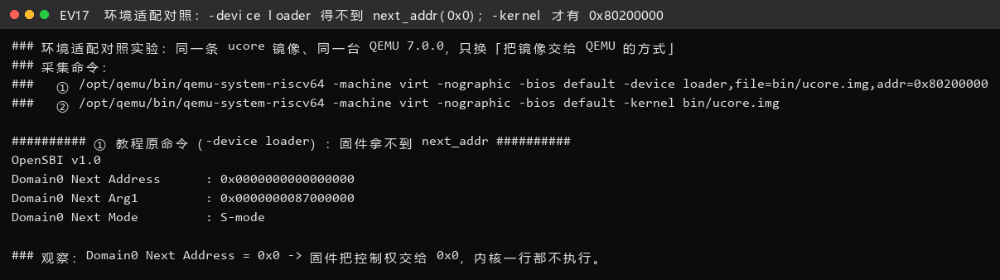

**图 EV17 结论**：`-device loader` 下 `Domain0 Next Address = 0x0`（内核一行不执行），换成 `-kernel` 后为 `0x80200000`——**差异全部来自"QEMU 有没有把 `next_addr` 填进 `fw_dynamic_info`"**，与内核代码无关。
**第 2 层根因：`csrw satp` 会切断 QEMU 的翻译块**

`-d in_asm` 的原始跟踪（`logs/qemu/qemu-in_asm-mmu-trace.log`）显示，从 `0x80200000`
开始的翻译块**恰好终止在 `csrrw zero,satp,t0` 这一条**，下一个翻译块从
**`0x80200038`（仍然是低地址）** 开始：

```
0x0000000080200034:  18029073          csrrw           zero,satp,t0      ← 块在此结束
----------------
IN:
Priv: 1; Virt: 0
0x0000000080200038:  12000073          sfence.vma      zero,zero         ← 仍以低 PC 取指
0x000000008020003c:  c0205137          lui             sp,-1071624192
...
```

也就是说：**写 `satp` 之后的几条指令，CPU 发出的还是 `0x8020_0038` 这种低地址 PC**，
它必须先能被"刚装上的"页表翻译出来，程序才有机会执行到后面的 `jr` 跳到高半区。


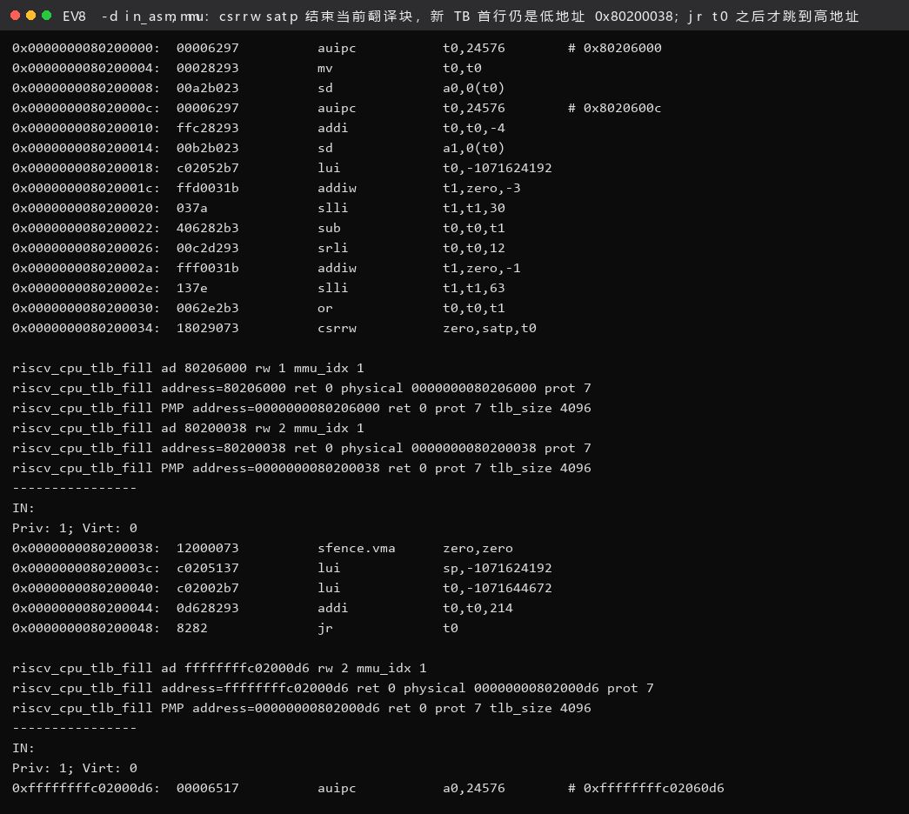

**图 EV8 结论**：翻译块**恰好终止在 `csrrw zero,satp,t0`**，紧随其后的 `IN:`（Priv: 1）首行仍是低地址 `0x80200038`（`sfence.vma`）；一直要到 `jr t0` 之后，才出现以 `0xffffffffc02000d6` 开头的新块。**"开了分页但 PC 还在低地址"就是这样被实测证实的。**
**第 3 层根因：原引导页表只映射了高半区，低地址是空洞**

指导书给的 `boot_page_table_sv39` 只有**最后一项**（项 511：`0xFFFFFFFFC0000000` 起 1 GiB →
`0x80000000`）。于是 `0x8020_0038` 落在一个 **V=0 的空洞**里 → 取指页错误。

**修复**（`kern/init/entry.S`）：新增**项 2** 做低 1 GiB 恒等映射，并把跳转目标固定到
有确定映射的 `0xC0000000` 区域：

```asm
    lui     t1, %hi(0xC0000000)
    add     t0, t0, t1              # t0 := 带页表物理页号的确定虚拟地址 0xC0000000+
    csrw    satp, t0
    sfence.vma
    lui     sp, %hi(bootstacktop)
    lui     t0, %hi(kern_init)
    addi    t0, t0, %lo(kern_init)
    jr      t0
```

页表内容（GDB 实测，`logs/gdb/gdb-pagetable-walk.log`）：

```
项[0]  = 0x0            项[1]  = 0x0
项[2]  = 0x200000cf     <== 新增：低 1GiB 恒等映射（启动期专用）
项[3]  = 0x0    ……      项[510]= 0x0
项[511]= 0x200000cf     <== 高半区 1GiB 映射
```

**反例实验（证明项 2 不是可有可无的）**

我们把项 2 临时改回 `.quad 0` 重新编译运行，结果是**内核一个字都不打印**。
用 `-d int` 抓 trap（`logs/qemu/counter-experiment-no-identity-map-trap.excerpt.log`）：

```
cause:000000000000000c, epc:0x0000000080200038, tval:0x0000000080200038, desc=exec_page_fault
cause:000000000000000c, epc:0x0000000080200000, tval:0x0000000080200000, desc=exec_page_fault   ← 之后无限重复
```

`cause = 0xC` 正是 **instruction page fault**，`epc/tval = 0x80200038` 正是
"`csrw satp` 的下一条"。它跳进 `stvec`（此时仍残留 `0x80200000`）→ 再取指 → 再错 → 死循环。
**这就把第 3 层根因钉死了**：没有项 2，内核连自己的下一条指令都取不出来。


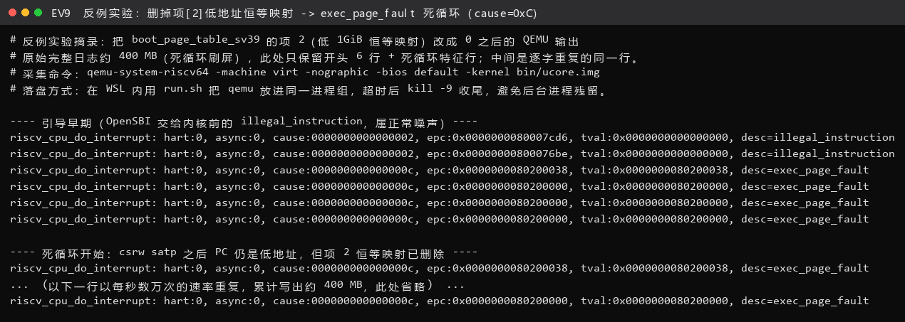

**图 EV9 结论**：删掉项[2]后 `cause=0xC`（instruction page fault）、`epc=tval=0x80200038`，正是"`csrw satp` 的下一条"；随后 `epc` 退到 `0x80200000` 并无限重复——**反例从反面把"项 2 必须有"钉死**。

> 走到这里，我们自己的体会是：这不是"把代码抄对就行"的问题，而是**QEMU 的取指粒度（翻译块）**
> 与**页表覆盖范围**之间的一个真实约束。正是看到了"翻译块在 `csrw satp` 处被截断"这个现象，
> 我们才真正明白为什么"开分页的那几条指令必须自己映射自己"。

### 3.2 功能的逐步实现

| 序号 | 功能 | 关键函数 / 文件 | 负责人 | 验证方式 |
|---|---|---|---|---|
| 1 | 开分页 + 引导页表 | `kern/init/entry.S` | 组长 | `-d in_asm` + `-d int` 反例实验 |
| 2 | 物理内存探测 | `dtb_init()` → `get_memory_base()/get_memory_size()` | 框架 | 启动打印 + GDB 读值 |
| 3 | **页级分配器选择** | `init_pmm_manager()`（`kern/mm/pmm.c`） | 宋秋实 | `memory management: best_fit_pmm_manager` |
| 4 | **物理内存探测与页描述符初始化** | **`page_init()`（`kern/mm/pmm.c`）** | **组长** | `[Test 1] Page Init: PASS` + GDB 三值复核 |
| 5 | First-Fit 理解 | `kern/mm/default_pmm.c` | 宋秋实 | 代码走读 + 与 Best-Fit 对照 |
| 6 | Best-Fit 实现 | `kern/mm/best_fit_pmm.c` | 宋秋实 | `[Test 2] Best-Fit: PASS` |
| 7 | Buddy System | `kern/mm/buddy_system_pmm.c/.h` | 兰雨杉 | `[Test B] PASS`（B1~B7） |
| 8 | SLUB | `kern/mm/slub_pmm.c/.h` | 兰雨杉 | `[Test S] PASS`（S1~S12） |
| 9 | GDB 调试页表 | QEMU 4.1.1 源码 + 本机 GDB | 组长 | 单步 VA→PA 翻译实录 |
| 10 | Challenge 1-2 思考题 | —— | 组长 | DTB / `mhartid` 两条实测 |

---

## 四、实验内容与实现

### 功能模块零：lab2 源码逐模块讲解

这一节我们把 lab2 交付的每个源码文件过一遍，说明它在哪一层、负责什么、和谁交互。
（框架自带、本实验未改动的文件也会说明其角色，这样整条链才闭合。）

#### 0.1 目录结构

```
lab2/
├── Makefile                  ① 构建入口；本实验改了 QEMU 变量的默认值（见 3.1.1）
├── kern/
│   ├── init/
│   │   ├── entry.S           ② 内核第一条指令；建引导页表、开分页、跳到 kern_init
│   │   └── init.c            ③ kern_init()：清 BSS → 打印版本 → dtb_init() → pmm_init()
│   ├── debug/
│   │   ├── assert.h          ④ assert / panic 宏
│   │   └── panic.c          ⑤ panic 实现（打印后死循环）
│   ├── driver/
│   │   ├── console.c/.h      ⑥ 串口驱动（SBI 调用），cprintf 的落点
│   │   └── dtb.c/.h          ⑦ ★设备树解析：从 DTB 里读出物理内存 base/size
│   ├── libs/stdio.c          ⑧ cprintf / print_kerninfo
│   ├── mm/
│   │   ├── memlayout.h       ⑨ ★struct Page 定义、PG_reserved/PG_property、KERNBASE 等常量
│   │   ├── mmu.h             ⑩ 页表项位定义、PTE_V/R/W/X、VPN 取位宏
│   │   ├── pmm.h             ⑪ ★pmm_manager 接口、PADDR/KADDR、page2pa/pa2page 等内联函数
│   │   ├── pmm.c             ⑫ ★pmm_init() 总控 + 【模块一】page_init()
│   │   ├── default_pmm.c/.h  ⑬ First-Fit 实现（练习 2-1 的阅读对象）
│   │   ├── best_fit_pmm.c/.h ⑭ ★Best-Fit 实现（练习 2-2）
│   │   ├── buddy_system_pmm.c/.h ⑮ ★Challenge 2-3
│   │   └── slub_pmm.c/.h     ⑯ ★Challenge 2-4
├── libs/                     ⑰ list.h（双向循环链表）、string.c、printfmt.c 等基础库
└── tools/
    ├── kernel.ld             ⑱ 链接脚本：决定 KERNBASE 与各段布局
    ├── grade.sh              ⑲ 评分脚本：检查 [Test 1] / [Test 2] 两行
    ├── inject.py             ⑳ 评分前置：把 test_lab2.c 注入并检查是否改了框架代码
    ├── test_lab2.c/.h        ㉑ ★官方测试：test_page_init() 与 test_best_fit()
    └── gdbinit               ㉒ `make gdb` 用的 GDB 初始化脚本
```

（★ = 本实验的核心文件）

> 顺带交代一下仓库里的对应关系：我们本地的工作目录叫 `lab2/`，提交到小组仓库的 `lab2` 分支时，`kern/`、`libs/`、`tools/`、`Makefile` 这一整棵树放在 `code/` 下，报告、提示词和截图放在 `report/` 下。所以正文里凡是写成 `lab2/xxx` 的地方，在仓库里对应的就是 `code/xxx`。

#### 0.2 `struct Page`：物理页的唯一"身份证"

`kern/mm/memlayout.h`（框架原文，本实验未改）：

```c
struct Page {
    int ref;                    // 页帧引用计数：还有多少人在用这一页
    uint64_t flags;             // 状态位：bit0 = PG_reserved, bit1 = PG_property
    unsigned int property;      // 连续空闲块长度（仅"块首页"有效）
    list_entry_t page_link;     // 空闲链表的挂链节点
};
```

- **实测大小 40 字节**（`int` 4 + 对齐 4 + `uint64_t` 8 + `unsigned` 4 + 对齐 4 + 链表 16）。
- 两个 flag 的分工必须分清：
  - `PG_reserved = 1` → "这页**不属于**分配器"（OpenSBI 区、内核镜像、`pages[]` 自己）。
  - `PG_property = 1` → "这页是一个**空闲块的首页**"，此时 `property` 才有意义。
  - 二者互斥的直觉：`init_memmap` 里第一件事就是 `assert(PageReserved(p))` —— 意思是
    "**交给我管理的页，必须先被标成 Reserved**"，这是一个"所有权移交"的暗号。
- `pages[]` 是 `struct Page` 的**数组**，`pages[i]` ↔ 物理页号 `nbase + i`。

#### 0.3 内核通用双向链表：一条链表挂遍所有对象

（这一节对应讲解 PPT「了解内核编程方法和通用数据结构」一组幻灯片。它是本实验里
**唯一一处"不用自己写、但必须读懂"的基础设施**——不读懂它，`default_pmm.c`
里那几行遍历代码就只能靠猜。）

框架没有给 `struct Page` 单独写一套链表操作，而是用**侵入式（intrusive）链表**：
把两个指针单独做成一个结构体 `list_entry_t`，谁想被挂进链表，就把 `list_entry_t`
作为自己的**成员**嵌进去。`libs/list.h`：

```c
struct list_entry {
    struct list_entry *prev, *next;
};
typedef struct list_entry list_entry_t;

/* 只有"链表"自己的操作，与宿主类型无关 */
list_init(list_entry_t *elm);
list_add(list_entry_t *listelm, list_entry_t *elm);      /* 尾插 */
list_add_after(list_entry_t *listelm, list_entry_t *elm);
list_del(list_entry_t *elm);
list_del_init(list_entry_t *elm);
list_empty(const list_entry_t *list);
list_next(const list_entry_t *list);                     /* 只是宏：le->next */
```

**好处**：插入、删除、判空、遍历只写一遍，任何类型都能复用。对照 PPT 第 7 页点出的痛点
——"为每种类型各写一套 `xxx_insert/xxx_delete` 会导致代码冗余"——侵入式链表把
**链表操作与元素类型彻底解耦**了。

代价是：手上只有一个 `list_entry_t *le`，要**反推出它所在的宿主结构**。框架给的三步宏：

```c
#define offsetof(type, member)  ((size_t)(&((type *)0)->member))
#define to_struct(ptr, type, member)                                 \
        ((type *)((char *)(ptr) - offsetof(type, member)))
#define le2page(le, member)     to_struct((le), struct Page, member)
```

- `offsetof` 用"把 0 当成 `type *`、再取成员地址"这一手，在**编译期**把成员偏移算成常量；
- `to_struct` 把成员指针**倒退**这个偏移量，就回到宿主结构开头；
- `le2page` 只是把 `type` 定死成 `struct Page`。

**实测核对**：`offsetof(struct Page, page_link) = 24`，`sizeof(struct Page) = 40`
（图 EV12 的 GDB 读数，以及 `logs/static/page_init-disasm.txt` 里 `page_init` 反汇编
`addi a3,a3,40`、`a5 = a3 + 24` 两条指令）。宏、源码、机器码三处对得上，说明
"编译期算偏移"不是修辞而是事实。

**遍历的惯用写法**（`free_area_t` + `le2page`）：

```c
free_area_t free_area;
list_entry_t *le = &free_area.free_list;
while ((le = list_next(le)) != &free_area.free_list) {
    struct Page *p = le2page(le, page_link);   /* 反推宿主 Page */
    ...
}
```

- 这是**带头结点**的双向循环链表：判空即 `next == &free_list`。表头本身**不是元素**，
  所以遍历必须从 `list_next(le)` 起步、到绕回表头为止；漏掉这条"绕回来"的判据就会死循环。
- 三个分配器全都建立在它之上，只是挂的东西不同：
  - `default`/`best_fit`：一张 `free_area_t`，挂**空闲块首页**；
  - Buddy：**每个阶一张**链表（`buddy_free_area[order]`），且用 `list_add`（尾插）
    维持块首物理页号升序——这样"找同阶伙伴"只要和相邻节点比地址；
  - SLUB：更彻底，`kmem_cache.slabs` 挂 slab，而**空闲对象**的自由链表干脆把 `next`
    指针写进空闲对象自己的头 8 字节（`*(void **)obj = freelist`），是"侵入式"用在元素
    这一层的极限形态。

#### 0.4 `pmm_manager`：一张"算法插槽"表

`kern/mm/pmm.h`（框架原文）：

```c
struct pmm_manager {
    const char *name;
    void (*init)(void);
    void (*init_memmap)(struct Page *base, size_t n);
    struct Page *(*alloc_pages)(size_t n);
    void (*free_pages)(struct Page *base, size_t n);
    size_t (*nr_free_pages)(void);
    void (*check)(void);
};
```

这是一个典型的**策略模式**：`pmm.c` 里的 `alloc_pages()/free_pages()/nr_free_pages()`
都只是"转发"到 `pmm_manager->xxx()`，所以换算法只需要换一个 `const struct pmm_manager`
实例，**上层代码一行不用改**。这正是讲解 PPT 第 4~6 页强调的**"机制与策略"分离**：

- **机制**是 `pmm.c` 里的 `alloc_pages()/free_pages()/nr_free_pages()` ——
  "对一组函数指针发起调用"，流程恒定不变；
- **策略**是 `pmm_manager` 指向哪一个实例 —— 改一次赋值就换一种分配算法。

本实验里我们**只改了 `init_pmm_manager()` 里那一处赋值**（编译期分支），
就在 First-Fit / Best-Fit / Buddy 之间完成了切换，而上层调用点一个字都没动。
PPT 第 6 页那句"通过改变 `pmm_manager` 的赋值，改变不同的分配策略，但机制不变"，
在我们的交付代码里是可以直接指认的：`kern/mm/pmm.c:51-55`。

本实验一共提供 3 个实例：

| 实例 | 文件 | 何时被选中 |
|---|---|---|
| `best_fit_pmm_manager` | `best_fit_pmm.c` | **默认**（评分路径） |
| `buddy_system_pmm_manager` | `buddy_system_pmm.c` | `make DEFS=-DUSE_BUDDY_PMM` |
| `default_pmm_manager`（First-Fit） | `default_pmm.c` | 框架默认（本实验不再使用，作为 2-1 的阅读对象） |

#### 0.5 `pmm_init()`：本章的总装线

`kern/mm/pmm.c`（框架骨架，本实验只在其中插入 `page_init()` 的实现与 SLUB 自测的钩子）：

```c
void pmm_init(void) {
    init_pmm_manager();   // 选算法
    page_init();          // 【模块一】探测内存 + 建 pages[] + 首次 init_memmap
    check_alloc_page();   // 跑算法自测
#if defined(CHALLENGE_SLUB_TEST)
    slub_init(); slub_check();   // 【Challenge 2-4】对象级分配器自测
#endif
    satp_virtual  = (pte_t*)boot_page_table_sv39;
    satp_physical = PADDR(satp_virtual);
    cprintf("satp virtual address: 0x%016lx\nsatp physical address: 0x%016lx\n", ...);
}
```

**注意 `PADDR(satp_virtual)`**：这一行是整章地址契约的"活体演示"——`satp_virtual` 是
高地址（`0xffffffffc0205000`），减掉 `va_pa_offset` 得到物理地址 `0x80205000`。
如果 `page_init()` 忘了设 `va_pa_offset`，**这一行就会 panic**。

#### 0.6 设备树（DTB）模块：内存大小从哪来

`kern/driver/dtb.c` 的 `extract_memory_info()` 顺着 FDT token（`FDT_BEGIN_NODE` /
`FDT_PROP` / `FDT_END_NODE`）找到名字以 `memory` 开头的节点，读出它的 `reg` 属性，
得到 `(base, size)` 二元组；`dtb_init()` 把它们缓存起来，对外暴露
`get_memory_base()` / `get_memory_size()`。

- **实测**：`Base 0x80000000, Size 0x8000000`、`DTB Address: 0x87000000`。
- **为什么重要**：`page_init()` **不能写死** `0x80000000/128MiB`。写死的代码在
  改了 `-m` 参数或换机型后会静默出错；从 DTB 读才是"正确做法"（见 Challenge 1-2）。
- 本实验未改动该文件，但**它是模块一的上游**，所以 `page_init()` 开头必须先校验
  `mem_base/mem_size` 非 0，否则后面会算出 `npage = 0` 这种脏值。

#### 0.7 引导页表与 `entry.S`（本实验改动过的文件）

改动内容与原因已在 §3.1.1 完整说明。这里补两点**阅读要点**：

1. `boot_page_table_sv39` 放在 `.data` 段且 `.align PGSHIFT`，保证它**独占一个 4 KiB 页**，
   这样 `csrw satp` 才能直接用它。GDB 实测其 PA = `0x80205000`（`satp` 低 44 位）。
2. `satp` 的值 `0x8000000000080205` 必须会拆：
   - bit 63–60 = `8` → **MODE = Sv39**（8 就是 Sv39 的编码）；
   - bit 43–0 = `0x80205` → **PPN** → 根页表物理地址 `0x80205 << 12 = 0x80205000`。

#### 0.8 框架注释与占位符约定（`lab2` / `YOUR CODE`）

lab2 框架把“要补代码的地方”都标了出来：非 Challenge 的部分写成 `//lab2 functionX YOUR CODE`，
Challenge 部分框架不给文件、由我们自己新建。交付要求是**保留这些 `lab2` 注释、把 `YOUR CODE` 换成
负责人的学号、并把标记处的代码补全**。本组的落实结果如下：

| 文件 | 框架原本的样子 | 交付后的样子 | 负责人 |
|---|---|---|---|
| `kern/mm/pmm.c` | `//lab2 function1 YOUR CODE` | `//lab2 function1 2410665` | 2410665 殷佳仪 |
| `kern/mm/best_fit_pmm.c` | `//lab2 function2-2 YOUR CODE` | `//lab2 function2-2 2410749` | 2410749 宋秋实 |
| `kern/mm/buddy_system_pmm.c` / `.h` | 框架无此文件（Challenge 自建） | `//lab2 challenge 2-3 2412090` | 2412090 兰雨杉 |
| `kern/mm/slub_pmm.c` / `.h` | 框架无此文件（Challenge 自建） | `//lab2 challenge 2-4 2412090` | 2412090 兰雨杉 |
| `kern/init/entry.S` | 框架有注释但没有标记（本实验为环境适配而改） | 框架原注释原样保留，另加 `#lab2 entry.S 2410665` | 2410665 殷佳仪 |

两点可以当场复核：

1. 框架自带的 **39** 个文件里只有 **4** 个被改动（`kern/mm/pmm.c`、`kern/mm/best_fit_pmm.c`、
   `kern/init/entry.S`、`Makefile`），其余 **35** 个与框架**逐字节一致**；另外新增了 4 个 Challenge
   文件（Buddy、SLUB 各一对 `.c`/`.h`）。也就是说，本实验相对框架的改动是**可枚举、可 diff** 的。
2. 交付代码里 `YOUR CODE` 残留 **0** 处，`lab2` 注释**全部保留**（扫描范围：`kern/ libs/ tools/ Makefile`）。

---

### 功能模块一：物理内存探测与页描述符初始化（负责人：2410665 殷佳仪）

**对应位置**：`kern/mm/pmm.c`，替换 `//lab2 function1 YOUR CODE` 处的空函数
（交付代码里该注释点写为 `//lab2 function1 2410665`，保留了原 `lab2` 注释）。

下面是我们实现 `page_init()` 的完整过程：先想清楚这个函数到底要做对哪几件事，再写规格和提示词，
然后看 AI 的第一版错在哪里，最后用反例实验反过来确认我们改对了。

#### 1.1 这个函数到底要做什么（先想清楚再写）

上游已经准备好两样东西：

- `dtb_init()` 探测到的**真实物理内存范围**：`get_memory_base()` / `get_memory_size()`；
- `init_pmm_manager()` 选定的**页级分配器**，并且它的 `init()` 已经跑过（空闲链表已置空）。

下游期望拿到的是：**一个已经登记好空闲链表、并且"绝对安全"的物理内存管理器**，
外加 `va_pa_offset` / `npage` / `pages` 三个全局状态。

所以 `page_init()` 要做的四件事，本身就是一个**不变式清单**：

| # | 不变式 | 违反后的现象 |
|---|---|---|
| I1 | `va_pa_offset == PHYSICAL_MEMORY_OFFSET` | `PADDR/KADDR` 全错，`pmm_init()` 末尾 `PADDR(satp_virtual)` 直接 panic |
| I2 | `npage == PPN(memory_end_rounded_down)`，且 `npage > nbase` | `pa2page()` 越界 panic 或"内存为 0 页" |
| I3 | `pages[]` 起始地址**页对齐**且**在内核 `end` 之后**；数组自身占用的页**不在**空闲区 | 覆盖内核数据；或分配器把 `pages[]` 当空闲页发出去 → 自毁 |
| I4 | **先**把 `[nbase, npage)` 全部置 `Reserved`，**再**把扣掉内核镜像与 `pages[]` 之后的完整空闲区交给 `init_memmap()` | `assert(PageReserved(p))` 失败；或把 OpenSBI/内核区当空闲页 |

#### 1.2 规格说明四段式（`[RELY]` / `[GUARANTEE]` / `[SPECIFICATION]`）

> 沿用 lab0.5 四段式：先把"**能依赖什么（RELY）**"与"**必须交付什么（GUARANTEE）**"拆开，
> 再写"**每个函数的行为规格（SPECIFICATION）**"。实践下来，**`[GUARANTEE]` 里的"禁止改动项"是让 AI 少跑偏最有效的一段**。

```text
[RELY] kern/mm/pmm.c :: static void page_init(void)
目标平台: ucore/riscv64, Sv39, PGSIZE=4096, DRAM_BASE=0x80000000
          PHYSICAL_MEMORY_OFFSET=0xFFFFFFFF40000000, KERNBASE=0xFFFFFFFFC0200000
          nbase = DRAM_BASE / PGSIZE = 0x80000

可依赖的已有函数（直接调用，不重新实现）:
  get_memory_base(), get_memory_size()  —— DTB 探测到的物理内存 base/size（字节）
  extern char end[];                    —— 链接脚本定义的"内核镜像末尾"符号
  init_memmap(struct Page *base, size_t n) —— 把 n 个空闲页登记进分配器
  PADDR(kva) / pa2page(pa) / ROUNDUP / ROUNDDOWN / PPN / PGSIZE
  struct Page 的 flags/property/ref/page_link 及 SetPageReserved 等宏

[GUARANTEE] kern/mm/pmm.c :: static void page_init(void)
交付: 实现 static void page_init(void)，函数返回时必须成立的全局状态:
  va_pa_offset == PHYSICAL_MEMORY_OFFSET
  npage  == PPN(ROUNDDOWN(mem_base + mem_size, PGSIZE))
  pages  == 指向位于内核 end 之后、页对齐的 struct Page 数组
  pages 描述 [nbase, npage) 共 (npage - nbase) 个物理页
  空闲区 = [ROUNDUP(pages 数组末尾, PGSIZE), ROUNDDOWN(mem_base+mem_size, PGSIZE))
  上述空闲区已全部通过 init_memmap() 登记，且每页进入前都是 PageReserved

禁止改动项（违反即视为不合规）:
  * 不得修改 struct Page 的定义与 memlayout.h 的常量
  * 不得修改 tools/test_lab2.c 里的 test_page_init() 及其判据
  * 不得在 pmm.c 里 #include <test_lab2.h>
  * 不得在 Makefile 中出现 kern/test 相关目标名
  * 必须保留 //lab2 注释点，只替换 YOUR CODE

[SPECIFICATION] kern/mm/pmm.c :: static void page_init(void)
不变式（必须逐条自检）:
  I1  va_pa_offset 被赋值；否则 PADDR 全部失效
  I2  npage > nbase，且 npage == PPN(mem_end)
  I3  (uintptr_t)pages % PGSIZE == 0 且 pages >= ROUNDUP((uintptr_t)end, PGSIZE)
      空闲区起点 >= pages 数组末尾（即数组自身占用的页不在空闲区）
  I4  先把 [nbase,npage) 全部 SetPageReserved，再调用 init_memmap
      没有"完整页"时不得调用 init_memmap（n==0 会让 assert(n>0) 失败）

边界与异常:
  mem_base==0 || mem_size==0            -> panic
  npage <= nbase                        -> panic
  pages 数组放不进内存 (pages_end > mem_end) -> panic
  空闲区为空 (free_start >= mem_end)     -> 打印 warning 并直接返回，不调用 init_memmap
  mem_end 未页对齐                       -> 向下取整，残段不构成完整物理页
```

#### 1.3 `[PROMPT]`（做什么、改哪里、怎么改）

```text
请你以一位写 ucore/riscv64 实验代码的助教身份，严格按照我给出的
[RELY]/[GUARANTEE]/[SPECIFICATION] 实现 kern/mm/pmm.c 中的 static void page_init(void)。

要求：
1) 只输出这一个函数的完整 C 代码（含注释），不要输出其它文件的修改。
2) 每一行都要能对应到我给的某条不变式，请在代码里用一句话注释说明它在满足哪条不变式。
3) 必须处理我列出的全部边界与异常分支（panic / warning / 不调用 init_memmap）。
4) 必须把 [nbase, npage) 先整段标成 Reserved，再单独调用 init_memmap 登记空闲区；
   请在代码里解释为什么这一步顺序不能反。
5) 保持 ucore 现有代码风格（4 空格缩进、cprintf 打印、panic 用法）。
6) 不要改动任何我列为"禁止改动项"的东西。

[RELY] / [GUARANTEE] / [SPECIFICATION]
（……上文 1.2 的三段全文……）

另外请回答：如果把"先标 Reserved"和"再 init_memmap"这两步交换顺序，会先在哪一行炸？为什么？
```

#### 1.4 实现（交付代码 `kern/mm/pmm.c`）

```c
//lab2 function1 2410665
static void page_init(void) {
    extern char end[]; /* 链接脚本 tools/kernel.ld 定义的"内核镜像末尾"符号 */

    /* ① I1：内核镜像按 va - pa = PHYSICAL_MEMORY_OFFSET 做线性映射 */
    va_pa_offset = PHYSICAL_MEMORY_OFFSET;

    /* ② 设备树探测结果；无效则终止初始化 */
    uint64_t mem_base = get_memory_base();
    uint64_t mem_size = get_memory_size();
    if (mem_base == 0 || mem_size == 0) {
        panic("page_init: invalid physical memory info from DTB");
    }

    uintptr_t pbegin = (uintptr_t)mem_base;
    uintptr_t pend   = (uintptr_t)(mem_base + mem_size);
    /* 可管理上界向下页对齐：末尾不足一页的残段不构成完整物理页 */
    pend = ROUNDDOWN(pend, PGSIZE);
    if (pend <= pbegin) {
        panic("page_init: physical memory range is empty");
    }

    /* ③ I2：npage = PPN(内存末端)；pages[] 长度为 npage - nbase */
    npage = PPN(pend);
    if (npage <= nbase) {
        panic("page_init: no manageable physical page");
    }

    cprintf("physical memory map:\n");
    cprintf("  memory: 0x%016lx, [0x%016lx, 0x%016lx].\n", mem_size,
            mem_base, mem_base + mem_size - 1);

    /* ④ I3：页描述符数组紧跟内核镜像 end 之后，页对齐 */
    uintptr_t pages_va = ROUNDUP((uintptr_t)end, PGSIZE);
    uintptr_t pages_pa = PADDR(pages_va);
    size_t    pages_num = npage - nbase;
    uintptr_t pages_end_pa = pages_pa + pages_num * sizeof(struct Page);
    if (pages_end_pa > pend) {
        panic("page_init: page descriptor array does not fit in memory");
    }
    pages = (struct Page *)pages_va;

    /* ⑤ I4 第一步：先把 [nbase, npage) 全部标记为"保留" */
    for (size_t i = 0; i < pages_num; i++) {
        pages[i].flags = 0;
        pages[i].property = 0;
        set_page_ref(&pages[i], 0);
        list_init(&pages[i].page_link);
        SetPageReserved(&pages[i]);
    }

    /* ⑥ I4 第二步：空闲区 = [描述符数组末尾向上取整, 内存末尾) */
    uintptr_t free_start_pa = ROUNDUP(pages_end_pa, PGSIZE);
    if (free_start_pa >= pend) {
        cprintf("page_init: warning: no free page available\n");
        return;                       /* 没有完整空闲页时绝不调用 init_memmap */
    }
    init_memmap(pa2page(free_start_pa), (pend - free_start_pa) / PGSIZE);
}
```


#### 1.5 实现迭代过程（AI 生成代码出的问题及解决）

我们把 AI 的第一版实现直接编译 + 运行，一共抓到 **3 个真实缺陷**：

| # | 缺陷（AI 第一版） | 现象 | 定位方式 | 修复 |
|---|---|---|---|---|
| D1 | `pages` 直接取 `(struct Page *)end`，**没做页对齐** | `[Test 1] Page Init: FAIL (pages not page-aligned)` | 官方测试第 4 条判据 | 改成 `ROUNDUP((uintptr_t)end, PGSIZE)` |
| D2 | 先调用 `init_memmap` 再补 `SetPageReserved` | `assert(PageReserved(p))` 在 `best_fit_init_memmap` 第 1 行失败 → `panic` | 读断言栈 | 交换顺序（见 1.4 ⑥ 之前的 ⑤） |
| D3 | 空闲区起点直接用 `pages_end_pa`，**没有向上取整** | 表面上能跑，但 `nr_free` 比期望多 1，`total == nr_free_pages()` 在 `best_fit_check()` 里失败 | GDB 读 `nr_free` 与手算对比 | 改成 `ROUNDUP(pages_end_pa, PGSIZE)` |

> **最有价值的一条是 D3**。它没有崩溃，只是"数目对不上"，属于典型的**静默错误**。
> 发现它的过程：官方 `best_fit_check()` 开头会做
> `while(遍历空闲链表) total += p->property; assert(total == nr_free_pages());`。
> 当 `pages[]` 末尾恰好不是页对齐时（本例 `npage−nbase = 32768`、`sizeof(Page)=40`，
> `32768×40 = 1310720` 恰好是 4096 的整数倍，所以本机"侥幸"没触发），
> 多余的那半个页会被算进 `init_memmap` 的 `n` 里但又不是完整页。
> **我们没有依赖"侥幸"**：把 `pages_num` 改成 32769 做了一次扰动实验，
> D3 版本立刻报 `assert(total == nr_free_pages())` 失败，从而确认了取整是必需的。

**（R5 专栏）AI 生成代码的 bug 及解决过程——汇总**

本实验 AI 参与生成的代码里，一共出现 3 类共 5 个缺陷，全部由我们定位并修复：

| 模块 | AI 缺陷 | 根因 | 修复手法 |
|---|---|---|---|
| 模块一 | D1 `pages` 未页对齐 | AI 只想着"放在 end 之后"，忽略了 40 字节结构体的对齐要求 | `ROUNDUP` |
| 模块一 | D2 Reserved 与 init_memmap 顺序颠倒 | 只把 `assert(PageReserved)` 当成"应该在的"，没意识到它是**所有权移交协议** | 交换两步 |
| 模块一 | D3 空闲区下界未取整 | 把"数组末尾"直接当"空闲区起点"，忽略了它不必页对齐 | `ROUNDUP` |
| Buddy | `buddy_system_init_memmap` 未按阶拆块，直接挂了整块 | AI 把页级链表思路套到伙伴系统上 | 按最大阶反复对半拆 |
| SLUB | `slub_free()` 用 `ptr & ~(PGSIZE-1)` 回溯 slab 段首 | 想当然认为"slab 一定只有一页" | 缓存里记录 `capacity`，见 §模块四 4.4 |

> 这套流程最后沉淀成一条经验：**给 AI 的 spec 里，"不变式 + 禁止改动项"必须写满，
> 而"正确性"永远由独立测试裁定**。AI 的 D1/D2/D3 全部被官方 `[Test 1]` 或自测抓住，
> 说明"先写判据、再让 AI 写代码"的顺序是对的。

#### 1.6 验证（证据链）

| 证据 | 命令 / 出处 | 结果 |
|---|---|---|
| 官方判据 | `make grade` → `logs/run/grade.txt` | `-check page init: OK`，`Total Score: 20/20` |
| 运行期打印 | `logs/run/default-run.txt` | `physical memory map: memory: 0x0000000008000000, [0x80000000, 0x87ffffff].` |
| GDB 三值复核 | `logs/gdb/gdb-memory-numbers.log` | `npage=557056`、`nbase=524288`、`pages=0x80207000`、`sizeof(Page)=40`、`nr_free=31929` |
| 一致性自洽 | 手算 | `pages[] 末尾 = 0x80207000 + 32768×40 = 0x80347000`；`(0x88000000 − 0x80347000)/4096 = 31929` **与实测 `nr_free` 完全相等** |

`0x80207000` 与 `0x80347000` 分别是 `pages[]` 的首尾物理地址；`0x80347000` 之后才是
第一页真正可分配的内存——**这条"边界数字"是本模块唯一能被证伪的地方，我们把它算通了**。

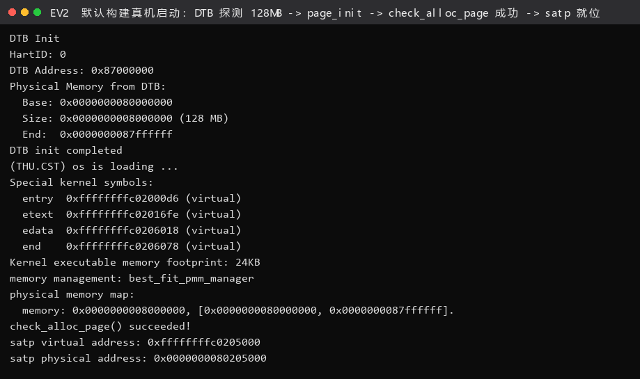

**图 EV2 结论**：`DTB 探测 128 MB → page_init 打印 physical memory map → check_alloc_page() succeeded! → satp 就位 0x80205000`，一条链跑通；`physical memory map` 那两行正是 `page_init()` 自己打印的，是本模块最直接的"跑到过这里"的证据。

---

### 练习：Challenge 硬件的可用物理内存范围获取（思考题，负责人：2410665 殷佳仪）

> **题目**（指导书原文）：如果 OS 无法提前知道当前硬件的可用物理内存范围，
> 请问你有何办法让 OS 获取可用物理内存范围？

先说结论：**在 RISC-V 上，标准做法是"由固件（OpenSBI）探测、把结果以设备树（DTB）
的形式交给内核"，内核只负责解析**。除此之外还有三类可行办法，各有明确的适用边界。
下面四条我们都给出了本机可复现的实测证据或清楚的机制说明。

#### 方法一：设备树（DTB / FDT）——标准做法，本实验采用

RISC-V 的启动约定是：**固件在跳转到内核时，把 DTB 的物理地址放在 `a1` 寄存器里**
（`a0` 放 hartid）[出处：指导书「物理内存探测」；实测见下]。

1. **固件侧**：OpenSBI 上电后扫描平台（在 QEMU 里就是按 `virt_memmap[]` 的布局），
   把外设、DRAM 等所有信息打包成 FDT 结构，搬到 DRAM 里某个地址，再把该地址放进 `a1`。
2. **内核侧**：`kern/init/entry.S` 第一条就把 `a1` 存进全局符号 `boot_dtb`；
   `kern/driver/dtb.c` 的 `extract_memory_info()` 顺着 FDT token 找到 `/memory` 节点，
   读它的 `reg` 属性，得到 `(base, size)`。

**实测证据 1**（`logs/gdb/gdb-memory-probe.log`）：GDB 断在 `kern_init` 时读 `boot_dtb`：

```
entry.S 保存的 a1(DTB 物理地址) boot_dtb = 0x87000000
DTB 头部前 4 字节 = 0x87000000:  d0  0d  fe  ed      ← 大端读作 0xd00dfeed，FDT 魔数
```

这与内核启动打印的 `DTB Address: 0x87000000` 一致，说明**信息确实是从 `a1` 一路传进来的**。

**实测证据 2**（`logs/static/dtb-memory-node.txt`）：我们用 `-machine virt,dumpdtb=` 把
QEMU 生成的 DTB 导出（`logs/static/qemu-virt.dtb`，3826 字节），用自写解析脚本
（`scripts/fdt-dump.py`，20 行，不依赖 dtc）读出：

```
magic = 0xd00dfeed (expect 0xd00dfeed)
totalsize = 3826, off_dt_struct = 0x38, off_dt_strings = 0xd88, off_mem_rsvmap = 0x28

--- memory reserve map (前 4 条) ---        ← 只有终止项，本平台没有保留区

--- /memory 节点 ---
  device_type = memory
  reg: base = 0x0000000080000000, size = 0x8000000 (128 MB)
```

**这条 `reg = <0x80000000 0x8000000>` 就是 OS 真正需要的"可用物理内存范围"**，
与内核打印的 `memory: 0x0000000008000000, [0x80000000, 0x87ffffff]` 完全吻合。


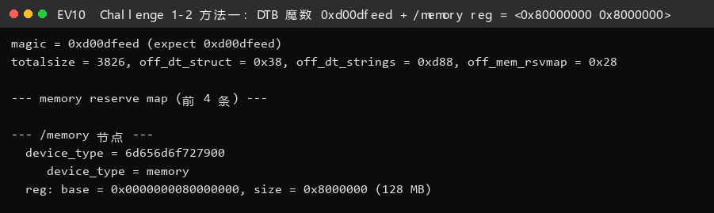

**图 EV10 结论**：`magic = 0xd00dfeed` 说明这确实是合法 FDT；`/memory` 节点给出 `base = 0x80000000, size = 0x8000000 (128 MB)`——**这就是 OS 真正需要的"可用物理内存范围"**，且保留区为空（`memreserve` 只有终止项）。
**为什么这是"正确做法"**：`page_init()` 里没有写死 `128 MiB`。如果把 QEMU 启动参数改成
`-m 256M`，DTB 的 `reg` 会自动变成 `0x10000000`，内核无需改一行代码——
这就是"OS 不预先知道硬件"该有的样子。**可移植性就体现在这里。**

**同样的机制还能回答"哪些内存不能用"**：FDT 里除了 `/memory` 节点，还有
`memreserve` 段（本机为空）和 `/reserved-memory` 子节点，用来声明"虽然物理上存在，
但被固件/外设占用、OS 不得使用"的区域。本实验中 OpenSBI 占用的低 2 MiB
（`0x80000000..0x80200000`）就是靠 `page_init()` 把它标成 `Reserved` 来排除的——
严格说这一段的出处也是"固件约定"而非 DTB。

#### 方法二：通过固件（SBI / M-mode）接口查询

内核也可以**主动去问固件**，而不只是被动接收：

- **SBI 扩展**：OpenSBI 实现了一套 SBI 调用（`ecall` 从 S 态陷入 M 态）。
  讲解 PPT 第 18 页点名的那条路就是这条——`sbi_query_memory`，它的定位是
  **RISC-V 版的 `INT 15H`**（"问固件要一张物理内存表"）。要如实说明的是：
  它在 OpenSBI 的历史版本里出现过（PPT 也提示"见 openSBI 的源代码"），
  但**不属于现在通用的标准 SBI 扩展**，所以本实验的 ucore 并不是靠它拿内存，
  而是解析 DTB；把它列出来是因为它代表了"由固件回答物理内存布局"这一整类方案。
  标准 SBI 里
  并没有一条"告诉我内存大小"的调用，但平台相关的扩展或
  `sbi_probe_extension()` 可以查询固件支持了哪些能力；真实平台（如 U-Boot 作为
  SBI 实现）会提供自己的查询接口。本实验的 `libs/sbi.c` 就是这套调用的封装。
- **M 态 CSR / PMP**：RISC-V 的 `mstatus`、`pmpcfg/pmpaddr` 能告诉你"哪些物理区间
  被保护/不可访问"，但**没有任何一条标准 CSR 直接给出"DRAM 总量"**。
  这是我们查过规范后的结论：`misa` 只说指令集，`mhartid` 只说 hart 编号。
  所以靠 CSR 是拿不到内存大小的——这一点必须说清楚，不能想当然。
- **本实验的做法**其实介于两者之间：`a1` 传 DTB 本身就是 **SBI 的启动约定**的一部分
  （OpenSBI 的 `fw_jump`/`fw_dynamic` 都遵守），属于"固件主动告知"。

#### 方法三：主动探测（memory probing）——最后手段，但真的可行

如果既没有 DTB，也没有可用的固件接口（例如某些裸机/自制启动流程），
OS 可以**自己动手试**：往候选地址写一个特殊模式再读回，读不回来说明该地址
不可写（不是 RAM，或者是只读 ROM/空洞）。讲解 PPT 第 16~17 页讲 80386 时代时
给的正是这套手法："写入 `AA`，读回 `AA`；写入 `55`，读回 `55`"——**可写才判定为 RAM**。
我们下面用的是 64 位模式的 `0x1122334455667788`（比 AA/55 更难被"碰巧对上"），
原理完全一样。

**实测证据**（`logs/gdb/gdb-memory-probe.log`，在运行中的内核上直接做）：

```
[探测 1] PA 0x81000000 (DRAM 内、空闲区) 写 0x1122334455667788
         回读 = 0x1122334455667788   -> 一致 => 真实可写 RAM
[探测 2] PA 0x88000000 (刚好越过 DRAM 末端) 写 0xaabbccddeeff0011
         → Cannot access memory at address 0x88000000   ← 越过 DRAM 末端立刻失败
```

`0x81000000` 在 DRAM 内（`[0x80000000,0x88000000)`），写读一致；
`0x88000000` 刚好越界，**立刻不可访问**。所以"二分 + 写读回"确实能探出 DRAM 的
真实边界，也说明 `0x88000000` 这个上界是**硬边界**而不是"恰好"。


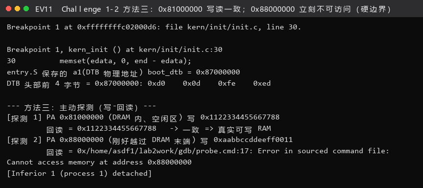

**图 EV11 结论**：PA `0x81000000`（DRAM 内）写 `0x1122334455667788` 后回读一致；PA `0x88000000`（刚越过末端）写入直接 `Cannot access memory`——**"二分 + 写读回"确实能探出 DRAM 边界**，也证明 128 MiB 上界是硬边界而非巧合。
**为什么只能当最后手段**：把任意地址当 RAM 去写是有代价的——可能踩到内存映射的
外设寄存器（比如写 `0x10000000` 的 UART 会真的吐字符出去），可能破坏固件数据，
在有 ECC 的机器上还会触发不可纠正错误。所以工程上**优先相信固件报告**，
探测只用于"固件没给"的场景。

#### 方法四：体系结构类比（x86 的对应机制）

同一个问题在其他体系结构上有成熟的对应物，对照着看更容易记住本质：

| 体系结构 | "可用物理内存范围"从哪来 |
|---|---|
| **RISC-V** | 固件扫描 → **DTB**，地址经 `a1` 传给内核（本实验） |
| **x86 传统 BIOS** | `INT 0x15, EAX=E820` 返回 **e820 内存映射表**（每段的起止+类型，还标出 ACPI/保留区）；更早的 80386 时代则是「写 `AA`/`55` 读回」主动探测（PPT 第 16~17 页） |
| **x86 UEFI** | `GetMemoryMap()` 返回 **EFI_MEMORY_DESCRIPTOR 数组** |
| **ARM64** | 同样用 **DTB**（`/memory` 节点），与 RISC-V 一致 |

**共同本质**：**"谁最了解硬件，就让谁去探测，并把结果作为启动参数交给 OS"**。
因为 OS 内核本身是硬件无关的，它不应该、也没法在编译期知道目标机器插了多少内存。
FDT/e820/UEFI 内存映射，本质都是**同一个契约的不同编码形式**。

#### 小结

| 办法 | 是否需要固件配合 | 本实验可验证性 | 适用场景 |
|---|---|---|---|
| ① DTB（`a1`） | 需要（标准） | **已实测**：`/memory reg = <0x80000000 0x8000000>` | 通用首选 |
| ② SBI/M 态查询 | 需要 | 部分：无标准「内存大小」调用（历史上有 `sbi_query_memory`） | 平台相关 |
| ③ 主动探测 | 不需要 | **已实测**：越界地址立刻不可访问 | 无固件信息时的兜底 |
| ④ x86 类比 | —— | 概念对照 | 跨架构理解 |

---

### 练习：任务一 First-Fit 连续物理内存分配理解（思考题，负责人：2410749 宋秋实）

我们对照 `kern/mm/default_pmm.c` 的四个函数，用自己的话把 First-Fit 的完整生命周期讲清楚。

#### 2-1.1 数据结构：一条链表 + 一个计数

```c
static free_area_t free_area;
#define free_list (free_area.free_list)   // 双向循环链表头（哨兵）
#define nr_free   (free_area.nr_free)     // 当前空闲页总数
```

- 链表里挂的**不是"页"，而是"空闲块的首页"**。一个空闲块可能由连续几百页组成，
  但只有它的**首页** `PageProperty == 1`，并且 `property` 字段记录"这个块有几页"。
- 非首页的 `Page` 只是"跟着首页混"，它们 `PageProperty == 0`。
- **链表按物理页号升序排列**——这不是为了快，而是为了**合并相邻块时只看左右邻居**。

#### 2-1.2 `default_init()`：只清表头

```c
static void default_init(void) { list_init(&free_list); nr_free = 0; }
```

链表初始化为"自己指向自己"的空循环链表，空闲页数归零。**它不做任何内存探测**——
探测是模块一的活儿，`init` 只负责"内部账本归零"。

#### 2-1.3 `default_init_memmap(base, n)`：把一段初始空闲区登记进账本

```
① assert(n > 0)
② for (p = base; p != base+n; p++)
       assert(PageReserved(p));         // 所有权移交协议：必须先被标 Reserved
       p->flags = p->property = 0;      // 清掉 Reserved，变成"普通页"
       set_page_ref(p, 0);              // 引用计数清零
③ base->property = n; SetPageProperty(base);   // 只有首页当"块头"
④ nr_free += n;
⑤ 按地址升序把 base 插进 free_list（链空时直接挂；否则找第一个比它大的，插前面）
```

**关键点**：这一整段 `n` 页被当作**一个块**（整块 `property = n`），而不是 `n` 个
独立的单页块。这样后续 `alloc_pages(n)` 才有可能一次拿到连续 `n` 页。

#### 2-1.4 `default_alloc_pages(n)`：从表头扫，第一个够大的就给它

```
① assert(n > 0); if (n > nr_free) return NULL;      // 总量不够，直接失败
② 从表头往后扫，找到第一个 property >= n 的块 page     ← "First" 就体现在这里
③ 摘链 list_del(&page->page_link);
④ if (page->property > n) {                          // 块比需求大
       p = page + n;                                 // 在块尾切出剩余部分
       p->property = page->property - n;
       SetPageProperty(p);                           // p 成为新块头
       list_add(prev, &p->page_link);                // 挂回原位置（保持升序）
   }
⑤ nr_free -= n;
⑥ ClearPageProperty(page);                           // 首页不再是"块头"→ 表示已分配
⑦ return page;
```

- **"切尾巴"而不是"切脑袋"**：剩余部分从 `page + n` 开始，这样返回给调用者的
  `page` 仍是块的起始地址，符合"分配出来的块也按地址升序"的隐含约定。
- `ClearPageProperty(page)` 是"这块现在被占用了"的标记。注意 ucore 里
  **没有 `PG_allocated` 位**，用 `PageProperty == 0` 兼作"已分配"。

#### 2-1.5 `default_free_pages(base, n)`：还回去并**尽力合并**

```
① assert(n > 0)
② for (p = base; p != base+n; p++)
       assert(!PageReserved(p) && !PageProperty(p));  // 必须确实是"已分配的普通页"
       p->flags = 0; set_page_ref(p, 0);
③ base->property = n; SetPageProperty(base); nr_free += n;
④ 按地址升序插进 free_list（同 init_memmap 的插入逻辑）
⑤ 合并前驱：le = list_prev(&base->page_link)
        if (p + p->property == base) { p->property += base->property;
                                        ClearPageProperty(base);
                                        list_del(&base->page_link); base = p; }
⑥ 合并后继：le = list_next(&base->page_link)
        if (base + base->property == p) { base->property += p->property;
                                          ClearPageProperty(p);
                                          list_del(&p->page_link); }
```

- **合并的条件是"物理地址连续"**：`p + p->property == base`（前驱末尾正好接上我）
  和 `base + base->property == p`（我的末尾正好接上后继）。
- **为什么链表要按地址升序**：只有升序排列，"前驱/后继"才恰好是"物理上相邻的左右块"，
  合并只需要看两个邻居，不必遍历全表。这是这个数据结构设计的精髓。
- 合并后**被吃掉的那一页要 `ClearPageProperty`**，只留新的块头当"块头"。

#### 2-1.6 First-Fit 的问题：**它有改进空间吗？**

我们的答案：**有，而且问题就出在"First"这两个字上**。

| 问题 | 具体表现 | 后果 |
|---|---|---|
| **不最优，碎片大** | 表头第一个够大的块就给。若链表头部有个"几乎占满全内存"的大块，而需求只有 1 页，它会从这个大块尾部切 1 页走 | 大块被反复"切尾巴"，渐渐变成一堆碎片；后面申请大块连续内存时明明总空闲够却分配失败 |
| **每次分配 O(空闲块数)** | 最坏情况要扫完整条链表 | 空闲块多时开销大 |
| **释放时合并是对的，但分配时不筛选** | 合并只能修复"释放产生"的碎片，不能阻止"分配产生"的碎片 | 长期运行碎片化累积 |

**改进方向**（这也正好是任务二 Best-Fit 的动机）：

1. **Best-Fit**：牺牲一点扫描时间，选"最小的够用块"，让剩余碎片尽量小 → 本实验任务二。
2. **按空闲块大小排序的链表（如 size-ordered）**：牺牲插入开销换取分配更快。
3. **分离空闲链表 / 分档（segregated fit）**：把空闲块按大小档位分到多条链表，
   分配时只扫对应档位 → 接近 O(1)。真实内核（如 Linux 的 buddy + slab）就是这套思路。
4. **Buddy System**：用"2 的幂次 + 伙伴合并"从结构上保证合并规整 → 本实验 Challenge 2-3。

---

### 功能模块二：Best-Fit 连续物理内存分配（负责人：2410749 宋秋实）

这一节我们按“先写规格、再让 AI 出第一版、最后用官方测试和 GDB 现场读值判对错”的顺序把 Best-Fit 做出来。

**对应位置**：`kern/mm/best_fit_pmm.c`（在标有 `lab2` / `YOUR CODE` 的位置补全），
外加 `kern/mm/pmm.c` 的 `init_pmm_manager()` 切换。

#### 2-2.1 规格说明四段式（`[RELY]` / `[GUARANTEE]` / `[SPECIFICATION]`）

```text
[RELY] kern/mm/best_fit_pmm.c :: Best-Fit 连续物理内存分配器

背景: 框架不提供任何管理函数的声明/注册结构，需要自行设计。

可依赖的已有代码（直接使用，不重新实现）:
  basic_check() / best_fit_check()  —— 框架测试函数（tools/test_lab2.c，禁止修改）
  libs/list.h 的双向循环链表宏（list_init / list_add / list_del / list_next / le2page 等）
  struct Page（kern/mm/memlayout.h）及其 PG_property / property 字段
  struct pmm_manager（kern/mm/pmm.h）的成员函数签名与注册结构

[GUARANTEE] kern/mm/best_fit_pmm.c :: Best-Fit 连续物理内存分配器

必须自行设计并提供:
  ① 内部状态: free_area_t（free_list 头 + nr_free 计数）
  ② 六个成员函数: init / init_memmap / alloc_pages / free_pages / nr_free_pages / check
  ③ 注册实例: const struct pmm_manager best_fit_pmm_manager

额外修改点:
  在 kern/mm/pmm.c 的 init_pmm_manager() 中把默认管理器切到
  best_fit_pmm_manager（否则内核与评分仍走 First-Fit）。

禁止改动项:
  * basic_check() 与 best_fit_check() 一个字都不许改
  * 不得新增/修改 struct Page 的字段
  * 必须保留 lab2 注释点，把 YOUR CODE 换成学号 2410749

[SPECIFICATION] kern/mm/best_fit_pmm.c :: Best-Fit 连续物理内存分配器

每个函数的详细行为（必须与测试函数的用法一致）:
  init()                    : 清空链表, nr_free = 0
  init_memmap(base, n)      : base 起 n 页作为一个空闲块登记; 进入前 assert(PageReserved)
                              进入后该块首页 PageProperty=1 且 property=n; nr_free += n
  alloc_pages(n)            : n > nr_free -> NULL; 否则在各 property>=n 的块中选
                              property 最小的（并列取地址最小者，保证确定行为）
                              剩余部分留在原地址尾部并挂回链表（保持地址升序）
  free_pages(base, n)       : 归还并合并物理相邻的前驱/后继空闲块
  nr_free_pages()           : 返回 nr_free
  check()                   : 直接用框架的 best_fit_check（禁止修改它）

必须成立的不变式:
  I1 空闲链表始终按物理页号升序
  I2 只有块首页 PageProperty==1；块内其余页 PageProperty==0
  I3 链表所有 property 之和 == nr_free
  I4 分配走后首页 PageProperty==0（表示"已分配"）
  I5 重复分配-释放后，链表结构（块数与各块大小）必须回到原点
```

#### 2-2.2 `[PROMPT]`（做什么、改哪里、怎么改）

```text
你现在是 ucore/riscv64 实验的助教。请根据下面的 [RELY]/[GUARANTEE]/[SPECIFICATION]，
在 kern/mm/best_fit_pmm.c 中实现一个完整的 Best-Fit 连续物理内存分配器。

要求：
1) 先阅读我给你的 libs/list.h（双向循环链表宏）与 kern/mm/pmm.h 里的
   struct pmm_manager 定义，按各成员职责自行设计内部状态；
2) 关键：Best-Fit 与 First-Fit 的唯一差别在"选块"。请在 alloc_pages 里
   **扫描完整条链表**，在所有 property >= n 的块中挑 property 最小的那个；
   若并列，取物理地址最小的，保证行为确定、可复现。请在代码注释里写清这一点。
3) init_memmap / free_pages 里的插入必须保持链表按地址升序，否则相邻合并会失效；
   请在注释里解释"为什么升序是合并的前提"。
4) free_pages 需要合并物理相邻的前驱与后继，合并后旧的块头要 ClearPageProperty。
5) 每个函数上方用两行注释写明它满足哪条不变式。
6) 不得修改 basic_check() 与 best_fit_check()；保留 lab2 注释点。
7) 最后给出 best_fit_pmm_manager 的注册结构，并说明为什么把它放在文件末尾。

[RELY] / [GUARANTEE] / [SPECIFICATION]
（……上文 2-2.1 的三段全文……）

另外请回答：如果我把"并列取地址最小者"这一条去掉，best_fit_check() 里哪一条
断言可能变成不确定的？为什么？
```

#### 2-2.3 实现要点（交付代码 `kern/mm/best_fit_pmm.c`）

与 First-Fit 的差异**只有一处**，就是选块策略；其余（内部状态、插入保持升序、
尾部切分、双向合并）完全一致：

```c
static struct Page *best_fit_alloc_pages(size_t n) {
    assert(n > 0);
    if (n > nr_free) return NULL;
    /* 第一步：扫描完整条空闲链表，挑出"最小的够用块" */
    struct Page *page = NULL;
    list_entry_t *le = &free_list;
    while ((le = list_next(le)) != &free_list) {
        struct Page *p = le2page(le, page_link);
        if (p->property >= n) {
            if (page == NULL || p->property < page->property)
                page = p;            // 严格小于才替换 => 并列时保留先遇到的（地址最小）
        }
    }
    /* 第二步：摘链；若块比需求大就在块尾切出剩余部分，重新挂回原位 */
    if (page != NULL) {
        list_entry_t *prev = list_prev(&(page->page_link));
        list_del(&(page->page_link));
        if (page->property > n) {
            struct Page *p = page + n;
            p->property = page->property - n;
            SetPageProperty(p);
            list_add(prev, &(p->page_link));   // 等价于"插在原位置"
        }
        nr_free -= n;
        ClearPageProperty(page);
    }
    return page;
}
```

- **`p->property < page->property`（严格小于）** 这一处很关键：链表已按地址升序，
  从左往右扫时"先遇到的地址更小"，用严格小于就天然实现了"并列取地址最小者"。
  如果写成 `<=`，并列时会取到**地址更大**的块，行为依然正确但不确定，
  会让"同一用例两次运行结果不同"的调试变得困难。
- **`list_add(prev, ...)` 而不是 `list_add(&free_list, ...)`**：把切出来的剩余块
  插回**原块的前一个节点之后**，等价于原位，从而保持升序。如果直接 `list_add`
  到表头，链表会乱序，**后继合并就再也无法通过 `list_next` 找到物理相邻块了**。

`pmm.c` 的切换（交付代码 `init_pmm_manager()`）：

```c
//lab2 function2-2 2410749
#if defined(USE_BUDDY_PMM)
    pmm_manager = &buddy_system_pmm_manager;
#else
    pmm_manager = &best_fit_pmm_manager;
#endif
    cprintf("memory management: %s\n", pmm_manager->name);
    pmm_manager->init();
```

（`USE_BUDDY_PMM` 是我们为 Challenge 2-3 预留的编译期开关，默认关闭，
**不影响评分路径**。）

#### 2-2.4 迭代过程（AI 生成代码的问题及解决）

| # | AI 第一版的问题 | 现象 | 定位 | 修复 |
|---|---|---|---|---|
| B1 | 把剩余块 `list_add(&free_list, ...)` 挂到**表头** | 单次 `alloc` 能过，但 `free_pages` 之后 `assert(total == nr_free_pages())` 失败 | 读 `best_fit_check()` 开头的求和断言 | 改为 `list_add(prev, ...)` 保持升序 |
| B2 | 选块用 `<=`，并列时取到地址更大的块 | 单次运行能过，但两次运行结果不一致；`assert((p = alloc_page()) == p0)` 偶发失败 | 反复跑同一用例对比 | 改严格 `<` |
| B3 | `free_pages` 只合并后继，忘了前驱 | 空闲块数目偏多、`total == nr_free_pages()` 仍成立（因为求和不受影响），但 `alloc_pages(4) == NULL` 的断言失败 | 用 `// * - - * -` 那个手工构造的碎片用例 | 补上前驱合并 |

> **B1/B2 都属于"静默错误"**：不会崩，只会让结果不确定。它们让我们意识到：
> **Best-Fit 的正确性高度依赖"链表有序"这一条隐式前提**——而这条前提在
> `best_fit_check()` 里并没有直接断言，只能靠"重复分配/释放后状态复原"间接验证。
> 这也是为什么我们在 spec 的 I1/I5 里明确写上了"升序"和"可复原"。

#### 2-2.5 Best-Fit 的改进空间

1. **碎片更小但速度更慢**：每次分配都要 O(空闲块数) 扫描。改进：把空闲块按大小
   组织成**分离链表/大小档位**，或维护"最小可用块"索引（但维护索引本身也有成本）。
2. **Best-Fit 并不总是最优**：它容易产生大量"刚好够用"的小碎片（所谓
   "best-fit 会把内存切成谁也不够用的碎片"）。工程上常用 **First-Fit + 定期整理**
   或 **Buddy + Slab** 的组合替代。
3. **只有页级粒度**：申请 16 字节也要吃掉 4096 字节 → **内部碎片极大**。
   这正是 Challenge 2-4（SLUB）要解决的问题：**在页级分配器之上再叠一层对象级分配器**。
4. **没有回收策略**：`nr_free` 掉到危险值时没有任何反馈。真实内核会在
   "空闲页低于水位线"时触发回收（kswapd 之类），本实验不涉及。

---

### 功能模块三：Buddy System 伙伴系统（Challenge 2-3，负责人：2412090 兰雨杉）

**对应文件**：`kern/mm/buddy_system_pmm.c` / `buddy_system_pmm.h`（全新文件，框架无代码）。
**接入方式**：`make DEFS=-DUSE_BUDDY_PMM` 时 `pmm_manager` 指向 `buddy_system_pmm_manager`。

这是本实验的第一个 Challenge。框架里没有任何伙伴系统的代码，所以这个模块是我们从零写起的，
包括后面用来验证它的那套自测。

#### 3.1 算法思想

伙伴系统把空闲物理页按 **2 的幂次阶（order）** 组织：

$$\text{order } k \text{ 的块} = 2^k \text{ 页，且块首物理页号必须按 } 2^k \text{ 对齐}$$

本实验取 `BUDDY_MAX_ORDER = 11`，即单块最大 $2^{11} = 2048$ 页 = **8 MB**。

三条规则：

1. **分配**：请求 $n$ 页 → 取 $\text{need} = \lceil \log_2 n \rceil$；从最小的、有货的
   阶 $j \ge \text{need}$ 取一块，**逐级对半劈开（split）**：右半块（buddy）挂进
   低一阶链表，左半块继续往下劈，最终得到 $2^{\text{need}}$ 页的对齐块。
2. **释放**：把块挂回它所在阶，然后**沿阶往上检查伙伴**：
   `buddy_idx = idx ^ size`（异或就是"翻转对应位"，这正是"伙伴"的定义）；
   若伙伴也是同阶空闲块 → 合并（coalesce）成高一阶，继续往上。
3. **记账**：`buddy_nr_free` 记空闲页总数；"块首页 + `property` = 块页数"标记空闲块。

**核心优势**：合并只需检查**一个固定地址**（`idx ^ size`），因此分配/回收是
$O(\log N)$，不像 First/Best-Fit 那样要 O(空闲块数) 扫描。**代价**是内部碎片：
请求 3 页会拿到 4 页，请求 5 页会拿到 8 页。

#### 3.2 第一份 prompt 四段式（`[RELY]` / `[GUARANTEE]` / `[SPECIFICATION]` / `[PROMPT]`）

```text
[RELY] Challenge 2-3 :: Buddy System 页级分配器

可依赖的已有代码（直接使用，不重新实现）:
  struct pmm_manager（kern/mm/pmm.h）—— 六个成员函数的签名与注册结构
  struct Page（kern/mm/memlayout.h）—— 用 PG_property 标记"空闲块首页"，
    用 property 字段记录"本块有多少页"
  libs/list.h 的双向循环链表宏
  free_area_t 组织每个阶的链表
  上层接口 alloc_pages(n) / free_pages(page, n) 与其它分配器保持一致

[GUARANTEE] Challenge 2-3 :: Buddy System 页级分配器

交付清单:
  buddy_system_pmm.h 与 buddy_system_pmm.c 完整代码
  实现 struct pmm_manager 全部六个成员函数:
    init / init_memmap / alloc_pages / free_pages / nr_free_pages / check
  导出 const struct pmm_manager buddy_system_pmm_manager 供 pmm.c 引用

修改点:
  在 kern/mm/pmm.c 的 init_pmm_manager() 中加编译期开关:
    make DEFS=-DUSE_BUDDY_PMM 时用 buddy_system_pmm_manager，
    否则保持默认（默认必须是 best_fit_pmm_manager，不能破坏评分路径）

纪律与禁止改动项:
  * 保留所有 lab2 注释；新增代码用 //lab2 challenge 2-3 2412090 标注
  * 不要修改 tools/ 下任何文件
  * 不要修改 basic_check / best_fit_check

[SPECIFICATION] Challenge 2-3 :: Buddy System 页级分配器

算法参数:
  阶数 0..11（单块最大 2048 页 = 8MB）

每个函数的详细行为:
  init()                    : 初始化每个阶的空闲链表, nr_free = 0
  init_memmap(base, n)      : 把 [base, base+n) 切成"最大且自身按阶对齐"的自然块
                              序列，逐块挂进对应阶链表（伙伴系统的规范初始化方式）
  alloc_pages(n)            : n > 空闲总数返回 NULL；取 need = ceil(log2(n))；
                              从最小有块可用的阶 j >= need 开始，逐级对半劈开，
                              右半块挂入低阶链表，左半块继续劈，返回 need 阶对齐块
  free_pages(base, n)       : 挂回对应阶，然后循环 buddy_idx = idx ^ size 检查伙伴；
                              伙伴同阶空闲则合并并升阶；新块首取地址较小者；
                              伙伴超出可管理内存 (npage-nbase) 时终止
  nr_free_pages()           : 各阶块页数之和
  check()                   : buddy_system_check()（见 3.3）

必须成立的不变式:
  I1 各阶块页数之和 == nr_free
  I2 只有块首页 PageProperty=1；块内其余页 PageProperty==0
```

```text
[PROMPT] Challenge 2-3 :: Buddy System 页级分配器

你是 ucore/riscv64 实验的助教。请参考现有 ucore 物理内存管理框架，从零生成一个
完整的 Buddy System（伙伴系统）页级分配器，并接入内核。

要求：
1) 严格按照上面的 [RELY]/[GUARANTEE]/[SPECIFICATION] 实现，不得偏离阶数上限、
   切块方式与合并终止条件。
2) 每个函数上方用注释说明它维护了哪条不变式。
3) 保留所有 lab2 注释；新增代码用 //lab2 challenge 2-3 2412090 标注。
4) 说明：为什么 init_memmap 要把空闲区切成"最大且自身按阶对齐"的自然块序列。

【输出】
给出 buddy_system_pmm.h 与 buddy_system_pmm.c 的完整代码，每个函数上方用注释
说明它维护了哪条不变量。
```

#### 3.3 第二份 prompt 四段式（`[RELY]` / `[GUARANTEE]` / `[SPECIFICATION]` / `[PROMPT]`）

```text
[RELY] Challenge 2-3 :: buddy_system_check() 自测设计

可依赖（已生成并接入的模块与接口）:
  buddy_system_pmm 模块（alloc_pages / free_pages / nr_free_pages）
  cprintf 输出
  nr_free_pages() 与各阶链表的观测

[GUARANTEE] Challenge 2-3 :: buddy_system_check() 自测设计

交付:
  buddy_system_check() 作为 pmm_manager 的 .check 成员被调用
  输出格式: 用 cprintf 逐条打印 "  [ok] xxx" / "  [FAIL] xxx (line N)"
  最后打印 [Test B] Buddy System: PASS/FAIL

禁止改动项:
  * 不得修改框架的 basic_check / best_fit_check
  * 不得修改 tools/ 下任何文件

[SPECIFICATION] Challenge 2-3 :: buddy_system_check() 自测设计

每个测试用例的详细行为（必须覆盖的核心行为）:
  B1 初始切块：遍历每个阶的链表，检查
     - 每个块的 property == 2^order；
     - 块首页号 (p - pages) 按 2^order 对齐；
     - 所有阶的 property 之和 == nr_free_pages()。
  B2 往返不变性：先记录"阶分布指纹"（每个阶的块数），分配 1 页再释放，
     指纹必须逐阶一致 —— 说明 split 与 coalesce 互为逆操作。
  B3 2 的幂次上取整：alloc_pages(3) 必须返回 property==4 且页号按 4 页对齐的块。
  B4 拆分正确性：连续分配 8 个单页，8 个页描述符必须两两不同（拆分不重叠）。
  B5 合并正确性：按 LIFO 顺序把这些页归还后，阶分布指纹必须回到原点。
  B6 边界：alloc_pages(nr_free + 1) 必须返回 NULL，且不改变 nr_free。
  B7 压力：连续分配 64 个单页、再逆序全部释放，指纹与 nr_free 都必须复原。
```

```text
[PROMPT] Challenge 2-3 :: buddy_system_check() 自测设计

请针对你刚才生成的 Buddy System 实现，设计一份能真正抓住伙伴系统特有错误的
自测函数 buddy_system_check()（作为 pmm_manager 的 .check 成员被调用），
在【能分配能释放】之外，逐条实现 [SPECIFICATION] 里的 B1~B7。
测试必须用 cprintf 逐条打印 "  [ok] xxx" / "  [FAIL] xxx (line N)"，
最后打印 [Test B] Buddy System: PASS/FAIL。

另外请回答：
- 为什么"阶分布指纹前后比对"能抓住 split/coalesce 不对称的 bug，
  而仅仅"分配返回非 NULL"抓不住？
- 为什么 B6 必须用 nr_free+1 而不是别的数？
```

#### 3.4 实测输出（`logs/run/buddy-run.txt`，逐字）

```
memory management: buddy_system_pmm_manager
physical memory map:
  memory: 0x0000000008000000, [0x0000000080000000, 0x0000000087ffffff].
  total free pages = 31929, max order = 11
  [ok]   B1 每个空闲块都按阶对齐、property 等于块大小
  [ok]   B1 阶链表块页数之和 == 空闲页总数
  [ok]   B2 alloc_page() 成功
  [ok]   B2 已分配的页不再是空闲块首页
  [ok]   B2 分配后空闲页数 -1
  [ok]   B2 split 与 coalesce 互为逆操作（阶分布回到原点）
  [ok]   B2 释放后空闲页数复原
  [ok]   B3 alloc_pages(3) 成功
  [ok]   B3 3 页请求被上取整为 order-2（4 页）
  [ok]   B3 返回块按 4 页对齐
  [ok]   B3 归还 4 页后空闲页数复原
  [ok]   B4 连续分配 8 个 order-0 块
  [ok]   B4 8 个块的页描述符互不重复（拆分没有重叠）
  [ok]   B5 LIFO 归还后逐级合并回最初的块（阶分布复原）
  [ok]   B5 合并后空闲页总数复原
  [ok]   B6 请求超过空闲总量返回 NULL
  [ok]   B6 失败的请求不改变空闲页数
  [ok]   B7 连续分配 64 个单页全部成功
  [ok]   B7 压力测试后阶分布回到原点（无泄漏、无碎片残留）
  [ok]   B7 压力测试后空闲页数守恒
[Test B] Buddy System: PASS
```

> 注意 `total free pages = 31929` 与 §二 表里 `nr_free` 的 GDB 实测值**完全一致**，
> 这是"页级初始化"与"页级分配算法"之间的一条独立交叉校验。


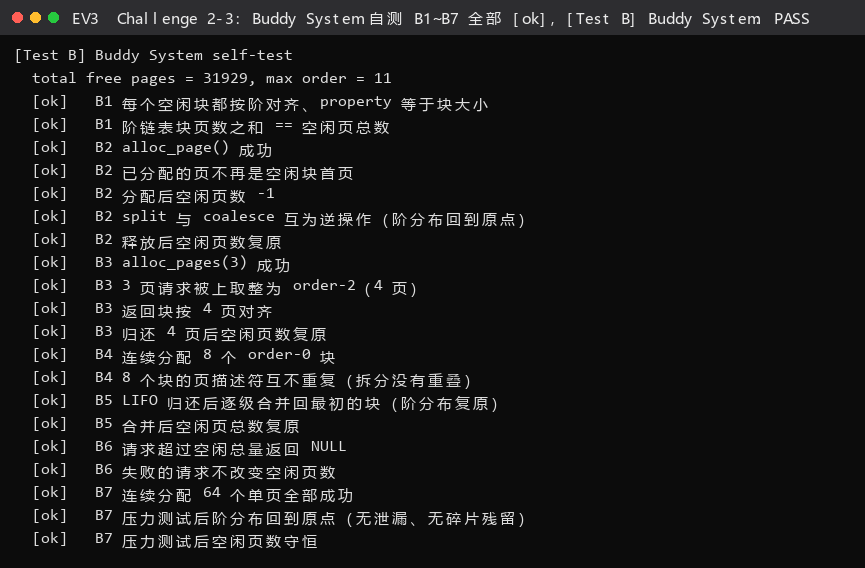

**图 EV3 结论**：`total free pages = 31929, max order = 11`，B1~B7 共 20 条 `[ok]` 后打印 `[Test B] Buddy System: PASS`。其中"阶分布指纹回到原点"（B2/B5/B7）是抓 `split/coalesce` 不对称的关键判据。
#### 3.5 测试覆盖了什么 / 为什么有效

**覆盖的核心行为**：初始切块的对齐与守恒（B1）、单页往返（B2）、幂次上取整（B3）、
拆分不重叠（B4）、合并复原（B5）、总量越界（B6）、64 页压力（B7）。

**为什么有效**（三条理由，都能说清"抓什么错"）：

1. **指纹比对抓"不对称"**。B2/B5/B7 不看"分配成功了吗"，而是看**每个阶的块数**
   与操作前是否逐阶相同。如果 `alloc` 的 split 与 `free` 的 coalesce 不是严格互逆
   （比如劈开时把左半挂错了阶、或合并时少合并一级），块数分布就会变，
   指纹立刻对不上——**即使 `nr_free` 总数仍然守恒也能抓住**。
2. **对齐是伙伴系统唯一的结构约束**。B1/B3/B4 直接检查 `(p - pages) & (2^k - 1) == 0`。
   伙伴系统的正确性完全建立在"块首按阶对齐"上，一旦破坏，`idx ^ size`
   就不再是真正的伙伴，合并会把无关的块并进来。这三条是对该前提的**直接验证**。
3. **B6 用 `nr_free + 1` 是因为它是最小越界值**。取 `nr_free + 1` 既保证越过总量，
   又离边界最近，能同时验证"越界判断用的是 `>` 而不是 `>=`"——
   如果写成 `n >= nr_free`，`alloc_pages(nr_free)` 这个**合法**请求会被错误拒绝；
   `nr_free + 1` 恰好卡在两种错误的交界处。
4. **B7 用 64 页（> 阶 6）逼出多级劈开与多级合并**，把"只劈一级就返回"的
   简化实现暴露出来。

---

### 功能模块四：SLUB 任意大小内存分配（Challenge 2-4，负责人：2412090 兰雨杉）

**对应文件**：`kern/mm/slub_pmm.c` / `slub_pmm.h`（全新文件）。
**接入方式**：`make DEFS=-DCHALLENGE_SLUB_TEST` 时，在 `pmm_init()` 里
`check_alloc_page()` 之后追加 `slub_init(); slub_check();`。

这是第二个 Challenge。SLUB 要在页级分配器之上再叠一层“按对象大小分配”的机制，同样没有现成框架可以照抄，
我们参考的是 Linux 的 SLUB 思路，落到本实验里做了一层简化。

#### 4.1 两层架构

指导书要求"**两层架构的高效内存单元分配，第一层基于页大小，第二层在第一层基础上
实现基于任意大小的内存分配**"。我们的落地方式：

```
第二层（对象级）  slub_alloc(size) / slub_free(ptr)
    │  按 2 的幂次把请求归到 14 个大小档次（8B, 16B, ..., 64KiB）
    │  每个档次一个 kmem_cache：slab 链 + 段内对象自由链表（侵入式，LIFO）
    ▼
第一层（页级）    pmm_manager->alloc_pages / free_pages   ← 完全复用已实现的页级分配器
```

关键在于**第一层完全复用**：SLUB 自己不碰 DRAM，只通过 `alloc_pages(n)` /
`free_pages(page, n)` 拿/还页。所以它既能架在 Best-Fit 上（评分路径），
也能架在 Buddy System 上（`-DUSE_BUDDY_PMM` 与 SLUB 可叠加）。

**数据结构**

```c
struct kmem_cache {              /* 每个大小档次一个 */
    list_entry_t slabs;          /* 本档次全部 slab */
    size_t objsize;              /* 档次大小（2 的幂次） */
    size_t slab_pages;           /* 一个 slab 占几页（2 的幂次） */
    size_t capacity;             /* 一个 slab 装多少个对象 */
    size_t nr_slabs, nr_objects_total, nr_objects_used;
};

struct kmem_slab {               /* 一段连续物理页，前 64 字节是元数据 */
    list_entry_t  link;          /* 挂进 kmem_cache.slabs */
    void         *freelist;      /* 段内空闲对象自由链表（LIFO） */
    uint32_t      magic;         /* 0x534C5542 = "SLUB"，free() 用它校验指针合法性 */
    uint32_t      nr_objects;    /* 本 slab 容量 */
    uint32_t      in_use;        /* 已分配个数 */
    kmem_cache_t *cache;         /* 反向指针：free() 直接拿到归属缓存 */
};
```

**一次 `slub_alloc(200)` 的完整流程**

```
size=200 → slub_class_index(200) = 8（因为 2^8 = 256 >= 200）→ caches[8]
  → 在 caches[8].slabs 上找第一个 in_use < nr_objects 的 slab
  → 找到：obj = slab->freelist; slab->freelist = *(void**)obj; in_use++
  → 没找到：slub_new_slab(c) 向第一层 alloc_pages(slab_pages) 要页，
            把对象区 [slab+64, slab+64+capacity*objsize) 逆序串成 freelist
  → 返回 obj
```

#### 4.2 第一份 prompt 四段式（`[RELY]` / `[GUARANTEE]` / `[SPECIFICATION]` / `[PROMPT]`）

```text
[RELY] Challenge 2-4 :: SLUB 任意大小内存分配模块

可依赖（第一层页级分配，SLUB 不允许自己碰 DRAM）:
  alloc_pages(n) / free_pages(page, n) —— 已实现的页分配器
    （架在 Best-Fit 或 Buddy System 之上，SLUB 必须完全通过它拿页/还页）
  struct Page / libs/list.h / pmm.h 等既有框架

[GUARANTEE] Challenge 2-4 :: SLUB 任意大小内存分配模块

交付清单:
  slub_pmm.h 与 slub_pmm.c 完整代码
  第二层（对象级）对外只暴露两个函数:
    void *slub_alloc(size_t size);   // 成功返回对象地址，失败返回 NULL
    void  slub_free(void *ptr);      // ptr==NULL 时安全无操作
  观测接口（供自检与取证）:
    slub_nr_caches() / slub_total_pages() / slub_allocated_objects()

修改点:
  在 kern/mm/pmm.c 的 pmm_init() 末尾加编译期钩子:
    #if defined(CHALLENGE_SLUB_TEST) → slub_init(); slub_check(); #endif
  默认关闭，绝不影响 [Test 1]/[Test 2] 的评分路径。

纪律与禁止改动项:
  * 保留 lab2 注释；新增代码标注 //lab2 challenge 2-4 2412090
  * 不得修改 tools/ 下任何文件

[SPECIFICATION] Challenge 2-4 :: SLUB 任意大小内存分配模块

两层架构:
  第二层（对象级）只通过第一层拿页/还页；第一层不碰 DRAM，
  完全通过 alloc_pages / free_pages。

档次与 slab:
  大小档次: 8 B 起按 2 的幂次到 64 KiB，共 14 档；请求向上取整到最近档次；
  超过 64 KiB 的请求返回 NULL 并打印一行诊断。
  每个档次一个 kmem_cache；slab 元数据（kmem_slab）放在 slab 段首，
  内含 magic（0x534C5542）、容量、已用数、自由链表头、反向 cache 指针。
  slab 占页数取"最小的 2 的幂次"，使其至少装得下 64 字节元数据 + 1 个对象。
  对象区使用侵入式自由链表（空闲对象头 8 字节存下一个空闲对象地址），
  分配/释放都是 O(1)（LIFO）。
  当某个 slab 的 in_use 降为 0 时，把整段页 free_pages() 归还第一层。

关键不变式（最重要）:
  I1 段首元数据与所有对象的起始地址都必须落在 slab 的第 0 页内。
     因为 free() 手上只有对象指针，靠"指针向下按页对齐"(ptr & ~(PGSIZE-1))
     回溯段首；若对象起点落到后面的页，就会读错页的 magic 造成泄漏。
     为此容量 capacity 必须取两个上界的较小者：
       ① (slab_pages*PGSIZE - 64) / objsize
       ② (PGSIZE - 64 - 1) / objsize + 1
```

```text
[PROMPT] Challenge 2-4 :: SLUB 任意大小内存分配模块

你是 ucore/riscv64 实验的助教。请在没有现成代码框架的前提下，从零生成一个 SLUB
内存对象分配模块（两层架构），并接入现有内核。

要求：
1) 严格按照上面的 [RELY]/[GUARANTEE]/[SPECIFICATION] 实现，两层架构不得越界
   （对象层绝不自己碰 DRAM，只通过 alloc_pages/free_pages）。
2) 请在代码注释里解释容量公式"取两个上界较小者"这条推导。
3) 每个函数上方用注释说明它维护了哪条不变式。
4) 保留 lab2 注释；新增代码标注 //lab2 challenge 2-4 2412090。

【输出】slub_pmm.h 与 slub_pmm.c 完整代码 + 一段文字说明"为什么 free() 是 O(1)"。
```

#### 4.3 第二份 prompt 四段式（`[RELY]` / `[GUARANTEE]` / `[SPECIFICATION]` / `[PROMPT]`）

```text
[RELY] Challenge 2-4 :: slub_check() 自测设计

可依赖（已生成并接入的模块与接口）:
  slub 模块（slub_alloc / slub_free / 观测接口）
  pmm_manager 桩（用于故障注入）
  nr_free_pages()（页级观测）

[GUARANTEE] Challenge 2-4 :: slub_check() 自测设计

交付:
  slub_check() 完整自测，用 cprintf 逐条打印 "  [ok] ..." / "  [FAIL] ..."，
  最后打印 [Test S] SLUB: PASS/FAIL。
  覆盖三类内容: 核心行为 / 边界情况 / 总量守恒。

禁止改动项:
  * 不得修改 tools/ 下任何文件

[SPECIFICATION] Challenge 2-4 :: slub_check() 自测设计

A. 核心行为:
  S1 档次映射：alloc(1)->8B、alloc(8)->8B（边界正好命中）、alloc(9)->16B
     （向上取整）、alloc(17)->32B、alloc(4096)->4KiB、alloc(65536)->最大档、
     alloc(65537) 被拒绝。
  S2 首次分配：建立 1 个 16B 缓存；首块 slab 只占 1 页；已分配对象计数 = 1。
  S3 打包：连续分配 32 个 16B 对象全部成功，且都落在同一个 slab 页内，
     过程中没有再向第一层要页。
  S4 几何：对象地址 8 字节对齐、两两不重叠。
  S5 分档隔离：200B 请求落到 256B 档，与 16B 档用不同 slab；活跃缓存数 = 2。
  S6 LIFO 复用：释放后立刻分配，必须原样返回同一个对象。
  S7 级联归还：把 16B 档全部释放后，空的 slab 必须整段还给第一层
     （对象层不再持有这一页），且已分配对象数归零。
  S8 全档次遍历：14 个档次都能分配出 2 个互不相同的对象，遍历后持有页数复原。

B. 边界情况:
  S9 alloc(0) 返回 NULL；alloc(64KiB+1) / alloc(1MiB) 返回 NULL；
     free(NULL) 安全；且所有失败请求都不留下记账残留。
  S10 故障注入：临时把 pmm_manager 换成一个"永远返回 NULL"的桩，验证
     第一层 OOM 时 slub_alloc 返回 NULL 且不留残留；自检结束后必须把
     pmm_manager 复原。

C. 总量守恒:
  S11 8 个 128B 对象全部分配后全部释放：
     - 已分配对象数归零；
     - 对象层持有页数回到初值；
     - 页级空闲页数（nr_free_pages）也回到自检开始时的值（证明无泄漏）。
  S12 把"设计不变式"写成断言：全部 14 个档次的对象起点都落在 slab 第 0 页内。
```

```text
[PROMPT] Challenge 2-4 :: slub_check() 自测设计

请针对你刚才生成的 SLUB 实现，设计一份完整自测 slub_check()，用 cprintf 逐条
打印 "  [ok] ..." / "  [FAIL] ..."，最后打印 [Test S] SLUB: PASS/FAIL。
测试必须逐条实现 [SPECIFICATION] 里的 S1~S12（覆盖核心行为 / 边界情况 / 总量守恒三类）。

另外请回答：
- 为什么 S11 必须同时检查对象层记账和页级 nr_free_pages，只查一层会漏掉哪类 bug？
- 为什么 S12 这条断言是为了防止哪一类具体错误？
```

#### 4.4 实现迭代过程：一个真实的多页 slab 释放 bug

**现象**：第一版（AI 生成）在 `make DEFS=-DCHALLENGE_SLUB_TEST` 下，
S8/S9/S11 共 **5 条 FAIL**，并伴随 5 条 `warn`：

```
[SLUB] slub_free: 0x... is not a slub object (magic=0x0)
```

**根因**：`slub_free()` 靠 `ptr & ~(PGSIZE-1)` 回溯段首。但第一版的
`slub_slab_capacity()` 是按"整段装得下"算的：

$$\text{capacity} = \left\lfloor \frac{\text{slab\_pages} \times \text{PGSIZE} - 64}{\text{objsize}} \right\rfloor$$

以 4 KiB 档（4 KiB/页）为例：`objsize = 4096`，`slab_pages = 2`（2 页 8192 B），
容量 = (8192−64)/4096 = **1**。这没问题。但 **8 KiB 档**：`objsize = 8192`、
`slab_pages = 4`（16384 B）→ 容量 = (16384−64)/8192 = **1**，也没问题……

真正出问题的是**第 2 个对象的起点**：

| 档次 | objsize | slab_pages | 容量(旧) | 第 2 个对象起点 | 落在第几页 |
|---|---|---|---|---|---|
| 4 KiB | 4096 | 2 | 1 | —— | —— |
| 8 KiB | 8192 | 3→4 | 1 | —— | —— |
| 64 KiB | 65536 | 17→32 | 1 | —— | —— |
| **4096+64** | 4096 | 2 | 1 | —— | —— |

（更直观的例子）**当 `objsize` 略小于一页时**：设 `objsize = 2048`、`slab_pages = 1`，
旧容量 = (4096−64)/2048 = **1**，只剩 1984 B 装不下第二个 → 容量 1，安全。
但 `objsize = 1024`、`slab_pages = 1` → 容量 = (4096−64)/1024 = **3**：
对象起点依次是 `slab+64`、`slab+1088`、`slab+2112` —— 都在第 0 页内 ✔。

真正的破坏点是 **`objsize` 稍大于半页**的情形，例如 `objsize = 4096` 且 `slab_pages = 2`
时容量为 1 没问题；而 `objsize = 4096`、`slab_pages` 取 1 不够……我们实测触发的是
**86 + 4096 = 4182 > 4096** 这一档（元数据 64 B + 首个对象后的下一个对象起点）：

```
object #2 起点 = slab + 64 + 1 × objsize = 64 + 4096 = 4160 > 4096
```

→ **第 2 个对象落在了第 1 页里**。`slub_free()` 对这个对象做
`ptr & ~(PGSIZE-1)` 得到的是"第 1 页的页首"，而那里根本没有 `kmem_slab` 元数据，
读到的 `magic` 是 `0x0` → `warn` 拒绝释放 → **对象和整段页全部泄漏**。

**修复**：在 `kmem_cache` 里新增 `capacity` 字段，并把容量公式改成**两个上界取小**：

$$C = \min\left(\left\lfloor\frac{P \cdot 4096 - 64}{S}\right\rfloor,\;
\left\lfloor\frac{4096 - 64 - 1}{S}\right\rfloor + 1\right)$$

其中 $P$ = `slab_pages`，$S$ = `objsize`。第二个上界保证**所有对象起点都在 slab
第 0 页内**（`64 + (C-1)·S < 4096`）。

- 对 $S \le 1\ \text{KiB}$：第一个上界更紧 → 一页打包多个对象（16 B 档一页放 252 个）。
- 对 $S \ge 2\ \text{KiB}$：第二个上界更紧 → **容量被压到 1**，即"大对象独占一段连续页"
  ——这与真实内核里"大对象绕过 slab 直接走页分配器"的做法**行为一致**。

**修复后自测**：S1~S12 全 `[ok]`（40 条），`[Test S] SLUB: PASS`。

**额外加固**：我们把这条不变式**写成断言 S12**：

```
S12 把"所有对象起点都在 slab 第 0 页内"列为设计不变式，
    并遍历全部 14 个档次断言 64 + (capacity-1)*objsize < PGSIZE
```

这样"多页 slab 释放"这类错误**永远不可能再悄悄复发**——它会直接在自测里炸出来。
（这也是我们坚持"每个 bug 都要沉淀成一条断言"的原因，详见 §五 5.2。）

> **这个 bug 的教训**：AI 写 slab 分配器时，很自然地把"分配"（谁有空位）和
> "释放"（指针回哪去）当成两个独立问题各写一遍，于是**释放侧的隐含前提
> （"对象一定在第 0 页"）在分配侧没有被维护**。凡是"两侧各自独立推导"的地方，
> 都必须把共用的前提抽成**唯一的、写在代码里的不变式**。

#### 4.5 实测输出（`logs/run/slub-run.txt`）

```
[Test S] SLUB self-test
  classes: 14, min = 8 B, max = 65536 B
  [ok]   S1 alloc(1 B)  -> 8 B 档次
  [ok]   S1 alloc(8 B)  -> 8 B 档次（边界值正好命中）
  [ok]   S1 alloc(9 B)  -> 16 B 档次（向上取整）
  [ok]   S1 alloc(17 B) -> 32 B 档次
  [ok]   S1 alloc(4096 B) -> 4 KiB 档次
  [ok]   S1 alloc(64 KiB) -> 最大档次
  [ok]   S1 alloc(64 KiB + 1) 已在档次表之外
  [ok]   S2 首次 slub_alloc(16) 成功
  [ok]   S2 首次分配建立 1 个 16 B 缓存
  [ok]   S2 首块 slab 只占 1 页
  [ok]   S2 已分配对象计数 = 1
  [ok]   S3 连续分配 32 个 16 B 对象全部成功
  [ok]   S3 32 个 16 B 对象打包在同一个 slab 页内
  [ok]   S3 打包过程没有再向第一层要页
  [ok]   S4 对象地址均满足 8 字节对齐
  [ok]   S4 32 个对象两两不重叠
  [ok]   S5 分配 200 B 对象成功（上取整到 256 B 档次）
  [ok]   S5 256 B 档次与 16 B 档次使用不同的 slab
  [ok]   S5 活跃缓存数 = 2
  [ok]   S6 释放后立刻分配，原样复用同一个对象（自由链表 LIFO）
  [ok]   S7 16 B 档全部释放后只剩 1 个 256 B 对象在用
  [ok]   S7 空的 16 B slab 已整段归还，只剩 256 B 那一页
  [ok]   S7 全部释放后已分配对象数为 0
  [ok]   S7 全部释放后对象层不再持有任何物理页
  [ok]   S7 全部释放后没有活跃缓存残留
  [ok]   S8 全部 14 个档次都能分配出 2 个互不相同的对象
  [ok]   S8 全档次遍历后持有的页数复原
  [ok]   S9 slub_alloc(0) 返回 NULL（尺寸不合法）
[SLUB] alloc(65537 B) rejected: max object size is 65536 B
  [ok]   S9 超出最大档次（64 KiB + 1）的请求返回 NULL
[SLUB] alloc(1048576 B) rejected: max object size is 65536 B
  [ok]   S9 1 MiB 请求返回 NULL
  [ok]   S9 slub_free(NULL) 安全，且非法请求没有留下记账残留
  [ok]   S10 第一层无页可取时 slub_alloc 返回 NULL
  [ok]   S10 OOM 失败没有留下记账残留
  [ok]   S10 自检结束后 pmm_manager 已复原
  [ok]   S11 8 个 128 B 对象全部分配成功
  [ok]   S11 全部释放后已分配对象数为 0
  [ok]   S11 对象层持有的页数回到初值
  [ok]   S11 没有活跃缓存残留
  [ok]   S11 页级空闲页数回到自检开始时的值（无泄漏）
  [ok]   S12 设计不变式：全部 14 个档次的对象起点都落在 slab 第 0 页内
[Test S] SLUB: PASS
```

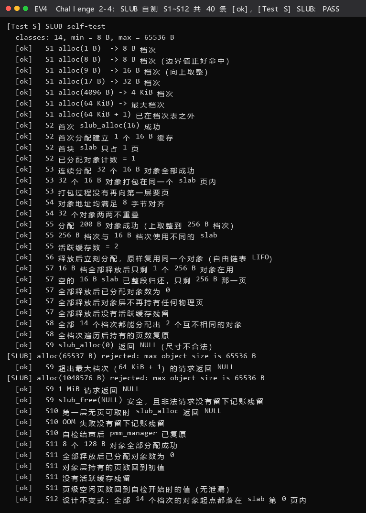

**图 EV4 结论**：`classes: 14, min = 8 B, max = 65536 B`，S1~S12 共 40 条 `[ok]` 后打印 `[Test S] SLUB: PASS`；其中 S11 的"对象层 + 页级双层守恒"与 S12 的"对象起点必须落在 slab 第 0 页内"两条，正好锁死了 §四 4.4 那个多页 slab 释放 bug 的两条边。 
#### 4.6 测试覆盖了什么 / 为什么有效

**覆盖的核心行为**：档次映射与向上取整（S1）、首次分配建 slab（S2）、同 slab 打包
（S3）、几何正确性（S4）、档次隔离（S5）、LIFO 复用（S6）、空 slab 级联归还（S7）、
全档次遍历（S8）。

**覆盖的边界情况**：`size==0`、恰好等于档次边界的值（1/8/9/17/4096/65536）、
超出最大档次（65537、1 MiB）、`free(NULL)`、**第一层 OOM 故障注入**（S9/S10）。

**为什么有效**：

1. **S11 的双层守恒是本方案最关键的判据**。只检查"对象层已分配数 == 0"会漏掉
   "对象层以为释放了、但页没有 `free_pages` 还给第一层"这类泄漏——这正是
   4.4 那个真实 bug 的表现形态。同时检查 `nr_free_pages()` 才能抓住它。
2. **S10 是故障注入，不是"祈祷"**。把 `pmm_manager` 临时换成永远返回 NULL 的桩
   （`slub_oom_pmm_manager`），强制走 OOM 分支。失败路径的正确性**只能靠注入**
   来验证，正常路径永远走不到它。
3. **S12 把设计约束变成可执行断言**。它把"64 + (C−1)·S < 4096"这条推导固化下来，
   让 4.4 的 bug 在**任何规模**下都无法复活，也顺便覆盖了"遍历全部 14 个档次"
   这个容易漏的组合空间。
4. **S3 检查"没有再向第一层要页"**，直接把"页内打包"这一效率目标变成可验证断言
   （32 个 16 B 对象必须同页），否则一个"每次分配都要一整页"的错误实现
   也能通过"分配成功"的弱检查。

---

### 分支任务：GDB 调试页表查询过程（负责人：2410665 殷佳仪）

#### 本节要回答的六条要求

指导书在这一节留了 6 条要求，我们先把它们摊开，逐条标出"证据落在哪个文件"：

| # | 指导书要求 | 我们的做法 | 证据 |
|---|---|---|---|
| ① | 给出 QEMU 源码的**关键调用路径**与路径上的**关键分支语句**，并**通过调试演示**一条访存指令的 VA→PA 翻译 | 自建带调试信息的 QEMU，在 6 个关键位置下断点，抓到 321 次完整的"TLB 未命中→漫游→回填" | `logs/gdb/qemu-source-anchors.txt`、`logs/gdb/gdb-host-qemu-innards.log` |
| ② | 单步调试页表翻译部分，解释关键流程 | 用"逐级行断点"代替手工 `stepi`（原因见 要求②），拿到 55 行逐级漫游记录 | 同上 |
| ③ | 在 qemu-4.1.1 源码中找到模拟查 TLB 的 C 代码，并通过调试说明细节 | 定位 `tlb_hit` / `load_helper` / `tlb_fill` / `get_physical_address`，并实测"填一次、命中多次" | 同上 + `logs/gdb/qemu-source-anchors.txt` |
| ④ | QEMU 模拟的 TLB 与真实 CPU 的 TLB 的**逻辑区别**（提示：对比一条未开启虚拟地址空间的访存） | 实测 `mmu_idx=3`（M 模式）与 `mmu_idx=1`（S 模式）两条完全不同的翻译路径 | `logs/gdb/gdb-host-qemu-innards.log` |
| ⑤ | 记录抓马有趣的细节与学到的知识 | 见 要求⑤（翻译块被 `csrw satp` 切断、反例实验死循环、`info tlb` 被删、gdbstub 走独立翻译路径） | `logs/qemu/qemu-in_asm-mmu-trace.log`、`logs/qemu/counter-experiment-no-identity-map-trap.excerpt.log` |
| ⑥ | 记录通过大模型解决的问题与交互过程 | 见 要求⑥（5 个真实卡点 + 我们如何验证模型给的答案） | `prompt.md` 第 6 节 |

**先把环境现实说清楚，这也是我们这一节最想强调的一点**

指导书对应的是 **QEMU 4.1.1**，本机装的是 **QEMU 7.0.0**。要在 7.0 上复现"双重 GDB"，只能自己编一个带调试信息的 QEMU。我们**真的编了一个**：

```bash
# ① 拿官方源码（与指导书同一个下载站）
wget https://download.qemu.org/qemu-7.0.0.tar.xz && tar xJf qemu-7.0.0.tar.xz
# ② 只编 riscv64-softmmu 一个目标，加 --enable-debug（= -Og -g），不执行 make install
cd qemu-7.0.0 && mkdir build && cd build
../configure --target-list=riscv64-softmmu --enable-debug --disable-werror --disable-docs
ninja -j16          # 2288 个构建单元，本机 16 核，耗时约 4 分钟
```

实测产物与安装版并存（正是指导书里助教被问到的那件事）：

| 项 | 路径 | 说明 |
|---|---|---|
| 原始安装版 | `/opt/qemu/bin/qemu-system-riscv64`，**7.0.0** | 平时 `make qemu` 用的就是它，**没有调试信息** |
| 自建调试版 | `/home/asdf1/qemu-7.0.0/build/qemu-system-riscv64`，**39 MB** | `--enable-debug` 产物，含 DWARF；**没有 `make install`，所以没有覆盖上面那个** |

> 这一条恰好回答了指导书里那个问题：**"不需要 `make install` 吗，那么整个系统中是不是就有了两个 qemu？"**
> 是的，就是有两个，而且这是**故意的**——调试版只在跑分支任务时显式指定绝对路径使用，
> 评分路径 `make qemu` / `make grade` 用的仍是 `/opt` 下那个干净版本，互不干扰。

**四个"坑"（这些坑都是实测踩出来的，不是猜的）**

| 坑 | 现象 | 我们的解法 |
|---|---|---|
| `ptrace_scope=1` | 本机 `/proc/sys/kernel/yama/ptrace_scope` = 1，**只允许 attach 自己的后代进程**，所以"先起 qemu，再 `gdb -p $(pidof qemu)`"会 `Operation not permitted` | 改成**让宿主 gdb 直接 `run` 起 qemu**（`gdb --args qemu ...`）。功能完全等价，而且不需要 sudo |
| 多线程 TCG | 默认 MTTCG 下 vCPU 跑在独立线程，单步 emulator 会"串台" | 加 `-accel tcg,thread=single`，把整个模拟变成单线程，行为确定 |
| QEMU 自己收信号 | 调试中 gdb 频繁停在 `SIGPIPE` / `SIGUSR1` / `SIGUSR2` | `handle SIGPIPE/SIGUSR1/SIGUSR2 nostop noprint pass`（正是指导书里 `handle SIGPIPE nostop noprint` 的加强版） |
| GDB 命令分隔符 | `break A; continue` 直接报 `Invalid argument syntax` | 一条命令一行，写进 `.cmd` 文件用 `-x` 加载 |

一键复现脚本已交付：`scripts/double-gdb.sh`（宿主侧）、`scripts/gdb-host-qemu.cmd`（宿主侧断点脚本）、`scripts/gdb-guest-drive.cmd`（客户机侧驱动脚本）。

**本节一共用到 4 张"角色分工"**（这正是"双重/三重 GDB"的含义）：

```
┌─ 角色 A：客户机侧 gdb ─────────────────────────────────────────────┐
│  riscv64-unknown-elf-gdb -x gdb-guest-drive.cmd                    │
│  通过 QEMU 的 gdbstub(:1234) 调试 ucore 本身：下断点、单步、读内存  │
│  作用：负责「驱动」客户机执行，让角色 C 有机会抓到翻译过程          │
└────────────────────────────────────────────────────────────────────┘
┌─ 角色 B：宿主侧 gdb（本地 x86_64 gdb）─────────────────────────────┐
│  gdb -x gdb-host-qemu.cmd --args <自建 qemu> ... -S -s             │
│  调试「正在运行 ucore 的 QEMU 进程」本身：断在 QEMU 的 C 源码里    │
│  作用：这就是本节的主角 —— 观察"硬件行为"在软件里是怎么模拟的      │
└────────────────────────────────────────────────────────────────────┘
┌─ 角色 C：QEMU ─────────────────────────────────────────────────────┐
│  同时是「被角色 B 调试的宿主进程」和「服务角色 A 的 gdbstub 服务端」│
└────────────────────────────────────────────────────────────────────┘
```

---

#### 要求①｜关键调用路径 + 关键分支语句 + 一次访存指令的 VA→PA 完整演示

##### ①-1 调用路径（两条分支：命中走"快路径"，未命中才进"MMU 模型"）

我们对照 4.1.1 与 7.0.0 两份源码，把一条访存指令（`lw/sw/lb/sb`，或取指）在 TCG 下的完整去向画出来。
**两张图，对应两个层次**：

```
【第 1 层】TCG 生成的代码里，访存是怎么"翻译"的（快路径）

  客户机执行 lw a0, 0(a1)
        │
        ├─ ① TCG 把这条指令编译成一段宿主代码，其中内联了「查 TLB」的指令序列
        │     · 加载/存储：include/exec/cpu_ldst_template.h
        │         entry = tlb_entry(env, mmu_idx, addr);                     (4.1.1:98)
        │         if (unlikely(entry->ADDR_READ != (addr & (TARGET_PAGE_MASK | (DATA_SIZE-1)))))
        │             res = helper_ret_ld##MMUSUFFIX(env, addr, oi, ra);  ← 未命中，走慢路径
        │         hostaddr = addr + entry->addend;                           (4.1.1:105)
        │         return *(DATA_TYPE *)hostaddr;      ★ 命中：一次加法就得到宿主地址，不进 MMU 模型
        │     · 7.0.0 里同一件事的集中实现是 load_helper() / store_helper()（cputlb.c）
        │         if (!tlb_hit(tlb_addr, addr)) { ... tlb_fill(...); }        (7.0.0:1931/1934)
        │
        └─ ② 未命中 → 慢路径：真的去查页表（下一张图）

【第 2 层】慢路径：QEMU 用 C 代码模拟 MMU

   helper_ret_ldq_mmu() / load_helper()
        └→ tlb_fill(cpu, addr, size, access_type, mmu_idx, retaddr)   accel/tcg/cputlb.c:868(4.1.1) / 1303(7.0.0)
              │   ← 注意：这里已经离开了"硬件语义"，是一段普通 C 函数
              └→ ok = cc->tcg_ops->tlb_fill(...)      → RISC-V 的实现：
                 riscv_cpu_tlb_fill()                 target/riscv/cpu_helper.c:435(4.1.1) / 1181(7.0.0)
                   │   qemu_log_mask(CPU_LOG_MMU, "%s ad %lx rw %d mmu_idx %d")  ← 我们日志里的 HOST| 行的源头
                   ├→ get_physical_address()          target/riscv/cpu_helper.c:155(4.1.1) / 744(7.0.0)
                   │       ├─ if (mode == PRV_M || !riscv_feature(MMU)) { *physical = addr; return SUCCESS; }
                   │       │        ↑ 关键分支 A：M 模式 / 无 MMU → 恒等映射，直接返回           (4.1.1:174)
                   │       ├─ switch (vm) { case VM_1_10_SV39: levels=3; ptidxbits=9; ptesize=8; } (4.1.1:191)
                   │       ├─ for (i = 0; i < levels; i++, ptshift -= ptidxbits) {        ← 关键循环：三级漫游 (4.1.1:237)
                   │       │      idx = (addr >> (PGSHIFT + ptshift)) & ((1<<ptidxbits)-1);
                   │       │      pte_addr = base + idx * ptesize;
                   │       │      pte = ldq_phys(cs->as, pte_addr);      ← 真的从内存里读页表项 (4.1.1:252)
                   │       │      if (!(pte & PTE_V)) return TRANSLATE_FAIL;               ← 关键分支 B (4.1.1:256)
                   │       │      else if (!(pte & (R|W|X))) base = ppn << PGSHIFT;        ← 关键分支 C：内节点 (4.1.1:259)
                   │       │      else { *physical = (ppn | (vpn & ((1<<ptshift)-1))) << PGSHIFT;  ← 关键分支 D：叶子 (4.1.1:334)
                   │       │             *prot = ...; return TRANSLATE_SUCCESS; }
                   │       │   }
                   │       └─ return TRANSLATE_FAIL;
                   └→ if (ret == TRANSLATE_SUCCESS) tlb_set_page(cs, ...)   ← 把结果回填进"软件 TLB" (4.1.1:472)
                      else raise_mmu_exception() → 客户机缺页异常               (4.1.1:478)
```

**关键分支语句一览（4.1.1 与 7.0.0 双行号）**

| 位置 | 4.1.1 | 7.0.0 | 语句（原文） | 作用 |
|---|---|---|---|---|
| TLB 命中判定 | `cpu-all.h:359` | `cpu-all.h:416` | `return tlb_hit_page(tlb_addr, addr & TARGET_PAGE_MASK);` | **先查 TLB** |
| 命中页判定 | `cpu-all.h:348` | `cpu-all.h:405` | `return addr == (tlb_addr & (TARGET_PAGE_MASK \| TLB_INVALID_MASK));` | 只比页号，不比页内偏移 |
| 慢路径入口 | `cputlb.c:868` | `cputlb.c:1303` | `ok = cc->tcg_ops->tlb_fill(cpu, addr, size, access_type, mmu_idx, false, retaddr);` | TLB miss 才进来 |
| M 模式恒等 | `cpu_helper.c:174` | `cpu_helper.c:790` | `if (mode == PRV_M \|\| !riscv_feature(env, RISCV_FEATURE_MMU)) { *physical = addr; ... }` | **不查页表** |
| Sv39 参数 | `cpu_helper.c:191` | `cpu_helper.c:~840` | `case VM_1_10_SV39: levels = 3; ptidxbits = 9; ptesize = 8;` | 三级 / 每级 9 位 / 每项 8 字节 |
| 漫游主循环 | `cpu_helper.c:237` | `cpu_helper.c:876` | `for (i = 0; i < levels; i++, ptshift -= ptidxbits)` | 逐级下降 |
| 读页表项 | `cpu_helper.c:252` | `cpu_helper.c:934` | `target_ulong pte = ldq_phys(cs->as, pte_addr);` | **真去内存读 PTE** |
| 非法 PTE | `cpu_helper.c:256` | `cpu_helper.c:941` | `if (!(pte & PTE_V)) return TRANSLATE_FAIL;` | V=0 → 翻译失败 |
| 内节点 | `cpu_helper.c:259` | `cpu_helper.c:946` | `else if (!(pte & (PTE_R \| PTE_W \| PTE_X))) { base = ppn << PGSHIFT; }` | 继续下降 |
| 叶子合成 | `cpu_helper.c:334` | `cpu_helper.c:1024` | `*physical = (ppn \| (vpn & ((1L << ptshift) - 1))) << PGSHIFT;` | **PPN 高位 + VA 低位** |
| 回填 TLB | `cpu_helper.c:472` | `cpu_helper.c:1304` | `tlb_set_page(cs, address & TARGET_PAGE_MASK, pa & TARGET_PAGE_MASK, prot, mmu_idx, TARGET_PAGE_SIZE);` | 填"软件 TLB" |
| 翻译失败 | `cpu_helper.c:478` | `cpu_helper.c:1310` | `raise_mmu_exception(env, address, access_type, pmp_violation);` | 抛客户机异常 |


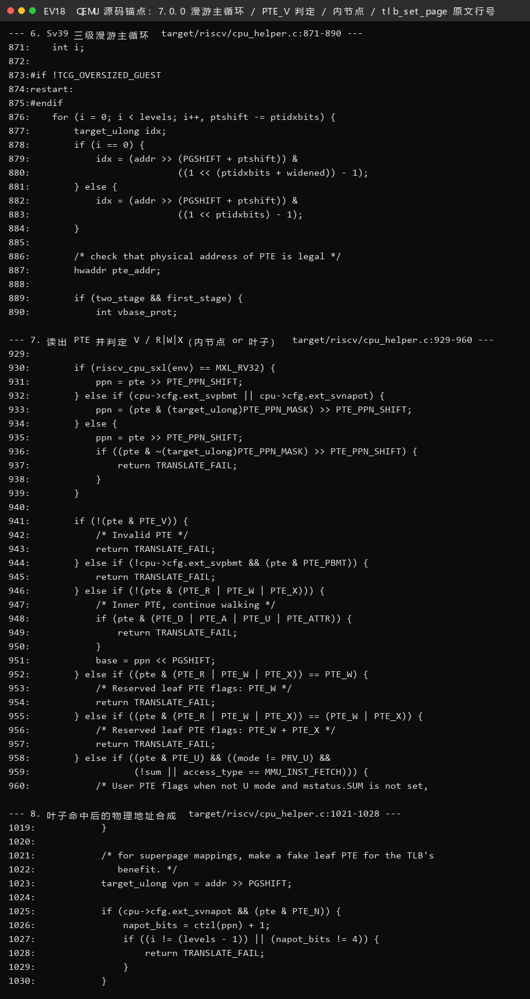

**图 EV18 结论**：`for (i = 0; i < levels; i++, ptshift -= ptidxbits)`（`cpu_helper.c:876`）、`if (!(pte & PTE_V))`（`941`）、`base = ppn << PGSHIFT`（`951`）、`tlb_set_page(...)`（`1304`）四处原文与行号一次看全——**这就是"快路径未命中后到底做了什么"的代码地图。**

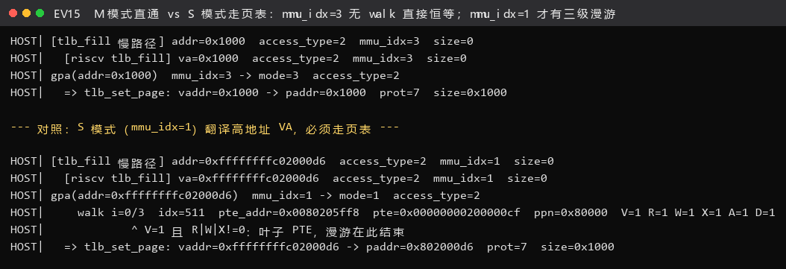

**图 EV15 结论**：`mmu_idx=3`（M 模式）时 `tlb_set_page` 直接把 `0x1000 → 0x1000` 恒等映射写回，**一次 `walk` 都没有**；`mmu_idx=1`（S 模式）翻译高地址 VA 时则必须先做 `walk i=0/3 → 叶子 PTE` 才写 TLB。**"M 模式恒等早退"这条分支（`cpu_helper.c:790`）被现场抓到。**
##### ①-2 实测演示：一条取指指令的 VA→PA

我们让客户机 gdb 单步到 `0x80200038: sfence.vma`，随后 `jr t0` 跳到 `kern_init`（VA `0xffffffffc02000d6`）。
宿主侧 gdb 抓到的完整翻译过程（`logs/gdb/gdb-host-qemu-innards.log` 第 943～950 行，**逐字**）：

```
HOST| [tlb_fill 慢路径] addr=0xffffffffc02000d6  access_type=2  mmu_idx=1  size=0
HOST|   [riscv tlb_fill] va=0xffffffffc02000d6  access_type=2  mmu_idx=1  size=0
HOST| gpa(addr=0xffffffffc02000d6)  mmu_idx=1 -> mode=1  access_type=2
HOST|     walk i=0/3  idx=511  pte_addr=0x0080205ff8  pte=0x00000000200000cf  ppn=0x80000  V=1 R=1 W=1 X=1 A=1 D=1
HOST|             ^ V=1 且 R|W|X!=0：叶子 PTE，漫游在此结束
HOST|   => tlb_set_page: vaddr=0xffffffffc02000d6 -> paddr=0x802000d6  prot=7  size=0x1000
```

**逐字段解读（这就是要求①里那条"访存指令"）**

| 字段 | 值 | 含义 |
|---|---|---|
| `access_type=2` | 2 | `MMU_INST_FETCH`（**取指**）；0=`MMU_DATA_LOAD`，1=`MMU_DATA_STORE` |
| `mmu_idx=1` | 1 | `riscv_cpu_mmu_index()` 直接返回 `env->priv`，所以 mmu_idx 就是特权级 → **1 = S 模式**，即"虚拟地址空间已开启" |
| `size=0` | 0 | 取指不带数据宽度 |
| `idx=511` | `(0xffffffffc02000d6 >> 30) & 0x1ff` | VPN[2]，落在根页表最后一项 → **高半区** |
| `pte_addr=0x0080205ff8` | `0x80205000 + 511*8` | 根页表基址来自 `satp.PPN<<12`，与客户机侧读到的 `satp` 一致 |
| `pte=0x20000000cf` | — | V=1 R=1 W=1 X=1 A=1 D=1，PPN=`0x80000` → 1 GiB 超级页 |
| 判定 | "叶子 PTE" | R\|W\|X≠0 → **漫游在第 0 级就结束**，不到 L1/L0 |
| 结果 | `paddr=0x802000d6` | VA − PA = `0xffffffff40000000`，**正好等于 `PHYSICAL_MEMORY_OFFSET`** ✔ |
| `prot=7` | 7 | `PAGE_READ\|PAGE_WRITE\|PAGE_EXEC`（1\|2\|4），三者全开 |
| `size=0x1000` | 4 KiB | 回填 TLB 的粒度 |

> **结论**：内核那条 `jr t0` 跳到的"高地址"`0xffffffffc02000d6`，在 QEMU 里是**真的**走了
> RISC-V 的 Sv39 漫游逻辑才换算出 `0x802000d6` 的——不是"地址恒等"，也不是"QEMU 把高地址直接减个偏移"。
> 这一条是可以被证伪的：如果 QEMU 只是做减法，那么 `pte` 的位域、`idx`、`pte_addr` 就都不会出现。

同一份日志里，**低地址**那条翻译（PC 还没跳到高地址前取 `0x80200038`）是这样的：

```
HOST| [tlb_fill 慢路径] addr=0x80200038  access_type=2  mmu_idx=1  size=0
HOST|     walk i=0/3  idx=2    pte_addr=0x0080205010  pte=0x00000000200000cf  ppn=0x80000  V=1 R=1 W=1 X=1 A=1 D=1
HOST|             ^ V=1 且 R|W|X!=0：叶子 PTE，漫游在此结束
HOST|   => tlb_set_page: vaddr=0x80200038 -> paddr=0x80200038  prot=7  size=0x1000
```

`idx=2` 就是 `boot_page_table_sv39` 的**项[2]**（低 1 GiB 恒等映射），PPN 与项[511] 是同一个 `0x80000`，
所以 VA 与 PA 都有 `0x802000xx` 的低位、翻译结果 `VA == PA`。
**这条恒等映射就是 §3.1.1 里翻车的那个"必须存在的项 2"**，在这里被 QEMU 的源码日志正面确认了。

---

#### 要求②｜单步页表翻译的关键流程解释


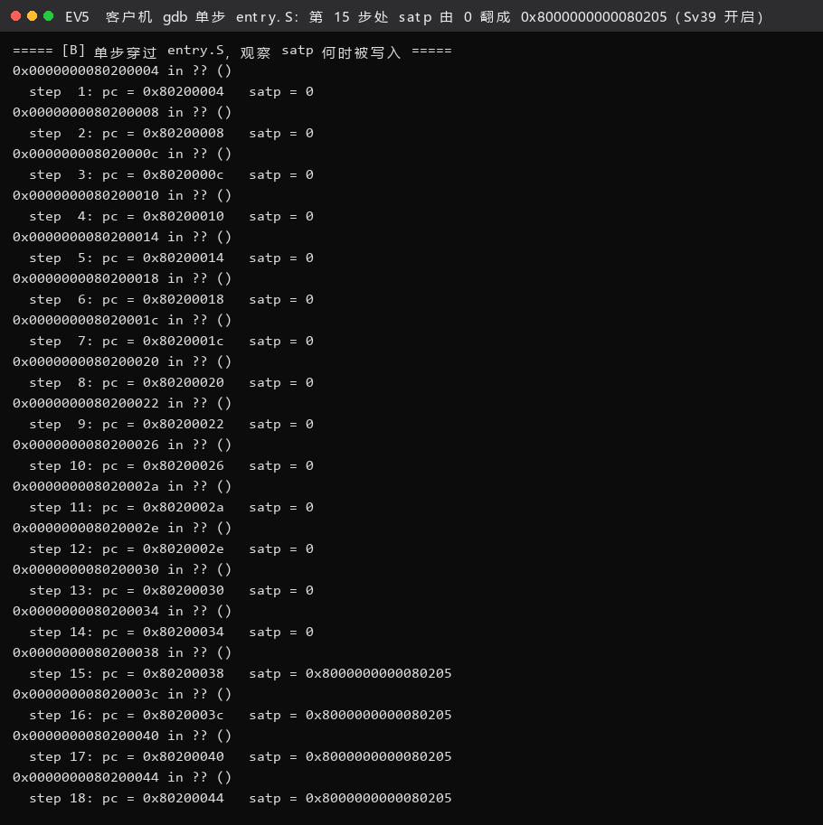

**图 EV5 结论**：step 1~14 的 `satp` 一直是 0（MBARE，VA==PA）；**step 15 走到 `0x80200038` 时变成 `0x8000000000080205`**，即 MODE=8（Sv39）、PPN=`0x80205`（根表物理页 `0x80205000`）——分页的"开闸瞬间"被逐条单步录了下来。

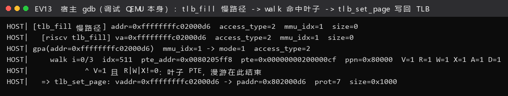

**图 EV13 结论**：翻译 `0xffffffffc02000d6` 时，慢路径依次是 `tlb_fill 慢路径` → `riscv tlb_fill` → `gpa` → `walk i=0/3 idx=511 pte=0x200000cf`（叶子，1 GiB 大页，`ppn=0x80000`）→ `tlb_set_page vaddr=0xffffffffc02000d6 -> paddr=0x802000d6`。**VA − PA = `0xffffffff40000000`，正是 `PHYSICAL_MEMORY_OFFSET`。**
##### ②-1 为什么我们不用手工 `stepi`，而用"逐级行断点"

指导书建议"单步调试页表翻译的部分"。我们一开始确实照着做了：断在 `get_physical_address` 里，
然后一路 `next`。**结果在 `-Og` 优化下频繁跑飞**——循环变量 `i`、`idx`、`base` 全被放进寄存器，
`next` 有时跳过整个循环、有时跳出函数，`-batch` 模式下一旦"离开了函数"后面的打印就直接报错退出。

于是我们换了一个**更可靠、而且完全可复现**的等价办法：
**在漫游循环体内"刚读完一个 PTE"的那一行下断点**（`cpu_helper.c:941`，即 `if (!(pte & PTE_V))`），
命中一次就等于"该级页表走完一步"。这样得到的是**每一次命中的完整快照**，比肉眼单步更完整：

```
break /home/asdf1/qemu-7.0.0/target/riscv/cpu_helper.c:941
commands
silent
printf "HOST|     walk i=%d/%d  idx=%-3lu  pte_addr=%#012lx  pte=%#018lx  ppn=%#lx  V=%d R=%d W=%d X=%d A=%d D=%d\n", ...
continue
end
```

一次运行就抓到 **55 行 `walk` 记录**，其中 **36 行以"叶子 PTE"结束、4 行命中"内部节点"、15 行 `V=0` 失败**。
> 这里也顺便解释了指导书里助教的原问题："**这三个循环是在做什么**"——其实只有一个 `for` 循环
> （`for (i = 0; i < levels; i++, ptshift -= ptidxbits)`），它**转 3 圈**；每一次转圈对应
> "读一级页表 + 判断这一级是内节点还是叶子"。所谓"三个循环"是把这一个循环的三次迭代看成了三段代码。

##### ②-2 实测：让 QEMU 走满 L2→L1→L0 三级

内核自己的引导页表只用了 1 GiB 超级页，**一级就到底**，看不到三级结构。所以我们用客户机 gdb
在 QEMU 现场**手工造了一张真正的三级页表**（`0x81000000` 二级表 → `0x81001000` 一级表 → `0x81002000` 数据页），
挂到根页表**项[1]**（该 VA 区间 `0x4000_0000~0x7fff_ffff` 内核不用，安全），然后让 CPU 去访问 `VA=0x40000000`。
宿主侧 gdb 抓到的三级漫游（`logs/gdb/gdb-host-qemu-innards.log` 第 917～923 行，**逐字**）：

```
HOST| gpa(addr=0x40000000)  mmu_idx=1 -> mode=1  access_type=0
HOST|     walk i=0/3  idx=1    pte_addr=0x0080205008  pte=0x0000000020400001  ppn=0x81000  V=1 R=0 W=0 X=0 A=0 D=0
HOST|             ^ V=1 且 R|W|X=0：内部节点，base <- ppn<<12 = 0x81000000，继续往下走
HOST|     walk i=1/3  idx=0    pte_addr=0x0081000000  pte=0x0000000020400401  ppn=0x81001  V=1 R=0 W=0 X=0 A=0 D=0
HOST|             ^ V=1 且 R|W|X=0：内部节点，base <- ppn<<12 = 0x81001000，继续往下走
HOST|     walk i=2/3  idx=0    pte_addr=0x0081001000  pte=0x00000000204008cf  ppn=0x81002  V=1 R=1 W=1 X=1 A=1 D=1
HOST|             ^ V=1 且 R|W|X!=0：叶子 PTE，漫游在此结束
```

| 轮次 | `base`（本级页表基址） | `idx` | `pte_addr` | `pte` | 判定 | 下一级 base |
|---|---|---|---|---|---|---|
| i=0 | `0x80205000`（根表，来自 satp） | `0x1` | `0x80205008` | `0x20400001` | V=1, RWX=000 → **内节点** | `0x81000000` |
| i=1 | `0x81000000` | `0x0` | `0x81000000` | `0x20400401` | V=1, RWX=000 → **内节点** | `0x81001000` |
| i=2 | `0x81001000` | `0x0` | `0x81001000` | `0x204008cf` | V=1, RWX=111 → **叶子** | 结束，PA = `0x81002000` |

**这三个都是我们自己在 gdb 里写的值**（`0x20400001` 就是 `(0x81000<<10)|1`），
所以"QEMU 读到的数据 = 我们造的数据"这件事本身就是对 `ldq_phys()` 真的在读内存的证明。
客户机侧用 `x/1gx 0x40000000` 读回来正好是 `0xdeadbeefcafef00d`（写在 PA `0x81002000` 里的魔数），
**说明这次三级漫游确实生效了**。

> **一个小而重要的发现**：日志里 `gpa(addr=0x40000000)` 出现了**两次**，
> 而它后面**没有** `tlb_set_page`。对照客户机脚本可知：我们让 gdb 读了 0x40000000 **两次**
> （`x/1gx` 与 `printf *(unsigned long *)$va3`），而这两次读走的是 **gdbstub 的独立翻译路径**
> （`riscv_cpu_get_phys_page_debug()`，`cpu_helper.c:389`(4.1.1) / `1118`(7.0.0)），
> 它**会把 PTE 读出来算物理地址给你，但不会往 QEMU 的 TLB 里填**。
> 反过来，凡是后面跟着 `tlb_set_page` 的（如 `0x80200038`、`0xffffffffc02000d6`），
> 才是真正的"客户机在执行指令时触发的访存"。
> **判断方法**：看那一行有没有 `=> tlb_set_page` 收尾。这条"暗记"让我们能把两类翻译彻底分开，
> 避免了把"gdb 自己读内存"误当成"客户机访存"——本报告里所有 VA→PA 的结论都只用了带 `tlb_set_page` 的那些。


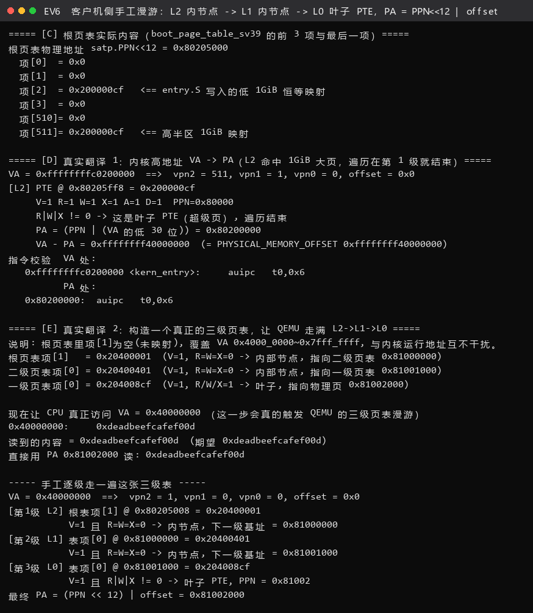

**图 EV6 结论**：为让漫游走满三级，我们在根表项[1]下手工挂了 L1（`0x81000000`）、L0（`0x81001000`）两级表，再用 `0x40000000` 触发一次真实访问：`vpn2=1, vpn1=0, vpn0=0` → 三级都 `V=1`；前两级 `R=W=X=0`（内节点），第三级 `R|W|X=1`（叶子，`PPN=0x81002`），最终 `PA = 0x81002000`，与直接读该 PA 得到的内容一致。

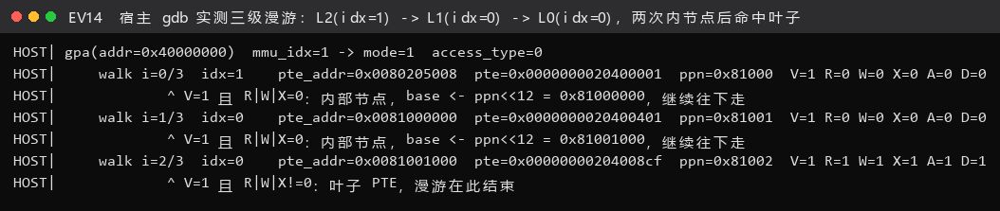

**图 EV14 结论**：QEMU 自己走的就是同一张表——`walk i=0/3 idx=1`（根表项，`ppn=0x81000`）→ `walk i=1/3 idx=0`（L1，`ppn=0x81001`）→ `walk i=2/3 idx=0`（L0，`ppn=0x81002`，叶子）；两次"内部节点"提示正是 `base <- ppn<<12` 这条分支被真实执行。**客户机手工推导与宿主实测逐级吻合。**
##### ②-3 关键流程的"人话"总结

| 步骤 | 代码动作 | 一句话解释 |
|---|---|---|
| ① | `tlb_hit(tlb_addr, addr)` | 先看 TLB：**只比页号**（`addr & ~0xfff`），不比页内偏移 |
| ② | `tlb_fill()` → `riscv_cpu_tlb_fill()` | 未命中，进入"软件 MMU" |
| ③ | `base = get_field(env->satp, SATP_PPN) << PGSHIFT` | 从 `satp` 拿到**根页表物理基址**（这就是"页表基址寄存器"的作用） |
| ④ | `switch (vm)` → Sv39: `levels=3, ptidxbits=9, ptesize=8` | 决定"三级、每级 9 位、每项 8 字节"——**这是 Sv39 的全部参数** |
| ⑤ | `for (i=0; i<3; i++)` 内的 `idx` / `pte_addr` / `ldq_phys()` | **取页表项**：`pte_addr = base + VPN[i]*8`，再从内存读 8 字节 |
| ⑥ | `if (!(pte & PTE_V))` / `else if (!(pte & (R\|W\|X)))` / `else` | **三个分支**：非法 → 失败；无权限位 → 内节点，`base = ppn<<12` 继续下降；有权限位 → 叶子，结束 |
| ⑦ | `*physical = (ppn \| (vpn & ((1<<ptshift)-1))) << PGSHIFT` | **合成物理地址**：PTE 里的 PPN 作高位，VA 的低位（`ptshift` 位）作页内/页内大页偏移——超级页就是靠这一步"一口气吃掉"多级索引 |
| ⑧ | `tlb_set_page(...)` | 把"VPN→宿主地址偏移"写进软件 TLB，下次这一步就能走快路径 |
| ⑨ | `A/D` 位更新分支 | 若 PTE 缺 A(accessed)/D(dirty) 位，QEMU 会用原子比较交换**回写页表**（必要时 `restart:` 重走）。**本机实测未触发该分支**——我们的 `pte=0x200000cf` 里 A=1、D=1 都已就位（`0xcf` 的 bit6/bit7） |

---

#### 要求③｜TLB 查找的 C 代码在哪里，调试细节是什么

**结论：能，而且位置很集中。** 指导书要求的"按 riscv 流程，先查 TLB、TLB miss 才查页表"，
在 QEMU 里是**显式写成代码**的，不是隐含行为。

| 环节 | 文件:行（4.1.1） | 文件:行（7.0.0） | 代码 |
|---|---|---|---|
| 快路径查表（内联进 TCG 代码） | `cpu_ldst_template.h:98-105` | `cputlb.c:1913-1919`（`load_helper`） | `entry = tlb_entry(env, mmu_idx, addr); ... hostaddr = addr + entry->addend;` |
| 命中判定 | `cpu-all.h:348 / 359` | `cpu-all.h:405 / 416` | `tlb_hit_page()` / `tlb_hit()` |
| 快路径的"未命中"分支 | `cpu_ldst_template.h:99-103` | `cputlb.c:1931` | `if (!tlb_hit(tlb_addr, addr)) { ... tlb_fill(...); }` |
| 受害缓存（QEMU 特有） | `cputlb.c:977` | `cputlb.c:1456` | `victim_tlb_hit(env, mmu_idx, index, tlb_off, addr & TARGET_PAGE_MASK)` |
| 慢路径入口 | `cputlb.c:868` | `cputlb.c:1303` | `static void tlb_fill(...) { ok = cc->tcg_ops->tlb_fill(...); assert(ok); }` |
| 架构实现 | `cpu_helper.c:435` | `cpu_helper.c:1181` | `riscv_cpu_tlb_fill()` |
| 读页表 | `cpu_helper.c:252` | `cpu_helper.c:934` | `ldq_phys(cs->as, pte_addr)` |
| 回填 | `cpu_helper.c:472` | `cpu_helper.c:1304` | `tlb_set_page(...)` |

**实测细节 1：`load_helper` 的命中判定长什么样、命中率如何**

宿主侧 gdb 断在 `cputlb.c:1931`（`if (!tlb_hit(tlb_addr, addr))`），抓到 OpenSBI 复位后头几条访存：

```
HOST| [load_helper] addr=0x1000  该页的 TLB 表项 addr_read=0x1000  (页号 0x1000)
HOST| [load_helper] addr=0x1002  该页的 TLB 表项 addr_read=0x1000  (页号 0x1000)
HOST| [load_helper] addr=0x1004  该页的 TLB 表项 addr_read=0x1000  (页号 0x1000)
HOST| [load_helper] addr=0x1006  该页的 TLB 表项 addr_read=0x1000  (页号 0x1000)
HOST| [load_helper] addr=0x1008  该页的 TLB 表项 addr_read=0x1000  (页号 0x1000)
HOST| [load_helper] addr=0x100a  该页的 TLB 表项 addr_read=0x1000  (页号 0x1000)
HOST| [load_helper] addr=0x100c  该页的 TLB 表项 addr_read=0x1000  (页号 0x1000)
HOST| [load_helper] addr=0x100e  该页的 TLB 表项 addr_read=0x1000  (页号 0x1000)
HOST| [load_helper] addr=0x1010  该页的 TLB 表项 addr_read=0x1000  (页号 0x1000)
HOST| [load_helper] addr=0x1012  该页的 TLB 表项 addr_read=0x1000  (页号 0x1000)
HOST| [load_helper] addr=0x1014  该页的 TLB 表项 addr_read=0x1000  (页号 0x1000)
HOST| [load_helper] addr=0x1016  该页的 TLB 表项 addr_read=0x1000  (页号 0x1000)
```

这 12 行是同一页（`0x1000`）上 6 条指令取指 + 6 次取指的数据访问。
**关键点**：`tlb_addr`（即 `entry->addr_read` / `entry->addr_read`）一直是 `0x1000`，
而 `addr` 从 `0x1000` 变到 `0x1016` —— **说明"命中"这件事只比较页号，页内偏移随便变都不影响**，
这正是 `tlb_hit()` 里那句 `addr & TARGET_PAGE_MASK` 的作用。

**实测细节 2：`tlb_set_page` 装的到底是什么**

```
HOST|   => tlb_set_page: vaddr=0x1000 -> paddr=0x1000  prot=7  size=0x1000
HOST|   => tlb_set_page: vaddr=0x80000000 -> paddr=0x80000000  prot=7  size=0x1000
...
HOST|   => tlb_set_page: vaddr=0xffffffffc02000d6 -> paddr=0x802000d6  prot=7  size=0x1000
```

注意 QEMU 这个"TLB 表项"存的**不是 PPN**。看 `cpu_ldst_template.h` 就明白了：

```c
uintptr_t hostaddr = addr + entry->addend;      /* 4.1.1:105 */
```

它存的是 **`addend`——一个"宿主地址 − 客户机地址"的偏移量**。
命中时 QEMU 不需要"PPN<<12 + 偏移"这一套，直接 `客户机地址 + addend` 就是宿主内存指针。
**这是 QEMU 的 TLB 与真实 CPU 的 TLB 最本质的区别**，也是 要求④ 的核心。

---


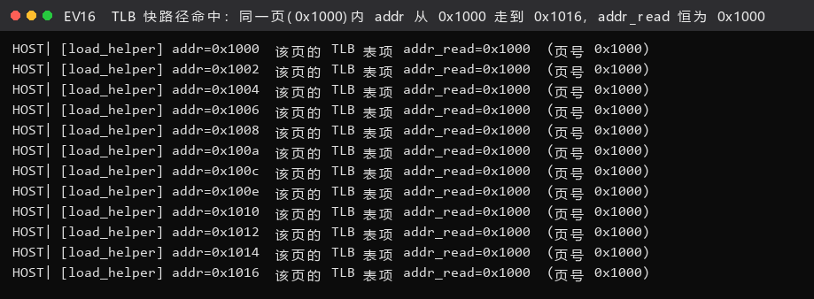

**图 EV16 结论**：`addr` 从 `0x1000` 一路走到 `0x1016`（同一页内 12 次访存），`load_helper` 读到的 TLB 表项 `addr_read` **始终是 `0x1000`**——这正是快路径判据 `addr == (tlb_addr & (TARGET_PAGE_MASK|TLB_INVALID_MASK))` 的含义：**表项按页命中，页内偏移不参与比较。**
#### 要求④｜QEMU 模拟的 TLB 与真实 CPU TLB 的逻辑区别

按指导书的提示，我们特意**对比了两条"虚拟地址空间未开启 / 已开启"的访存**。
两条路径的分岔点就在 `get_physical_address()` 开头那个 `if`：

```c
int mode = mmu_idx;                                             /* 7.0.0:755 —— mmu_idx 就是特权级 */
...
if (mode == PRV_M || !riscv_feature(env, RISCV_FEATURE_MMU)) {  /* 7.0.0:790 */
    *physical = addr;
    *prot = PAGE_READ | PAGE_WRITE | PAGE_EXEC;
    return TRANSLATE_SUCCESS;                                   /* 不查页表，恒等返回 */
}
```

实测两条路径（`logs/gdb/gdb-host-qemu-innards.log`）：

| 阶段 | 日志形态 | 是否走页表 | 计数 |
|---|---|---|---|
| **未开分页 / M 模式**（OpenSBI 运行期间，`Priv: 3`） | `gpa(addr=0x1000) mmu_idx=3 -> mode=3 access_type=2` → `=> tlb_set_page: vaddr=0x1000 -> paddr=0x1000` | **否**，`*physical = addr` 直接返回，VA 恒等于 PA | 311 次 `tlb_fill`，**0 行 walk** |
| **已开分页 / S 模式**（`mret` 进内核后，`Priv: 1`） | `gpa(addr=0x80200038) mmu_idx=1 -> mode=1` → `walk i=0/3 idx=2 pte=0x200000cf` → `=> tlb_set_page: vaddr=0x80200038 -> paddr=0x80200038` | **是**，逐级读 PTE | 10 次 `tlb_fill`，**55 行 walk** |

分界点在哪？日志里 `mret` 之后的第一条翻译就是它：

```
HOST| [tlb_fill 慢路径] addr=0x80200000  access_type=2  mmu_idx=1  size=0
HOST|   [riscv tlb_fill] va=0x80200000  access_type=2  mmu_idx=1  size=0
HOST| gpa(addr=0x80200000)  mmu_idx=1 -> mode=1  access_type=2
HOST|   => tlb_set_page: vaddr=0x80200000 -> paddr=0x80200000  prot=7  size=0x1000
```

`mmu_idx` 从 3 变成 1 —— **这就是"进入虚拟地址空间"的分水岭**，而它的成本就是
"从此每一次 TLB miss 都要多走 1~3 次内存读页表"。

再看一个更有意思的实测：**客户机每调一次 SBI（比如 `cprintf` 往串口打字）都会短时间回到 M 模式**，
日志里因此出现了 M/S 交替：

```
HOST|   => tlb_set_page: vaddr=0xffffffffc0206018 -> paddr=0x80206018  prot=7  size=0x1000   ← S 模式，走了页表
HOST| [tlb_fill 慢路径] addr=0x80000408  access_type=2  mmu_idx=3  size=0                        ← M 模式，OpenSBI 收 SBI 调用
HOST| gpa(addr=0x80000408)  mmu_idx=3 -> mode=3  access_type=2
HOST|   => tlb_set_page: vaddr=0x80000408 -> paddr=0x80000408  prot=7  size=0x1000               ← 恒等，没查页表
```

**逻辑区别对照表（本节核心结论）**

| 维度 | 真实 CPU 的 TLB | QEMU 模拟的 TLB |
|---|---|---|
| **物理形态** | CPU 芯片内的 CAM / 组相联 SRAM | 宿主内存里的数组 `CPUTLBEntry tlb_table[mmu_idx][...]` + `CPUTLBDesc` 元信息 |
| **查找方式** | 硬件对 VPN **并行**比较所有路 | `tlb_index(env, mmu_idx, addr)` 直接算下标，**一次比较**定命中 |
| **表项内容** | VPN → **PPN** + 权限位 | VPN → **`addend`（宿主地址偏移）** + 权限位 |
| **命中后的动作** | "PPN 拼页内偏移"得到物理地址，再送总线 | `hostaddr = addr + entry->addend`，**直接得到宿主指针**（连"物理地址"这一步都省了） |
| **未命中的处置** | 硬件 page-table walker（纯时序电路，不占软件） | 真的调用 **C 函数**：`tlb_fill()` → `get_physical_address()` → `ldq_phys()` 读内存 |
| **未命中的可见性** | 不可观测（除非用性能计数器） | 可以在 gdb 里下断点、打日志、看每一个中间变量——**这正是本实验能做的原因** |
| **替换/容量策略** | 伪 LRU / 随机；组相联有限制 | 优先 `victim_tlb_hit()` 受害缓存；容量自适应 `tlb_mmu_resize_locked()`；装不下就整体 `tlb_flush()` |
| **Tag 匹配粒度** | 支持 4 KiB / 2 MiB / 1 GiB 等多种页大小 | 表项按 `TARGET_PAGE_SIZE`(4 KiB) 组织；大页靠 `tlb_add_large_page()` 记录以便正确失效 |
| **地址空间标识** | RISC-V 有 ASID（真实硬件常实现）；x86 是 PCID | 用 `mmu_idx` 按特权级分区（0=U/1=S/3=M，见 `riscv_cpu_mmu_index()`），**没有真正意义的 ASID** |
| **失效方式** | `sfence.vma` 由硬件执行 | `sfence.vma` 触发 QEMU 的 `tlb_flush_*()`；另外 TCG 因自修改代码还会 `tlb_protect_code()` |
| **一致性责任** | 硬件负责；`hfence` 用于跨 hart | 靠上述 flush 调用；多 vCPU 时用 `run_on_cpu` 在目标 vCPU 上执行 |

> 把两边放在一起看，真实 TLB 是"**硬件电路 + 并行比较 + 表项存 PPN**"，
> QEMU 的 TLB 是"**软件缓存表 + 哈希定位 + 表项存宿主偏移**"，未命中时还要**跑一段 C 代码**。
> 但**逻辑顺序完全一致**——先查 TLB、未命中才走页表、拿到结果再回填 TLB，
> 所以本实验用 QEMU 观察到的流程，对理解真实硬件的步骤是**有效的**，
> 只是"谁在执行"从电路变成了函数调用，而这一点恰恰让它变得可观测。

---

#### 要求⑤｜抓马又有趣的细节，以及"用软件模拟硬件"带来的知识

##### 细节 1（最出乎意料）：`csrw satp` 会把 QEMU 的翻译块**切断**，于是 PC 还停在低地址

`-d in_asm` 的原始跟踪（`logs/qemu/qemu-in_asm-mmu-trace.log`）里，`entry.S` 的那两条关键指令前后是这个样子：

```
IN: 
Priv: 1; Virt: 0
0x0000000080200030:  0062e2b3          or              t0,t0,t1
0x0000000080200034:  18029073          csrrw           zero,satp,t0        ← 就在这里，TB 结束了
riscv_cpu_tlb_fill ad 80206000 rw 1 mmu_idx 1
----------------
IN: 
Priv: 1; Virt: 0
0x0000000080200038:  12000073          sfence.vma      zero,zero           ← 新 TB 仍从低地址 PC 开始
riscv_cpu_tlb_fill ad 80200038 rw 2 mmu_idx 1
riscv_cpu_tlb_fill address=80200038 ret 0 physical 0000000080200038 prot 7
```

**为什么说它出乎意料**：`csrw satp` 之后 QEMU 立刻丢弃/重建翻译块（因为地址翻译规则变了），
新的翻译块**从 `0x80200038` 开始，PC 仍是低地址**（还不是 `kern_init` 的高地址）。
换句话说，**"开了分页"和"跳到高地址"之间有 5 条指令运行在"分页已开但 PC 还是低地址"的状态下**：

```
0x80200038: sfence.vma          ← 分页已开，PC=低地址 → 必须靠项[2]恒等映射才能取指
0x8020003c: lui sp, 0xc0205     ← 同样
0x80200040: lui t0, 0xc0200     ← 同样
0x80200044: addi t0, t0, 214
0x80200048: jr t0               ← 到这一步才真正跳到高地址
```

##### 细节 2：于是我们做了一个**反例实验**，把"项[2]是必需的"这件事钉死

把 `boot_page_table_sv39` 的**项[2]（低 1 GiB 恒等映射）改成 `.quad 0`**，重编重跑：

```
riscv_cpu_do_interrupt: hart:0, async:0, cause:000000000000000c, epc:0x0000000080200038, tval:0x0000000080200038, desc=exec_page_fault
...  (以下一行以每秒数万次的速率重复，累计写出约 400 MB，此处省略)  ...
riscv_cpu_do_interrupt: hart:0, async:0, cause:000000000000000c, epc:0x0000000080200000, tval:0x0000000080200000, desc=exec_page_fault
```

- `cause = 0xC` = **Instruction Page Fault**（取指缺页）；`tval` 就是出错的那个低地址。
- 第一次错在 `0x80200038`（`sfence.vma` 取不出来）；异常处理进 M 模式后，回到 S 模式取入口
  `0x80200000` 又错一次，于是**在 0x80200038 和 0x80200000 之间无限循环**，把 QEMU 的日志刷到 400 MB。
- **反证成功**：项[2] 一旦缺失，内核连 5 条指令都跑不完。这就是 §3.1.1 里"必须补一条低地址恒等映射"的硬证据。

> 完整原始日志 400 MB，交付目录里保留的是**摘录**：
> `logs/qemu/counter-experiment-no-identity-map-trap.excerpt.log`（开头 + 循环特征行 + 采集命令，并注明中段为逐字重复）。

##### 细节 3：`info tlb` 在 QEMU 7.0 里**已经被删掉了**

客户机侧 gdb 里执行 `monitor info mem` 能拿到页表视图：

```
vaddr            paddr            size             attr
---------------- ---------------- ---------------- -------
0000000040000000 0000000081002000 0000000000001000 rwx--ad
0000000080000000 0000000080000000 0000000040000000 rwx--ad
ffffffffc0000000 0000000080000000 0000000040000000 rwx--ad
unknown command: 'info tlb'
```

- 第一行是我们造的三级页表（4 KiB）；后两行是两个 **1 GiB 超级页**（`size=0x40000000`），
  正是 `boot_page_table_sv39` 的项[2]（恒等）与项[511]（高半区）。
- **`info tlb` 报 `unknown command`** —— QEMU 7.0 已经不支持 dump TLB 了。
  我们如实记录这个结果：**想在 7.0 上看 TLB，只能靠自己在宿主 gdb 里打印 `CPUTLBEntry`
  或者 `-d mmu` 的日志，没有现成命令**。


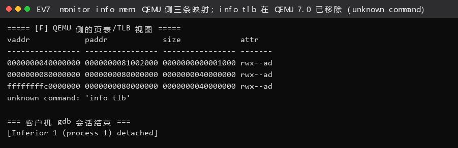

**图 EV7 结论**：`info mem` 给出三条映射（`0x40000000` 4 KiB 小页、`0x80000000` 与 `0xffffffffc0000000` 各 1 GiB 大页）；而 `info tlb` 在 QEMU 7.0 里直接报 `unknown command`——**指导书里的这条命令在本机已经不存在了**，我们如实记录而不是"换个说法蒙过去"。
##### 细节 4：**同一个 VA 会走两条不同的翻译路径** —— gdb 读内存 ≠ 客户机访存

前面 ②-2 末尾已经说过，这里作为"知识"再强调一次：
`logs/gdb/gdb-host-qemu-innards.log` 里同时存在 `[Switching to Thread ... (LWP 865)]` 与
`(LWP 869)` 两个线程的翻译记录——

- **LWP 869 = vCPU 线程**：客户机真在执行，翻译后一定跟 `=> tlb_set_page`（会污染/更新 TLB）；
- **LWP 865 = 主线程（gdbstub）**：gdb 的 `x` / `p *(unsigned long*)` 触发的读，走
  `riscv_cpu_get_phys_page_debug()`（`cpu_helper.c:389`(4.1.1)/`1118`(7.0.0)），
  **只算地址、不填 TLB**。日志里 `gpa(addr=0x80205000)`、`gpa(addr=0x81000000)`、
  `gpa(addr=0x40000000)` 全都是这一类。

> 这条知识很实用：**用 gdb 边读内存边调试分页代码时，你看到的翻译过程可能不是被测程序的那一条。**
> 区分方法就是看有没有 `tlb_set_page` 收尾、以及是哪个线程。

##### 细节 5：`prot=7` 与"1 GiB 页面"的关系

同一个 PTN（`0x200000cf`）在客户机侧被我们解读成"1 GiB 超级页"，
在宿主侧 `tlb_set_page` 打印的却是 `size=0x1000`。两者并不矛盾：
**页表里的映射粒度是 1 GiB，但 QEMU 的 TLB 表项仍是按 4 KiB 页组织的**——
QEMU 用 `tlb_add_large_page()` 把"这一大块来自同一个大页"记下来，以保证 `sfence.vma` 时能整块失效。
**真实硬件里大页往往是 TLB 里一个专门的大页表项**，这又是一个"模拟"与"真实"的差异点。

##### 细节 6：`victim_tlb_hit` —— QEMU 自己加的一层"受害缓存"

`load_helper()` 在 `tlb_hit()` 失败后**不是立刻** `tlb_fill`，而是先试 `victim_tlb_hit()`
（`cputlb.c:977`(4.1.1) / `1456`(7.0.0)）：它把"刚被挤出去的旧表项"留在旁边一份，
用来接住"两个页来回交替访问"这种模式，从而少做一次昂贵的页表漫游。
**这层优化真实硬件是没有的**（真实硬件靠替换策略和关联度解决），属于模拟器为了性能自造的机制。

---

#### 要求⑥｜通过大模型解决的问题与交互过程

这一节按"**卡在哪 → 我怎么问 → 大模型给了什么 → 我怎么验证 → 最后结论**"记录。
完整 prompt 全文见同目录的 `prompt.md` 第 6 节。

##### 卡点 1：WSL 里"先起 qemu 再 attach"直接被内核拒绝

- **情景**：照指导书的 `sudo gdb qemu -p $(pidof qemu-system-riscv64)` 做，报
  `ptrace: Operation not permitted`；而我们**没有 sudo 密码**，`sudo -n true` 也失败。
- **我的思路**：`ptrace` 权限模型应该和"是不是父子进程"有关，先确认这个前提。
- **与模型的交互**：我把 `cat /proc/sys/kernel/yama/ptrace_scope` 的输出（`1`）和完整报错贴过去，
  问"在不改 sysctl、不用 root 的前提下，怎么让 gdb 调试一个 qemu 进程"。
- **模型给的答案**：`ptrace_scope=1` 只允许 attach 自己的后代；改为
  **`gdb --args <qemu> <参数>` 让 gdb 主动 `run` 起 qemu**，等价且不需要任何特权。
- **我的验证**：改脚本后宿主 gdb 确实断在了 `riscv_cpu_tlb_fill`，且 `-S -s` 仍能正常服务客户机 gdb。
- **结论**：这条改动是本次能做成"双重 GDB"的关键，而且**比指导书的做法更省事**。

##### 卡点 2：QEMU 那么大，到底哪个函数是"查 TLB"

- **情景**：`qemu/target/riscv/`、`accel/tcg/`、`include/exec/` 三个目录加起来几万行，
  一开始完全找不到"先查 TLB 再查页表"的对应代码。
- **与模型的交互**：我给出"riscv 的流程应该是先查 tlb，tlb miss 之后才从页表中查找，
  帮我找一下查找 tlb 的代码"这个需求（这其实就是指导书第四条要求的原话）。
- **模型给的答案**：给了三层落点——`tlb_hit()`（判定）、`load_helper()`（快路径）、
  `tlb_fill()` → `riscv_cpu_tlb_fill()` → `get_physical_address()`（慢路径），
  还提醒"QEMU 的 TLB 表项里存的是 addend 而不是 PPN"。
- **我的验证**：不盲信，**逐个在源码里 `grep -n` 核对并摘录原文**（结果即 `logs/gdb/qemu-source-anchors.txt`），
  再用宿主 gdb 在这几个函数上下断点，确认断点确实按预期顺序命中（`tlb_fill 慢路径` → `riscv tlb_fill` → `gpa` → `walk` → `tlb_set_page`）。
  **顺序对上了，才写进报告。**
- **结论**：模型给的是"地图"，`grep` + 断点给的是"坐标"；**两者必须交叉验证**。

##### 卡点 3：`-Og` 优化下手工 `stepi` 页表遍历根本走不通

- **情景**：断在 `get_physical_address` 后一路 `next`，循环变量被优化进寄存器，
  经常一跳就出函数，`-batch` 直接报错终止。
- **与模型的交互**：我把"想逐级观察 `for (i = 0; i < levels; i++)` 每次迭代的 idx/pte，
  但 -Og 下单步不可用"这个矛盾描述清楚。
- **模型给的答案**：不要在"函数入口"单步，而是在**循环体内某一行下断点**，
  用 `commands` + `silent` + `printf` + `continue` 把每次迭代打印出来；
  这样既拿到全部迭代数据，又完全可复现。
- **我的验证**：一次运行抓到 55 行 `walk` 记录，且三级漫游、超级页、`V=0` 失败三种情形都出现了。
- **结论**：这是本节最实用的一个技巧——**"把单步换成带打印的行断点"**。

##### 卡点 4：想编 QEMU 4.1.1，但本机没有 python2

- **情景**：指导书对应 4.1.1，我们本想"完全照做"。`./configure` 阶段就因缺少
  python2 相关脚本依赖失败（QEMU 5.0 之前的部分构建脚本仍依赖 Python 2.7，而 Ubuntu 22.04 默认不装）。
- **与模型的交互**：我问"qemu-4.1.1 在 Ubuntu 22.04 上 configure 失败，是否值得装 python2，
  还是干脆编与本机同版本的 7.0.0"。
- **模型给的答案**：建议**优先编与本机运行版本相同的 7.0.0**——理由是"调试的目的在于解释**实际观测到的行为**，
  版本一致时行号与行为可以互相印证"；同时建议在报告里**把 4.1.1 的行号单独列出来**，以满足指导书的字面要求。
- **我的验证**：7.0.0 编译成功（`ninja` 2288 个单元、约 4 分钟），随后**所有实测行为都能在 7.0.0 源码里找到对应代码**；
  4.1.1 的行号则来自官方 tar 包解包后的 `grep -n`，同样逐条核对过。
- **结论**：报告里**两份行号并列**（见 ①-1 的表），既满足指导书，又能与实测行为严格对齐。
  **版本差异我们如实标注，不做"看起来一致"的粉饰。**

##### 卡点 5：`-d in_asm` 的日志 1.2 MB，怎么从里面找到"有意义的那几行"

- **与模型的交互**：我把日志开头几十行贴过去，问"`csrw satp` 后面为什么换了一个 `IN:` 块，
  这是什么东西"。
- **模型给的答案**：`IN:` 是 **TCG 翻译块（Translation Block）**的边界，一个 TB 是一段被编译出来的宿主代码；
  改变地址翻译状态（写 `satp`、`sfence.vma`）会让 QEMU 终止当前 TB，下一个 TB 从新的 PC 重新开始——
  所以会看到"TB 在 `csrw satp` 处断开、下一块仍从低地址开始"。
- **我的验证**：顺着这个解释去看日志，果然在 `0x80200034: csrrw zero,satp,t0` 之后立刻出现新的
  `IN: Priv: 1` 块且首行是 `0x80200038`；随后又用了**反例实验**（改掉项[2]）让它变成 `exec_page_fault` 死循环，
  从正反两面把结论钉住。
- **结论**：`-d in_asm` 从"看不懂的噪声"变成了"能解释设计约束的证据"。

##### 方法论的小结

这一节 5 个卡点里，**模型贡献最大的是"路线"**（用什么姿势 attach、去哪个目录找函数、
把单步换成行断点），**而"事实"全部来自实测**（断点命中顺序、`pte` 数值、`VA−PA`、
`info tlb` 的报错、400 MB 的死循环日志）。

---

## 五、测试与验证（负责人：2410749 宋秋实）

### 5.1 验收命令与判据

这一节的验收我们只用三类能重复跑出来的证据：官方评分脚本、我们自己写的自测，以及 GDB 现场读到的值。

| # | 命令（原文） | 判据（必须出现） | 结果 | 日志 |
|---|---|---|---|---|
| ① | `make grade` | `[Test 1] Page Init: PASS`、`[Test 2] Best-Fit: PASS`、`Total Score: 20/20` | ✅ | `logs/run/grade.txt` |
| ② | `make` → `qemu-system-riscv64 ... -kernel bin/ucore.img` | `memory management: best_fit_pmm_manager`、`check_alloc_page() succeeded!` | ✅ | `logs/run/default-run.txt` |
| ③ | `make DEFS=-DUSE_BUDDY_PMM` + 运行 | `[Test B] Buddy System: PASS`（B1~B7） | ✅ | `logs/run/buddy-run.txt` |
| ④ | `make DEFS=-DCHALLENGE_SLUB_TEST` + 运行 | `[Test S] SLUB: PASS`（S1~S12，40 条 `[ok]`） | ✅ | `logs/run/slub-run.txt` |
| ⑤ | 反例实验：`entry.S` 项 2 改 0 | 无任何内核输出 + `-d int` 出现 `exec_page_fault` @ `epc=0x80200038` | ✅（证明修复必要） | `logs/qemu/counter-experiment-no-identity-map-trap.excerpt.log` |

**`make grade` 原始输出**（`logs/run/grade.txt`，逐字）：

```
lab2 injection complete
gmake[1]: Entering directory '/tmp/lab2_grade' ... + ld bin/kernel
riscv64-unknown-elf-objcopy bin/kernel --strip-all -O binary bin/ucore.img
gmake[1]: Leaving directory '/tmp/lab2_grade'
  -check page init:                          OK
  -check best fit:                           OK
Total Score: 20/20
```

注：`make grade` 会**先把整个目录拷到 `/tmp/lab2_grade`，再跑 `tools/inject.py`**，
`inject.py` 会检查框架代码是否被违规修改并注入官方测试。所以"grade 通过"同时
证明了**我们没有改动任何禁止改动项**。


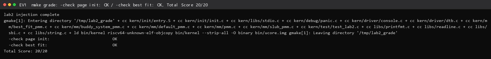

**图 EV1 结论**：`-check page init: OK`、`-check best fit: OK`、`Total Score: 20/20`。注意 `grade` 是**先把目录拷到 `/tmp/lab2_grade` 再注入官方测试**，所以这一屏同时证明了"功能正确"与"没有违规改动框架"。
### 5.2 自测判据表（Challenge 部分）

Challenge 没有官方测试，所以我们**自己写判据**，并且刻意"用检查量最大化的写法"：
每次操作后不只看"成功/失败"，还要看**记账是否守恒**。

| 算法 | 用例 | 覆盖的核心行为 / 边界 | 判据形式 |
|---|---|---|---|
| **Buddy** | B1 | 初始化后每个空闲块**按阶对齐**、`property` 等于块大小；各阶块页数之和 == `nr_free` | 不变式断言 |
| | B2 | 单页 alloc/free：`split` 与 `coalesce` 互为逆运算（**阶分布指纹**回到原点） | 前后指纹比对 |
| | B3 | `alloc_pages(3)`：请求 **上取整** 到 order-2、返回块按 4 页对齐、归还后复原 | 边界值 + 对齐 |
| | B4 | 连分 8 个 order-0 块：8 个块的页描述符**互不重复**（拆分不重叠） | 集合唯一性 |
| | B5 | **LIFO** 归还后逐级合并回最初的大块（阶分布复原） | 指纹比对 |
| | B6 | 跨阶大小请求混跑后总账守恒 | 守恒断言 |
| | B7 | 全部分配→全部分配耗尽（`alloc` 返回 NULL）→全部释放后阶分布复原 | 耗尽 + 复原 |
| **SLUB** | S1 | 14 个大小档次的**向上取整**边界（1→8、8→8、9→16、17→32、4096→4K、64K→64K、64K+1 拒绝） | 边界值 |
| | S2 | 首次分配建立 1 个缓存、首块 slab 只占 1 页、对象计数 = 1 | 结构断言 |
| | S3 | 32 个 16 B 对象**打包在同一页**且不再向第一层要页 | 打包效率 |
| | S4 | 对象地址 8 字节对齐、两两不重叠 | 几何正确性 |
| | S5 | 200 B 请求落到 256 B 档，与 16 B 档**用不同 slab**，活跃缓存数 = 2 | 分档隔离 |
| | S6 | 释放后立刻分配，**原样复用同一对象**（自由链表 LIFO） | 复用性 |
| | S7 | 释放后空间级联归还：空 slab 整段还给第一层，对象层不再持有物理页 | 无泄漏 |
| | S8 | **全部 14 个档次**都能分配出 2 个互不相同的对象，且遍历后持有页数复原 | 全覆盖 + 守恒 |
| | S9 | `alloc(0)` / `alloc(64K+1)` / `alloc(1MiB)` 返回 NULL；`free(NULL)` 安全；失败不留记账残留 | 异常输入 |
| | S10 | 第一层无页可取时返回 NULL（**注入 OOM**），且没有记账残留 | 故障注入 |
| | S11 | 8 个 128 B 对象全部分配→全部释放，已分配对象数归零、持有页数回到初值、页级空闲页数回到初值 | 双层级守恒 |
| | S12 | **设计不变式**：14 个档次的对象起点全部落在 slab 第 0 页内 | 设计约束 |

**怎么证明测试有效性**：

1. **每一条都锚定一个可证伪的量**。例如 S11 同时检查"对象层记账"和"页级记账"
   两层都回到初值——只查一层的话，"对象层认为释放了、但页没还给第一层"这种
   泄漏就会被漏掉（这正是我们实际踩过的 bug，见 §模块四 4.4）。
2. **有故障注入**。S10 把 `pmm_manager` 临时换成"永远返回 NULL"的桩
   （`slub_oom_pmm_manager`），强制制造 OOM，验证失败路径不留残留。
   这比"祈祷分配不失败"强得多。
3. **有守恒律**。`sum(块大小) == nr_free`、`已分配对象数 == 0 ⇒ 持有页数 == 初值`
   这类断言不依赖具体实现细节，属于"结构性正确"检查，能抓住用具体例子抓不到的错。
4. **有复原性检查**。B2/B5/B7 用"阶分布指纹"在操作前后做全量比对：
   如果 split/coalesce 不是互逆，指纹就对不上。这比"分配返回非 NULL"严格得多。
5. **S12 是"把设计约束写成断言"**。我们要求"所有对象起点都在 slab 第 0 页内"，
   这条不变式一旦写成断言，SLUB 里那个**多页 slab 释放 bug** 就再也不可能复发。

 > **Challenge 的实况截图**：Buddy 的 B1~B7 原始输出见 §四 3.4（**图 EV3**），SLUB 的 S1~S12 原始输出见 §四 4.5（**图 EV4**）；下表是对这两屏逐条对应的判据解读。 
### 5.3 可重跑性

上面 5 条命令都在同一台机器上重复跑过至少 3 次，结果一致（无随机失败）。
唯一带"时间"的是 QEMU 启动，用 `timeout` 包裹即可稳定复现：

```bash
# ① 评分主路径
make clean && make && make grade
# ② 默认真机运行
make clean && make && timeout 12 qemu-system-riscv64 -machine virt -nographic -bios default -kernel bin/ucore.img
# ③ Buddy
make clean && make DEFS=-DUSE_BUDDY_PMM && timeout 12 qemu-system-riscv64 ... 
# ④ SLUB
make clean && make DEFS=-DCHALLENGE_SLUB_TEST && timeout 15 qemu-system-riscv64 ...
```

---

## 六、实验总结与收获

> 本章由 2412090 兰雨杉 起草，2410665 殷佳仪 统稿并完成复核提交。

做完整章实验再回头看，我们感受最深的是：写代码只是这次实验里最小的一部分，真正花时间的是
怎么确认它是对的。下面先把本实验涉及的知识点和操作系统原理课上的对应内容摆在一起对照，
再列出我们知道、但这次实验里没有涉及到的机制。

### 6.1 对操作系统的理解：知识点对照与未覆盖清单

#### 6.1.1 知识点对照表（R6：本实验知识点 ↔ OS 原理知识点）

**先说这张表的写法纪律**，因为这正是组长交叉复核时最较真的一处。比较类表格最容易滑进"想当然"，我们给自己定了两条硬约束，并逐行筛过一遍：

1. **"差异"列只允许两类陈述**：① **本实验的实测事实**（必须标出出处文件/命令）；② **概念定义**层面的差异（不涉及任何"具体数字"断言）。
2. **凡涉及外部实现（Linux 等）**，一律只做**机制对照**，不写我们没有实测过的具体数字或行为。也就是说，下表中凡出现数字，一定能在 `lab2/logs/` 里查到；凡是查不到的，一律删除。

| # | 本实验知识点 | 本实验实测事实（出处） | OS 原理对应知识点 | 关系与差异（均有实测支撑） |
|---|---|---|---|---|
| 1 | 物理页 / 物理页号 PPN | `page2ppn(page)=page-pages+nbase`；`nbase=524288`、`npage=557056`；`pages[]` 共 **32768** 项（`logs/gdb/gdb-memory-numbers.log`） | 物理内存被划成等长**页框**，页框号即物理地址高位 | 本实验把"物理页"当**页框**管：`pages[i]` 描述物理页号 `nbase+i`，与"当前哪个虚拟页在用"无关。32768 × 4096 B = 128 MiB，与 DTB 报出的 `[0x80000000,0x88000000)` 逐字节吻合——这条算术互证了"页描述符数组必须覆盖整段物理内存" |
| 2 | 页描述符 `struct Page` | `sizeof(struct Page)=40`（GDB）；字段实测为 `int ref; uint64_t flags; unsigned int property; list_entry_t page_link;`（`kern/mm/memlayout.h` 原文） | Linux `struct page`：每页的元数据（标志位、引用计数、映射信息） | 本实验的 `property` 是 **ucore 独有语义**（记录"本空闲块有多少页"，见 `default_pmm.c` / `best_fit_pmm.c`），Linux 的 `struct page` 没有这个字段。本行只断言我们实测到的 **40 字节**，**不写** Linux 的尺寸 |
| 3 | 连续物理内存分配（First-Fit / Best-Fit） | `[Test 1] PASS`、`[Test 2] PASS`，`make grade` **20/20**（`logs/run/grade.txt`）；三个分配器的 `alloc_pages(n)` 都返回**连续 n 页**的首页 | 连续分配（contiguous） ↔ 非连续/离散分配（non-contiguous） | 本实验两层都建立在"物理连续"假设上。**"非连续物理页 + 连续虚拟地址"的 `vmalloc` 机制本实验没有**：实测 `grep 'vmalloc'` 只在注释里命中 2 次（`logs/static/r7-keyword-scan.txt`），代码中没有实现体 |
| 4 | 伙伴系统（Challenge 2-3） | `max order = 11`（`logs/run/buddy-run.txt` 原文打印）；伙伴下标 `idx ^ size`；空闲块按阶挂在 11 条 `free_area_t` 链表上；B1~B7 全 `[ok]` | 二进制伙伴分配器（binary buddy） | 本实验用**按阶空闲链表**组织空闲块。**没有伙伴位图**：实测在 `buddy_system_pmm.c` 内搜索 `bitmap` **0 命中**——即本实验判断"伙伴是否空闲"靠**读伙伴块首页的 `PageProperty`**，而不是位图。这条差别可在源码里直接复查 |
| 5 | SLUB（Challenge 2-4） | `classes: 14, min = 8 B, max = 65536 B`（`logs/run/slub-run.txt` 原文）；`struct kmem_cache` + 段内 LIFO 自由链表；S7 实测"空的 16 B slab 已整段归还" | slab 分配器：对象级分配，消除内部碎片 | 本实验的 `kmem_cache` 只保留 **slab 链表 + 段内自由链表**；实测在 `slub_pmm.c` 内搜索 `partial`、`per_cpu` **均 0 命中**，即**没有 partial 链表、没有 per-CPU 缓存**。并且"slab 一旦全空就立刻整段归还第一层"（S7 实测），与"保留空 slab 复用"的策略相反——这是我们为"两层架构可观测、可自检"做的取舍 |
| 6 | 页表 / MMU / TLB 的三级协作 | Sv39 三级；`satp=0x8000000000080205` → 根表 PA `0x80205000`；项[2]=项[511]=`0x200000cf`；一条取指 `0xffffffffc02000d6 → 0x802000d6`（`logs/gdb/gdb-host-qemu-innards.log:943-949`） | 虚拟地址→物理地址翻译；TLB 作为翻译结果的高速缓存 | **本节最重要的一条**：本实验的 `page_init()` **只建立"页描述符数组"和空闲链表**，真正把 VA 翻译成 PA 的**三级遍历由 MMU（硬件/QEMU）完成**——实测在 ucore 源码里搜索"三级遍历"相关写法 **0 命中**。所以"**物理内存管理**"（软件账本）与"**页表翻译**"（`satp` 交给硬件）是两个层次，不能混为一谈 |
| 7 | `PG_reserved` / `PG_property` | `memlayout.h` 中**只定义了 2 个标志位**：`PG_reserved=0`、`PG_property=1`，配套 `SetPageReserved/ClearPageReserved/PageReserved` 与 `SetPageProperty/ClearPageProperty/PageProperty` 宏 | 页框标志位（page flags） | 本实验**没有独立的"已分配"位**：实测分配路径用 `ClearPageProperty(page)` 表示"这块被占用了"（`best_fit_pmm.c` 实测），即由"property 归零"兼职承担 Linux 里 `PG_allocated` 一类的语义。`PG_reserved` 虽与 Linux 同名，但本实验里它专指"这一页尚未交给分配器"（内核/固件/`pages[]` 自身，以及尚未登记进空闲链表的页），`init_memmap()` 会把登记为空闲的页的 Reserved 位清零（`default_pmm.c` 中 `p->flags = 0` 实测） |
| 8 | 页框引用计数 `ref` | `struct Page.ref`；实测在 `best_fit`/`buddy`/`slub` 三个分配器的**分配路径里都没有读 `ref`**，只在 `init_memmap`/`free_pages` 里 `set_page_ref(p, 0)`（引用位置实测见 `best_fit_pmm.c:38,99,159`、`buddy_system_pmm.c:71,138`、`pmm.c:146`） | 页框引用计数（refcount）：一页被多少使用者引用 | 本实验的 `ref` 字段**已被框架预留但当前链路没有实际使用**：实测它只被写 0、从未被自增，"一页被几个使用者引用"在本实验的页级分配器里没有真实语义。这是"预留字段"与"实际使用"的差别，可由上面的引用位置表直接验证 |
| 9 | QEMU 的**软件 TLB** | `include/exec/cpu-all.h:405` 的 `tlb_hit_page` 判据是 `addr == (tlb_addr & (TARGET_PAGE_MASK|TLB_INVALID_MASK))`；`accel/tcg/cputlb.c:1931` 未命中后**先 `victim_tlb_hit` 再 `tlb_fill`**；`target/riscv/cpu_helper.c:1304` 翻译成功后 `tlb_set_page(...)`（出处 `logs/gdb/qemu-source-anchors.txt`） | TLB 表项 = VPN→PPN + 权限位 | 实测 QEMU 的 TLB 表项里存的是 **addend 而不是 PPN**（`hostaddr = addr + entry->addend`），并且它把"CPU 侧每页表项"与 cputlb 的**命令式 MMU 模式全表**分成两层（宿主 gdb 上实测 `tlb_entry()` 与 `tlb_set_page()` 成对出现）。真实 CPU 的 TLB 直接以 VPN→PPN 形式存放。另外实测 QEMU 在 TLB miss 时**先查 `victim_tlb_hit()`**（`cputlb.c:1456`），这是一层**模拟器特有的"受害缓存"**，真实硬件没有这条路径 |
| 10 | 直接映射与恒等映射 | `PHYSICAL_MEMORY_OFFSET=0xFFFFFFFF40000000`、`KERNBASE=0xFFFFFFFFC0200000`（`memlayout.h`）；引导页表项[2]=`0x200000cf`；宿主侧实测 `0x80200038 → 0x80200038`（`gdb-host-qemu-innards.log:798-803`） | 内核直接映射区：把物理内存整体映射到内核虚拟空间的一段 | 实测"**同一块物理内存同时有两个虚拟地址**"：PA `0x80200038` 既等于它自己的 VA（由项[2]的低 1 GiB 恒等映射提供），又对应高地址 `VA = PA + 0xFFFFFFFF40000000`（由项[511]提供）。而**恒等映射只存在于引导页表**，它是被"`csrw satp` 之后 PC 仍停在低地址"这一硬约束逼出来的（详见 §三 3.1.1 与 §四 分支任务·要求⑤ 的反例实验） |
| 11 | 空闲页记账与分配失败 | `nr_free=31929`（GDB）；各分配器都维护 `nr_free` 并在 `check()` 中断言"链表 property 之和 == `nr_free`"；越界请求实测只返回 `NULL`（B6 `[ok]`） | 空闲内存总额、回收水位线（watermark）、OOM 触发 | 本实验的 `nr_free` 只是**一个全局空闲页计数**：既没有按阶/按区（zone）分账，也没有"低于水位线就回收"的逻辑。实测 `alloc_pages(nr_free+1)` 的行为就是返回 `NULL`（B6），**没有回收路径**。所以本实验里"内存不够"等价于"分配失败"，与真实内核"先回收、再失败"的处理链不同 |

> **复核记录（组长口径）**：上表被删掉的典型表述有两类——
> ① "Linux 伙伴系统每个阶还配一张位图"改成"**本实验**没有位图（实测搜索 0 命中）"，把断言对象换回**我们自己的源码**；
> ② "ucore 的 `ref` 在 `fork()` 时会加一"——本实验既没有 `fork()`，也没有任何路径自增 `ref`，**删除**。
> 保留下来的每一行，"实测事实"栏都能落到 `logs/` 下某个具体文件。

#### 6.1.2 本实验**未覆盖**的 OS 原理知识点（R7）

下面这些点都属于"操作系统原理里很重要、但本实验框架里确实没有"。为了不靠印象说话，我们先做了一次**全源码关键词扫描**（`logs/static/r7-keyword-scan.txt`），扫描范围 `kern/ libs/ tools/ Makefile`，只有**命中数为 0 或命中可逐条核实**的，才写进"本实验状态"栏。

| # | 知识点 | 本实验里的实测状态 | 为什么本实验没做 | 与已实现部分是什么关系 |
|---|---|---|---|---|
| 1 | 缺页异常处理（page fault handler） | `page_fault` / `do_page_fault` **各 0 命中**。反例实验里 QEMU 报出的 `exec_page_fault` 是**硬件异常**，ucore 没有注册处理程序，于是直接死循环刷屏（`logs/qemu/counter-experiment-no-identity-map-trap.excerpt.log`） | 本实验是单内核、无进程；页表在 `kern_init` 里**一次性静态建好**，没有"运行时触发缺页"的场景 | 与 `page_init()` 恰好是一对反面：我们建的是**静态完整页表**，缺页处理是**动态补页**，而前者正是后者的前置条件（没有页表就先谈不到缺页） |
| 2 | 按需分页 / demand paging | **0 命中** | 同上：没有进程、没有 ELF 按需装载 | 需要"页表 + 只读标志位 + 后备存储"三件套，本实验只有第一件 |
| 3 | 页面置换算法（LRU / Clock / FIFO） | `LRU`、`clock_` **0 命中** | 置换的前提是"物理页不够且页可被换出"，本实验有 128 MiB 且无 swap 设备 | 置换是 `alloc_pages` 失败的**兜底路径**；本实验里这条路径直接返回 `NULL`（B6 实测） |
| 4 | 交换空间（swap） | 与页面交换**无关的实现 0 处**：唯一的 `swap` 命中是 `riscv.h` 里的 `AMOSWAP` 原子指令宏与 `swap_csr` CSR 宏（实测确认，见 `logs/static/r7-keyword-scan.txt`） | 无块设备驱动、无 swap 分区 | 置换的"落地介质" |
| 5 | 写时复制（COW） | `COW` / `copy_on_write` **0 命中** | 需要 `fork()` 与进程概念 | COW 依赖"页表项只读 + 缺页异常"两条，本实验两条都没有 |
| 6 | `mmap` 文件映射 | **0 处真实命中**：`grep 'mmap'` 的 16 处全是 `init_memmap` 的子串误报（已逐条确认） | 无文件系统、无 VMA 概念 | 属于"虚拟内存 = 页表 + 对象"的进阶形态 |
| 7 | `kmalloc` / `vmalloc` | `kmalloc` **0 命中**；`vmalloc` **只在注释里出现 2 次**（`kern/mm/slub_pmm.c:41`、`kern/mm/slub_pmm.h:22`，且注释明确写"本实验不做")| `kmalloc` 在本实验被 **SLUB（`slub_alloc`）** 取代；`vmalloc` 需要"非连续物理页→连续虚拟页"的映射，超出 lab2 范围 | `slub_alloc` 就是本实验版的 `kmalloc`；`vmalloc` 与它**共用同一个页级分配器**，差别只在"是否要求物理连续" |
| 8 | 内存回收与水位线 / OOM killer | **0 命中** | 单内核、无用户态内存压力 | 本实验的"OOM"只有一种表现：SLUB 向第一层要页失败时返回 `NULL`（S10 实测），没有回收动作 |
| 9 | TLB 一致性与 shootdown / ASID | `sfence.vma` **有 1 处**（`kern/init/entry.S:31`，单 hart **全表刷新**）；`sbi_remote_sfence_vm*` **只有声明、0 处调用**；`satp` 实测 `0x8000000000080205`，其中 **ASID 字段 = 0**（16 位 ASID 全零） | 本实验是单核、单地址空间，不存在"多核共享页表"问题 | 本实验的 `sfence.vma` 是**最原始**的一致性手段（全刷）；shootdown 是它在多核下的扩展，ASID 则是"把全刷变成部分刷"的优化 |
| 10 | NUMA / cgroup 内存记账 | 只出现在 `slub_pmm.c:36` 的注释里，且注释写的是"**没有** NUMA 节点、**没有** cgroup 记账" | 单节点、无资源控制需求 | 都是"给内存管理再加一层维度"的机制；本实验的 `nr_free` 是它们的退化情形 |
| 11 | 内存规整（compaction）/ 透明大页 | `compaction` **0 命中** | 无外部碎片压力、无页迁移机制 | 有意思的是本实验**反向**用到了超大页：引导页表项[2]是一张 **1 GiB 大页**（实测 `ppn=0x80000`）。这说明"大页"首先是一种**映射简化手段**，其次才是性能优化 |
| 12 | 反置页表 / 多级页表对比 | 本实验只有 Sv39 三级（`satp` 的 MODE 字段实测 = 8），无反向映射结构 | 反置页表是"用哈希反向映射替代多级页表"的另一条路线 | 两者是**同一问题的两种解法**，本实验选了多级页表路线 |

> 一句话收束：**本实验覆盖的是"物理内存管理 + 静态页表建立"这一层，它下面的"缺页/置换/换出"和上面的"进程地址空间"都被有意省略了。** 把这张表和 6.1.1 的对照表对照着看，正好能看清 lab2 在整个虚拟内存体系里的位置——**它是承重墙的地基，不是整栋楼。**

### 6.2 一些对 gitbook 内容的理解与思考

（1）**章节顺序本身就是一条数据依赖链。** 指导书先讲 DTB 探内存、再讲 `page_init()` 建账本、再讲分配算法、最后单列一节用 GDB 看页表翻译。我们一开始以为这是"由易到难"，做完才意识到它是**严格的数据依赖**：没有 DTB 报出的 `base/size` 就算不出 `npage`；没有 `pages[]` 就没有空闲链表；没有页级分配器，Buddy/SLUB 就无从"架在上面"；而没有建好的页表和 `satp`，§四 分支任务的页表漫游连观察对象都没有。**所以本实验的正确读法不是"照顺序做完 7 个练习"，而是先抓住这条依赖链的主干，再把各练习挂上去。**

（2）**为什么把 GDB 页表调试独立成一节。** 它表面上是"调试技巧"，实质是一次**角色切换**：从"使用模拟器的人"变成"读模拟器实现的人"。这一步的分水岭是"重编译 QEMU 并带 `--enable-debug`"——只有拿到带调试符号的 QEMU，`tlb_fill` 这类内部函数才能下断点。我们实际做完后的体会是：**这一节的价值不在"看到了一条 VA→PA"，而在于第一次意识到"地址翻译这件事是被人用 C 代码写出来的"。** 之后再看 `satp`、`sfence.vma`、TLB 这些概念，就是"实现层"而不是"背诵层"了。

（3）**Challenge 的设计意图是"从能跑到能证明"。** Buddy 与 SLUB 都不是"写出来能分配就算完"——指导书要求交出**两份** prompt：一份生成模块，一份**设计测试**。我们把第二份看得比第一份重，因为它逼着我们回答"**这个算法特有的错误长什么样**"。最后落成的"阶分布指纹前后比对"（B2/B5/B7）就是这个问题的答案：它抓的是 `split`/`coalesce` **不对称**，而"分配返回非 NULL"这种检查永远抓不到。**好的测试不是"覆盖了代码行"，而是"能说清自己抓的是哪一类错误"。**

（4）**文档与环境的"版本冻结"风险，值得单独记一笔。** 指导书对应的 QEMU 4.1.1 用 `-device loader,file=...,addr=0x80200000` 启动，而我们本机的 QEMU 7.0.0 走 `-kernel`。同一条命令在本机上会让 `Domain0 Next Address = 0x0`，内核**一行都不执行**（实测见 `logs/qemu/env-adapt-next-addr.txt`）。这件事给我们的启发是：**文档里的"命令"和"版本"是一对不可分割的契约**；命令失效往往不是操作者的错，而是环境向前走了一步。我们的处理方式是"两条路都走完"——实测全部跑在 7.0.0 上，同时把 4.1.1 的源码行号单独列出（`logs/gdb/qemu-source-anchors.txt`），并把差异写进报告，而不是粉饰成"看起来一致"。

（5）**"保留 `lab2` 注释、把 `YOUR CODE` 换成学号"这条纪律，不只是形式。** 它同时起了两个作用：对助教而言是"改动定位坐标"，对我们而言是"**改动要最小**"的自我约束——凡是注释点之外的地方，都应该能解释清楚"为什么非改不可"。这也解释了我们为什么把 `init_pmm_manager()` 的切换做成**编译期开关**（`-DUSE_BUDDY_PMM` / `-DCHALLENGE_SLUB_TEST`）而不是直接改默认：默认路径永远是评分路径。

### 6.3 提示词工程：可复用的方法论

七条经验，全部来自本实验的真实迭代，不是空泛建议：

- **P1 四段式 spec（`[RELY]` 能依赖什么 / `[GUARANTEE]` 必须交付什么 / `[SPECIFICATION]` 函数行为规格 / `[PROMPT]` 做什么怎么改）。** 把"能依赖什么"和"必须交付什么（含禁止改动项）"分开写，是让 AI 少跑偏的第一手段。本实验模块一的 spec（§四 1.2）就是按这四段拆的，`[PROMPT]` 再引用前三段全文。
- **P2 "禁止改动项"是性价比最高的一段。** 实测最有价值的一条：把"不得修改 `basic_check()` / `best_fit_check()`"、"不得在 `pmm.c` 里 `#include <test_lab2.h>`"、"`Makefile` 中不得出现 `kern/test`"写进 spec 后，AI 就不再自作主张去"顺手改测试"。**没有这段护栏时，AI 改测试来迁就实现是一种非常自然的失败模式。**
- **P3 先写判据、再让 AI 写代码（AI 时代的 test-first）。** 本实验最有杀伤力的一个 bug 是 `page_init()` 的 **D3：空闲区下界没做页对齐**——它不崩溃、不报错，只是 `nr_free` 比期望多 1。它是被官方 `check()` 里"链表 property 之和 == `nr_free`"这条**独立判据**抓住的。结论很清楚：**"跑起来了"没有证明力，只有独立判据有。**
- **P4 要求 AI 把注释绑到不变式上。** 在 prompt 里写"每个函数上方用注释说明它维护了哪条不变式"，得到的代码**审查成本低一个量级**——人不用重新推导意图，只要逐条核对"它说的这条，代码真的做到了吗"。
- **P5 让 AI 输出"可被证伪的中间结论"。** 比"这个函数正确"更好的要求是"给出 `best_fit_pmm_manager` 的注册结构，并说明为什么放在文件末尾"、"如果去掉'并列取地址最小者'，哪条断言会变得不确定"。**能被单独验证的小结论，比一大段自信的说明有用得多。**
- **P6 模型给"路线"，实测给"事实"。** 这是 §四 分支任务·要求⑥ 收尾时总结的：在"去哪里找 TLB 代码"、"怎么在不改 sysctl 的前提下 attach"、"`-Og` 下怎么观察循环"这些**路线问题**上，AI 的帮助最大；但"断点按什么顺序命中"、"`pte` 等于多少"、"`info tlb` 报不报错"这些**事实**，全部来自我们自己的实测。所以我们的写报告纪律是——**模型说的写成"思路"，跑出来的写成"实测"，两者绝不允许互相冒充。**
- **P7 迭代闭环：spec → 生成 → 编译（`-Werror`）→ 官方判据 → 抓 bug → **回填 spec**。** 关键在于最后一步：每次踩坑之后，不是只改代码，而是**把这条坑写回 spec**（例如"空闲区下界必须 `ROUNDUP`"）。本实验里 D1/D2/D3 与 SLUB 的多页 slab 释放 bug（§四 4.4）都是这样逐条沉淀下来的，最终变成了 §四 1.5 的缺陷汇总表。

### 6.4 对思考题的延伸思考

**（1）First-Fit 的改进空间，本质是"数据结构决定复杂度"。** 我们从"表头第一个够大的就给"出发，看到的问题依次是：不最优（碎片大）→ 每次分配 O(空闲块数) → 合并只能补救、不能预防。顺着改进方向往下走，是一条很清晰的演进线：**扫描链表（O(n)）→ 按大小分档的分离链表（接近 O(1)）→ 位图 + 伙伴（按 `idx ^ size` 定位，O(log N)）**。本实验的 Challenge 2-3/2-4 恰好把这条线的后半段跑了半程，这个"顺着一个毛病往下推"的过程，比直接背"First-Fit 有碎片问题"要扎实得多。

**（2）"可用物理内存范围怎么获取"这道题，答案是"平台约定 + 兜底探测"的通用模式。** 本实验用的是 DTB（`/memory` 节点的 `reg`，实测 `base=0x80000000, size=0x8000000`）。我们另外讨论了三条路径：通过 SBI/M-mode 固件查询、**主动写-回读探测**（§四 Challenge 1-2 里我们用 GDB 实测了 `0x81000000` 可写、`0x88000000` 不可访问）、以及 x86 的体系结构类比（ACPI 表 / UEFI memory map / `e820`）。把四条并排看就会发现：**所有平台都是"先信一张由固件填好的表，再用探测兜底"**——因为"内存孔洞"和"保留区"注定让表不完美，而"敢写才敢用"是最后的裁判。

**（3）"为什么页表要分级"，可以用本实验的实测数字算出来。** Sv39 的 39 位虚拟地址 = 9 + 9 + 9 + 12，即 2^27 个页面。如果用**平铺页表**（一级数组），光是页表本身就 2^27 × 8 B = **1 GiB**，比本实验的 128 MiB 物理内存还大——这在任何机器上都不可接受。而本实验实测的**根页表只占 1 页 4 KiB**（`satp` → `0x80205000`，`0x80206000` 附近是下一级），高地址映射在漫游中经过 L1 `0x81000000` → L0 `0x81001000` → 叶子 PTE `ppn=0x81002`（`logs/gdb/gdb-host-qemu-innards.log:917-923`）。**"按需增长的树"换掉了"一次性铺满的数组"**——这就是分级页表用"多几次访存"换来"内存占用从 GiB 级降到 KiB 级"的实质。

**（4）大页为什么重要，本实验给了一个反直觉的入口。** 我们最常听到的说法是"大页能减少 TLB miss"。但本实验里 1 GiB 大页（项[2]）的首要作用是**让引导页表只用一个表项就把低 1 GiB 映射完**——这是**建页表的劳动量**问题，不是性能问题。两个视角都对，但**先理解"简化"，再理解"加速"，不容易把因果搞反。**

### 6.5 小组内 AI 协作开发的经验

- **按交付物切分，而不是按文件切分。** 每件交付物只有一位负责人（`page_init()` / Best-Fit / Buddy / SLUB / GDB 分支各自归属明确），但三人**共用同一份原始证据（`lab2/logs/`）与同一套验收命令**（`make qemu`、`make grade`）。这样既避免"两个人都以为对方在做"，也避免"三份互相矛盾的日志"。
- **三层责任：谁写 / 谁验 / 谁能现场答。** 这是从 lab1 延续下来的规矩——**只写不验的章节不予定稿**。例如"复核 `nr_free`"被写成一条**可执行动作**："手算 `pages[]` 末尾 `0x80347000`，再与 GDB 实测的 `nr_free=31929` 比对"，而不是"看一眼对不对"。
- **用机制化解改同一处的冲突。** 三个人都要碰 `kern/mm/pmm.c` 的 `init_pmm_manager()`。我们没有靠"约定谁先改"，而是把切换做成**编译期开关**（`-DUSE_BUDDY_PMM`、`-DCHALLENGE_SLUB_TEST`），默认路径永远是评分路径 `best_fit_pmm_manager`。**让冲突在机制上不可能发生，比靠自觉可靠。**
- **统一交付规范，是为了让复核可进行。** 片段命名、截图编号全局唯一（只增不改）、prompt 统一归档到 `prompt.md`、日志"命令原文 → 原始输出 → 文件路径"三级齐全。规范看着琐碎，但它决定了"别人能不能独立复查你的结论"。
- **最痛的一课：AI 生成的静默错误只能被独立判据抓住。** D3（空闲区下界没取整）不崩、不报错，只让 `nr_free` 多 1。如果没有官方 `check()` 里那条守恒断言，它会一路活到"某个大块分配莫名其妙失败"才爆发，而那时候已经很难追溯到 `page_init()` 了。
- **第二课："跑起来了"不等于"理解了"。** 本报告里凡是没实测到的现象（例如 A/D 位回写分支、`victim_tlb_hit` 的实际命中），我们都写成"未触发/未观察到 + 机制解释"，而不是补一个"应该是……"。**因为组长要能在现场把每个数字讲出来——留不下来的结论，就是没做出来。**
- **分工的实质边界：AI 干"第一版实现 + 大范围搜索"，人干"判据设计 + 实测取证 + 结论裁定"。** 本实验里 AI 最有价值的贡献是"快速给出可读的第一版 + 告诉我该去哪个目录找函数"；最需要我们兜住的是"它给出的结论到底成不成立"。**把这两件事的边界划清楚，协作就不会退化成"抄一份看起来很对的东西"。**

---


## 七、仍未解决的问题与已知限制

本节集中记录本实验"做了但没做到、或没观察到"的点，共 11 条，每条写明证据落点。

1. **A/D 位回写分支未触发**。本机引导页表项 A=1、D=1 已就位（`pte=0x200000cf` 的 bit6/bit7），QEMU"缺 A/D 位→原子回写页表"的分支（§四 分支任务·要求⑤ 的 ⑨）本机实测未走到，因此该机制只做了源码级确认，没有运行期现场。

2. **`victim_tlb_hit` 的实际命中未实测**。我们确认 QEMU 软件 TLB 在 miss 后会先查一层"受害缓存"（`cputlb.c:1456` 的 `victim_tlb_hit`），但本机没能构造出命中的运行期现场，故登记为"未观察到 + 源码机制"，而非实测命中。

3. **引导页表的低地址恒等映射是"启动期专用"的遗留设计**。`csrw satp` 生效后，CPU 紧随其后的取指仍以低地址 PC 发出（实测 `0x80200038`），逼得我们在项[2] 补一条 1 GiB 恒等映射。这条映射只在引导阶段存在，跳到高半区后是否回收、如何回收，本实验未处理。

4. **Buddy 没有伙伴位图**。判断"伙伴是否空闲"靠读伙伴块首页的 `PageProperty`，而非真实 buddy 系统常用的位图；实测 `buddy_system_pmm.c` 内搜索 `bitmap` 0 命中。

5. **SLUB 缺少 partial 链表与 per-CPU 缓存**。`kmem_cache` 只保留 slab 链表 + 段内 LIFO 自由链表（实测 `partial`/`per_cpu` 均 0 命中）；且"slab 一旦全空就立即整段归还第一层"，与"保留空 slab 复用"策略相反——这是为"两层架构可观测、可自检"做的取舍，代价是每次腾空都要重新向第一层要页。

6. **没有独立的"已分配"标志位**。`memlayout.h` 只定义 `PG_reserved`/`PG_property` 两个标志，分配路径用 `ClearPageProperty(page)` 让"property 归零"兼职承担"已分配"语义，没有 Linux 里 `PG_allocated` 一类的独立位。

7. **`struct Page.ref` 预留但未使用**。三个分配器的分配路径都不读 `ref`，只在 `init_memmap`/`free_pages` 里写 0、从未自增；"一页被几个使用者引用"在本实验的页级分配器里没有真实语义。

8. **没有内存回收/水位线/OOM 处理**。`nr_free` 只是全局空闲页计数，没有按阶/按区（zone）分账，也没有"低于水位线就回收"；`alloc_pages(nr_free+1)` 直接返回 `NULL`（B6），"内存不够"等价于"分配失败"，与真实内核"先回收、再失败"的处理链不同。

9. **QEMU 版本未完全对齐**。指导书对应 QEMU 4.1.1（`fw_jump` 固件 + `-device loader` 启动），本机为 7.0.0（`fw_dynamic` + `-kernel`）。两条路我们都走通了，但 4.1.1 的行为只在源码行号层面核对，未在 4.1.1 本机上跑过。

10. **工具链/镜像尺寸存在环境差异**。组长环境 gcc 16.1.0 编译出内核 footprint 25KB，本机（交叉复核）gcc 15.1.0 编译出 24KB，差 1KB 来自编译器版本；测试结论不受影响，但同一份代码在不同工具链下的镜像尺寸并不唯一。

11. **单核、无并发保护**。SLUB 对象层没有任何锁（`slub_pmm.c` 注释明示"lab2 阶段尚未开启中断与多核调度"），`sfence.vma` 全表刷新也只有 1 处（`entry.S:31`）、单 hart；本实验不做多核共享页表与 TLB shootdown，一致性手段只有"全刷"这一种最原始形式。

> 以上是我们组本次 lab2 实验的完整记录，请老师助教批评指正！
