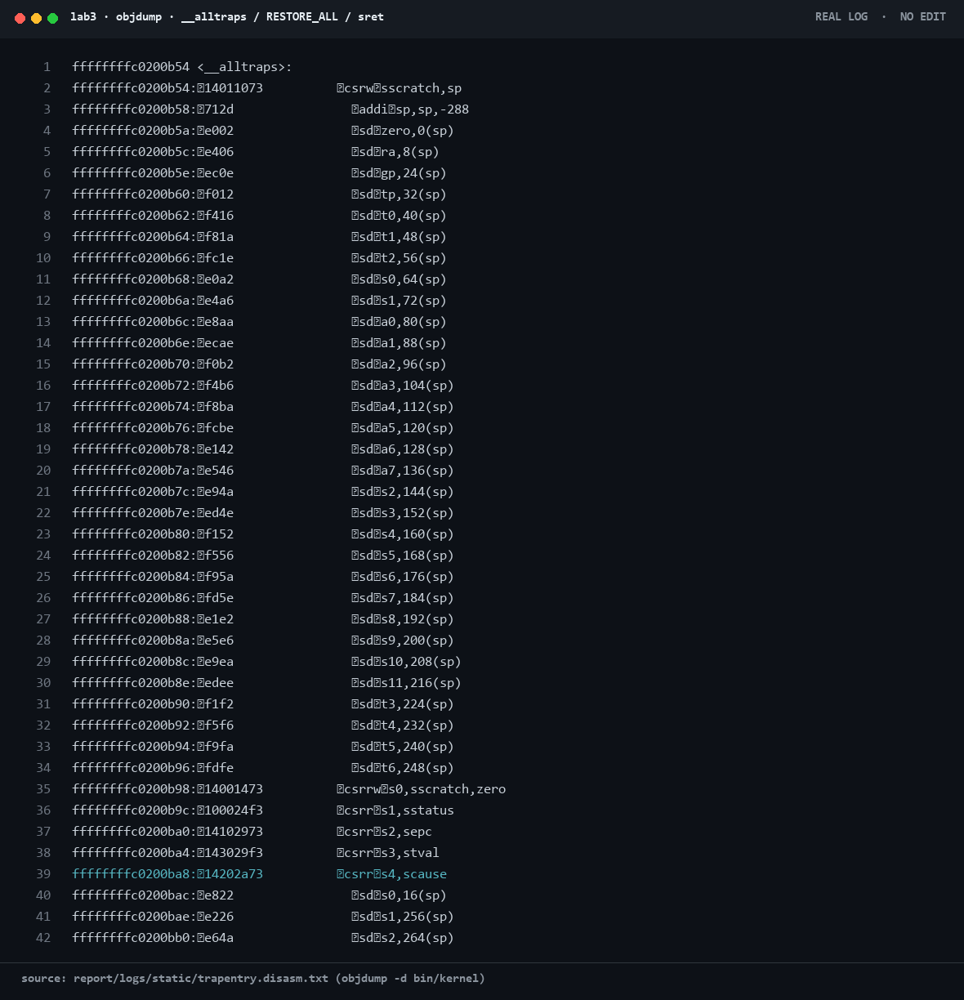
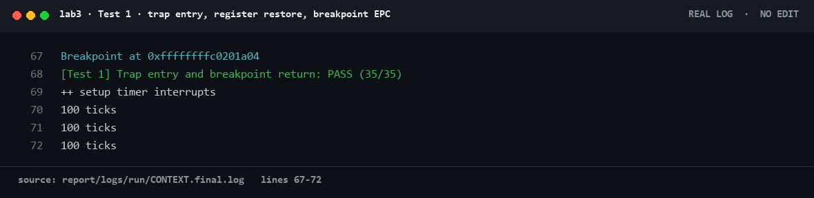
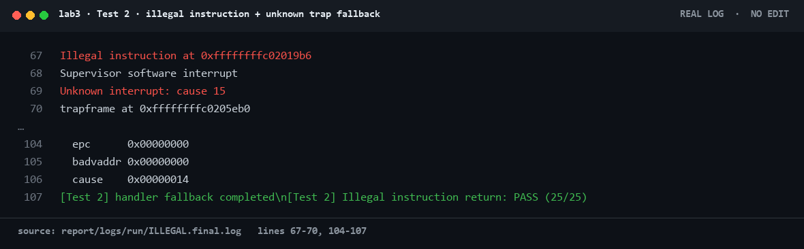
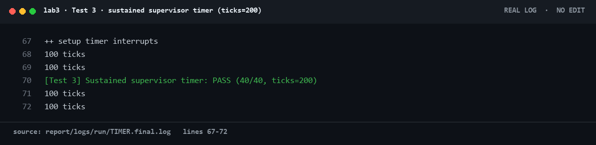
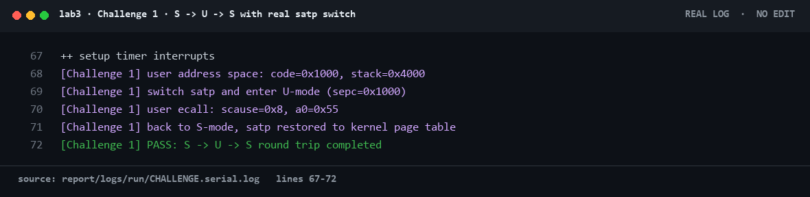
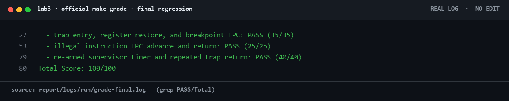

# 实验 3：中断、异常与特权级往返

## 基本信息

| 项目 | 内容 |
|---|---|
| 实验名称 | 实验 3 · 中断与异常（ucore / RISC-V 64） |
| 交付代码 | `code/`：`kern/`、`libs/`、`tools/`、`Makefile` |
| 运行环境 | WSL2 Ubuntu 22.04.5；riscv64-unknown-elf-gcc 16.1.0；QEMU 7.0.0（OpenSBI `fw_dynamic`）；riscv64-unknown-elf-gdb 19.0.50 |
| 小组成员 | 2410665 殷佳仪、2410749 宋秋实、2412090 兰雨杉 |

## 一、实验目的与材料判定

### 1.1 本次实验要完成的闭环

Lab1 建立启动与最小内核，Lab2 完成物理页管理；到 Lab3，内核还缺少对异步事件和同步异常的响应能力。指导书的核心不是缺页，而是 **Trap 闭环**：

```text
异常/中断发生
  -> 硬件保存 sepc/scause/sstatus/stval，跳到 stvec
  -> __alltraps 用 SAVE_ALL 在栈上构造 trapframe
  -> 以 trapframe* 调用 trap()
  -> interrupt_handler() / exception_handler() 分类处理
  -> __trapret 用 RESTORE_ALL 恢复现场
  -> sret 回到被打断的指令
```

硬件只保存 PC 和少量 CSR，32 个通用寄存器不在硬件现场里。因此本章要补的是“半个现场”：把 32 个通用寄存器和 4 个 CSR 组织成可返回的 `trapframe`，交给 C 处理，再按同一布局装回去。对应的两个功能模块是：

1. `kern/trap/trapentry.S`：`RESTORE_ALL` 与 `__alltraps`；
2. `kern/trap/trap.c`：`interrupt_handler()` 与 `exception_handler()`。

### 1.2 材料版本与范围判定

我们先把两份材料对齐，避免把不同版本的实验混在一起：

| 维度 | `lab3缺页机制.pptx` | `lab3指导书.docx` + 当前代码 |
|---|---|---|
| 主题 | 缺页异常、VMA、页换入换出 | RISC-V Trap 入口、上下文保存/恢复、时钟中断、非法指令、断点 |
| 关键结构 | `vma_struct`、`mm_struct` | `struct trapframe`、`struct pushregs` |
| 关键文件 | `vmm.c`、`swap.c`、`swap_fifo.c` | `trapentry.S`、`trap.c` |
| 评分 | PPT 中的缺页流程 | `tools/grade.sh`：35 + 25 + 40 分 |

我们的范围判断是：**以 docx、当前骨架和 `tools/grade.sh` 为准**。PPT 只作为“中断/异常在 OS 中处于什么位置”的背景；当前骨架没有 VMA、swap 和换页接口，强行实现缺页既无法进入评分路径，也会偏离本章的 Trap 主线。缺页留给后续虚拟内存实验。

### 1.3 指导书留下的设计空间

指导书没有给出 `RESTORE_ALL` 的完整指令序列，只给出四条约束：`trapframe` 布局、`x2(sp)` 的特殊处理、RISC-V 调用约定、`sret` 返回语义。这不是遗漏，而是要求学生从已有的 `SAVE_ALL` 反推恢复顺序。直接照抄一段“能跑”的汇编，无法解释偏移为什么这样排、`sp` 为什么必须最后恢复；从保存关系反推，才能把布局、顺序和返回语义对应起来。

## 二、实验环境与可复现命令

### 2.1 实测环境

```text
WSL2 Ubuntu 22.04.5
riscv64-unknown-elf-gcc 16.1.0
qemu-system-riscv64 7.0.0（OpenSBI fw_dynamic）
riscv64-unknown-elf-gdb 19.0.50
```

`tools/grade.sh` 的三组用例分别设置 8s、8s、30s 超时；最终分数由脚本输出，不以手工观察代替。

### 2.2 构建、运行与评分

在 WSL 中进入 `lab3/code`：

```bash
make clean
make                 # 生成 bin/kernel、bin/ucore.img
make grade           # 官方三组用例，目标 100/100
```

Challenge 1 使用独立构建，不进入默认评分：

```bash
make clean
make DEFS=-DLAB3_CHALLENGE_SWITCH
timeout 15 qemu-system-riscv64 -machine virt -nographic -bios default \
  -kernel bin/ucore.img
```

### 2.3 环境差异与修复

指导书配套的是旧版 QEMU 的 `fw_jump` 加载方式，本机是 QEMU 7.0.0 的 `fw_dynamic`。第一次执行 `make grade` 得到 0/100，串口只有：

```text
Domain0 Next Address      : 0x0000000000000000
```

内核没有执行。根因不是 Trap 代码，而是 `fw_dynamic` 不读取 `-device loader,file=...,addr=0x80200000` 这条加载路径。评分脚本改用 `-kernel bin/ucore.img` 后，同一份内核正常启动，OpenSBI 打印 `Next Address : 0x0000000080200000`。失败现场保留在 `logs/run/qemu-loader-failure-20261103.log`，用于区分“加载失败”和“Trap 实现错误”。

第二个差异来自工具链。`SAVE_ALL` 使用 `csrr s3, sbadaddr`，新版 binutils 已删除这个旧别名，编译报 `unknown CSR`。指导书要求不得修改 `SAVE_ALL`，因此修复放在文件头：

```asm
.equ sbadaddr, 0x143
```

`0x143` 是 `stval` 的 CSR 编号，汇编结果与旧工具链一致，`SAVE_ALL` 原文未改。该错误可用一个三行汇编文件稳定复现，日志在 `logs/build/binutils-sbadaddr-20261103.log`。这两项都不属于 Trap 算法本身，但会直接影响“代码能否进入被验证的路径”，因此单独记录。

## 三、Trap 闭环的设计

### 3.1 硬件做什么，软件做什么

| 阶段 | 执行者 | 动作 |
|---|---|---|
| 陷入 | 硬件 | `sepc` 记当前 PC；`scause` 记原因；`stval` 记附加信息；`SPIE←SIE`、`SIE←0`、`SPP←当前特权级`；PC←`stvec` |
| 建现场 | `SAVE_ALL` | 在当前栈顶压出 36 个 `uintptr_t` |
| 分发 | `trap()` | 用 `scause` 最高位区分中断/异常 |
| 处理 | 两个 handler | 续订时钟、推进 `epc`、打印或关机 |
| 拆现场 | `RESTORE_ALL` | 先 CSR，后通用寄存器，`sp` 最后 |
| 返回 | `sret` | PC←`sepc`；特权级←`SPP`；`SIE←SPIE` |

这张表是我们理解本章的主干。后面所有 bug 都能落回某一行：`sp` 提前恢复是“拆现场”错了，`epc` 不推进是“处理”错了，`sret` 前 `SPP` 不对是“返回”错了。

### 3.2 36 个槽位是硬契约

`struct trapframe` 在 64 位下是 36 个 `uintptr_t`，共 288 字节：

| 偏移 | 内容 |
|---:|---|
| `0x000`–`0x0F8` | `x0`–`x31` |
| `0x100` | `sstatus` |
| `0x108` | `sepc` |
| `0x110` | `stval`（`badvaddr`） |
| `0x118` | `scause` |

`SAVE_ALL` 用 `STORE xN, N*REGBYTES(sp)` 写这份布局，`RESTORE_ALL` 就必须用同样的偏移读回来。这里没有“大约对齐”的余地：错一个槽，返回后就是一个错误的寄存器值，而且往往要到很远的地方才炸。

### 3.3 三条硬约束，和一条容易照搬错的写法

1. **`sp` 必须最后恢复**。前面的每一条 `ld` 都要用当前 `sp` 当基址；先恢复 `sp`，后面的加载就全读到原栈上去了。
2. **用 `t0` 写 CSR 必须发生在恢复 `x5(t0)` 之前**。`sstatus`、`sepc` 只能用 `t0` 做临时寄存器；一旦先把 `x5(t0)` 从 frame 恢复，就再没有空闲寄存器可用了。
3. **`x0` 不恢复**。它是硬连线零，写它无效；读 frame 里的 `x0` 也没有意义。

还有一条不写在指导书里、但很容易踩的：**不能用 `sscratch` 恢复 `sp`**。`SAVE_ALL` 开头先 `csrw sscratch, sp` 暂存旧栈指针，末尾的 `csrrw s0, sscratch, x0` 再把它换进 `s0`，同时把 `sscratch` 清零。等到 `RESTORE_ALL` 执行时，`sscratch` 已经是 0，不是旧栈指针。我们一开始想过“用 `sscratch` 取回 `sp` 更优雅”，核对 `SAVE_ALL` 后放弃——这也是本章最典型的一处“不能凭直觉写汇编”。

### 3.4 指导书里两个“看起来无关”的问题

`local_intr_save(x)` 为什么写成 `do { ... } while (0)`？如果宏直接展开成 `{ ... }`，调用处写 `if (c) local_intr_save(flag); else ...` 时，`}` 后的分号会变成一条空语句，`else` 随即悬空。`do { ... } while (0)` 把宏变成语法上的一条语句，调用者照常写分号；`while (0)` 保证循环体只执行一次，不是运行时轮询。当前宏体只有一条赋值，裸花括号也能编译；但宏一旦增加语句，问题就会暴露。框架这样写，是在防守调用点的语法边界。

`stvec` 的 MODE 字段为什么能向后兼容？RISC-V 1.9.1 要求 `stvec.BASE` 四字节对齐，低两位本来就是 `00`；1.10 把这两位解释为 MODE，`00` 是 Direct，`01` 才是 Vectored。旧内核写 `stvec` 时低两位必然为 0，所以升级后自然被解释成 Direct，行为不变。`__alltraps` 前的 `.align(2)` 也是这个契约的一部分：入口地址对齐，MODE 字段才不会被地址本身污染。

## 四、模块一：`RESTORE_ALL` 与 `__alltraps`

### 4.1 实现

我们只新增了 `RESTORE_ALL` 和 `__alltraps` 的传参、跳转；`SAVE_ALL`、`struct trapframe` 和 `trap()` 的签名均未改动。`RESTORE_ALL` 按“先 CSR、再通用寄存器、最后 `sp`”展开：

```asm
.macro RESTORE_ALL
    ld t0, 32*REGBYTES(sp)
    csrw sstatus, t0
    ld t0, 33*REGBYTES(sp)
    csrw sepc, t0

    ld x1, 1*REGBYTES(sp)
    ld x3, 3*REGBYTES(sp)
    ...
    ld x31, 31*REGBYTES(sp)
    ld sp, 2*REGBYTES(sp)
.endm
```

`__alltraps` 只做三件事：保存、传参、跳到统一返回路径。

```asm
__alltraps:
    SAVE_ALL
    mv a0, sp
    jal trap
    j __trapret
```

`mv a0, sp` 是 RISC-V 调用约定里“第一个参数”的位置。此时 `sp` 正指向刚建好的 `trapframe`，所以 C 层拿到的 `struct trapframe *tf` 就是这份现场。`jal trap` 之后不写 `ret`，而是跳到 `__trapret`，保证所有返回路径都走同一套恢复逻辑。



图中前半段是 `SAVE_ALL`：31 条 `sd` 直接覆盖 `x0`、`x1`、`x3`–`x31`，被跳过的 `x2` 由后面的 `sd s0,16(sp)` 补上；随后四条 `csrr` 取 CSR，最后四个 `sd` 把它们写进 256–280 字节的槽位。偏移和结构体完全对得上。

### 4.2 验证

官方 Test 1 会构造一次断点，逐个比对寄存器，再检查返回地址：

```text
Breakpoint at 0xffffffffc0201a04
[Test 1] Trap entry and breakpoint return: PASS (35/35)
```

反汇编里 `__trapret` 返回前的最后两条有效指令是：

    ffffffffc0200fda:	6142                	ld	sp,16(sp)
    ffffffffc0200fdc:	10200073          	sret

前面所有 `ld` 都以旧 `sp` 为基址；`sp` 直到最后才换回用户/内核栈，然后才 `sret`。这条证据比“代码看起来对”有用：它证明汇编器真的把 `sp` 放在了最后（`logs/static/trapentry.disasm.txt`）。



上图是 Test 1 的完整输出：断点地址、35 项检查与返回结果在同一屏内。

### 4.3 三个设计取舍

**为什么不在 `__alltraps` 里切换内核栈？** 本实验的 `SAVE_ALL` 直接在“当前 `sp`”上建 frame。内核态陷入时，当前栈就是内核栈，没问题；一旦从用户态陷入，当前 `sp` 是用户栈，`trapframe` 就落在用户可写内存里。这是框架的设计缺口，不是本次评分点，我们在 Challenge 里显式切栈来规避，但默认路径没有改——改了会动到 `SAVE_ALL` 的契约，超出本次范围。

**为什么 `x0` 在 `SAVE_ALL` 里存、在 `RESTORE_ALL` 里不恢复？** 存它是为了让 36 个槽位与结构体字段一一对应，偏移计算不需要特判；不恢复它是因为 `x0` 恒为 0，恢复动作没有语义。两件事看起来矛盾，其实分别服务于“布局一致性”和“执行正确性”。

**任何中断都需要保存全部寄存器吗？** 不一定。若入口能按 cause 精确分流，理论上只保存被破坏的寄存器和必要 CSR 就够；但 ucore 在进入 C 代码前还不知道这次是什么中断，handler 又可能调用任意函数，所以只保存一部分无法证明安全。统一保存 32 个通用寄存器，代价是每次陷入 288 字节，换来的是“无论 handler 怎么改都不会漏现场”。这是典型的用空间换可证明性。

## 五、模块二：中断与异常处理

### 5.1 分流：最高位是中断位

`trap_dispatch` 本身是骨架代码，我们逐字未改；它用有符号数判断：

```c
if ((intptr_t)tf->cause < 0) interrupt_handler(tf);
else                          exception_handler(tf);
```

`scause` 最高位为 1 表示异步中断。进入 `interrupt_handler` 后还要把最高位掩掉，才能和 `IRQ_S_TIMER` 这类小整数比较：

```c
switch (tf->cause & INTERRUPT_CAUSE_MASK) { ... }
```

这一步很容易漏。漏了不会编译错，只会让所有中断都落进 `default`，然后打印一串“Unknown interrupt”。

### 5.2 时钟：每次进入都必须续订

```c
case IRQ_S_TIMER:
    clock_set_next_event();
    ticks++;
    if (ticks % TICK_NUM == 0) print_ticks();
    if (ticks >= SHUTDOWN_AFTER) sbi_shutdown();
    break;
```

`clock_set_next_event()` 调的是 `sbi_set_timer(get_cycles() + timebase)`，一次只预约一个事件，不会自动重装。我们第一版把续订放在分支末尾，第 100 次打印后路径提前离开，续订恰好被绕过；前 99 次都正常，所以问题直到第一行 `100 ticks` 才暴露，之后时钟就停住了。把续订提到 `case` 第一行，不是形式要求：它让“先预约下一次”不受后续任何 `break`、打印或关机判断影响。

`TICK_NUM=100`、`ticks` 在 `clock.c` 里是 `volatile size_t`，这两点是框架给定的。`SHUTDOWN_AFTER` 是我们加的：评分用例只要求跑到 200 tick，关机点必须明显晚于它，否则可能在测试打印 PASS 之前就断电。取 1000，是给评分留 5 倍余量，不是在模拟真实内核的关机策略。

### 5.3 异常：`epc` 不能一律加 4

```c
static uintptr_t instruction_length(uintptr_t epc) {
    uint16_t insn = *(volatile uint16_t *)epc;
    return (insn & 0x3) == 0x3 ? 4 : 2;
}
```

RISC-V 的 32 位指令低两位是 `11`，16 位压缩指令不是。测试里的 `ebreak` 是 2 字节，`.word 0x7b` 是 4 字节。统一 `+4` 的后果不是“少执行一条”，而是返回到指令中间，马上再触发一次非法指令，形成异常循环。

`ecall` 是另一种情况：它本身是 4 字节，语义上要返回到下一条指令，所以 `CAUSE_USER_ECALL` 和 `CAUSE_SUPERVISOR_ECALL` 都直接 `+4`。

未列出的异常一律 `print_trapframe(tf)`。这不是“偷懒”，而是同步异常没法凭空恢复：不知道该不该跳过、该跳到哪，贸然返回只会无限重入。把完整现场打出来，是唯一诚实的兜底。

### 5.4 验证

Test 2 同时覆盖非法指令、软件中断、未知中断和未知异常：

```text
Illegal instruction at 0xffffffffc02019b6
Supervisor software interrupt
Unknown interrupt: cause 15
  cause    0x00000014
[Test 2] Illegal instruction return: PASS (25/25)
```

Test 3 覆盖持续时钟：

```text
100 ticks
...
[Test 3] Sustained supervisor timer: PASS (40/40, ticks=200)
```

日志里 `100 ticks` 出现 10 次，说明不是“第一次中断凑巧打印了一次”，而是真的被反复续订。



Test 2 的关键不是 PASS 本身，而是 `Illegal instruction at ...` 之后还能回到用户测试代码；若 `epc` 推进错，下一行就会变成新的非法指令。截图最后一行的换行转义符是评分脚本打印的字面量，不是内核多输出了一行。



`100 ticks` 连续出现，尾部给出 `ticks=200`，两者必须同时成立。

### 5.5 一个框架层面的缺陷

`print_trapframe()` 用 `0x%08x` 打印 64 位寄存器：

```c
cprintf("  epc      0x%08x\n", tf->epc);
```

在 RV64 上这会截掉高 32 位。日志里的 `cause 0x00000014` 看不出问题，因为异常号本来就只有几位；但 `epc`、`badvaddr` 的高位会丢失，真正调试时可能被误导。这是骨架自带的问题，我们没有改：评分脚本只匹配 `cause` 行，改打印格式反而可能影响既有输出。把它写出来，是因为“能通过测试”不等于“工具没问题”。

### 5.6 对 Lab2 的回归：分配器必须关中断

Lab2 的 `alloc_pages/free_pages` 在“单线程、没有异步中断”的假设下不加保护也能过；Lab3 一打开时钟中断，这个假设就不成立了。分配器正在改 free list 时被 timer trap 打断，如果后续路径再分配或释放页，就可能看到半更新的链表。我们在 `pmm.c` 的这两个入口外包 `local_intr_save/local_intr_restore`，恢复的是进入前的 SIE，而不是无条件开中断——嵌套临界区才不会提前放行。

这不是评分点，但它是 Lab3 对 Lab2 的真实回归：中断让“顺序执行的代码”变成了“随时可能被切开的代码”。理论课把这类问题叫临界区；实验里它的表现不是锁竞争，而是 alloc/free 的内部状态被 trap 看见。

## 六、Challenge 1：S → U → S 的一次完整往返

### 6.1 设计

目标不是“改一下 `SPP` 跳过去再跳回来”，而是真的换地址空间：

1. 建独立 Sv39 根页表 `user_root`，复制内核高半区（entry 511）和启动期恒等映射（entry 2），保证切 `satp` 后内核还能取指；
2. 在 `user_root[0]` 下建 `L1 → L0`，映射用户代码页 `0x1000`（`U|R|W|X`）和用户栈页 `0x2000`、`0x3000`（`U|R|W`，栈顶 `0x4000`）；
3. 用户代码只有三条指令：`addi a0, x0, 0x55`、`ecall`、`j .`；
4. 清 `SPP`、置 `SUM`，切 `satp`，`sfence.vma`，`sret` 进入 U 模式；
5. U 模式 `ecall` 触发 `scause=8`，处理函数把 `SPP` 置 1、`sp` 换到挑战专用内核栈、`epc` 指向恢复桩；
6. 恢复桩先切内核栈，再清 `SUM`，最后切回内核页表。

指导书没有规定 Challenge 入口，`init.c` 也没有预留钩子。我们用 `LAB3_CHALLENGE_SWITCH` 编译开关接入：默认构建不编译、不执行这段代码，评分路径保持原样；只有显式传 `DEFS=-DLAB3_CHALLENGE_SWITCH` 时才进入挑战。这样既不改默认 trap 路径，也不会让挑战代码污染 100/100 的基线。

### 6.2 最关键的一个 bug：`SUM` 清早了

第一版在 `lab3_switch_back()` 里就把 `SUM` 清掉。结果 `RESTORE_ALL` 的第一条 `csrw sstatus, t0` 把 `SUM=0` 写进 CSR，紧接着还要从**用户栈上的 trapframe** 读 `sepc`，直接触发：

```text
scause = 0xd    # load page fault
```

然后递归 Trap，栈一路往下掉。现象看起来像“栈指针恢复错了”，但 GDB 在 `__trapret` 看到的 frame 完全正确。真正的原因是：S 模式在 `SUM=0` 时不能读用户页。

修复顺序只有一句话：**先离开用户栈，再关 `SUM`**。`lab3_switch_back()` 不再清 `SUM`；恢复桩先 `sp = switch_stack_top`，再 `csrc sstatus, SUM`，最后恢复 `satp`。这个 bug 让我们第一次真正理解 `SUM` 不是“用户态权限位”，而是“S 模式能否访问 U 页”的开关。

### 6.3 结果

```text
[Challenge 1] user ecall: scause=0x8, a0=0x55
[Challenge 1] back to S-mode, satp restored to kernel page table
[Challenge 1] PASS: S -> U -> S round trip completed
```

`a0=0x55` 证明用户代码真的执行了，`scause=0x8` 证明是 U 模式 `ecall`，最后一行证明 `satp` 已经切回内核页表。



这几行分别对应：建立用户地址空间、切换 `satp` 进入 U 模式、在 U 模式发起 `ecall`、恢复 S 模式并切回内核页表。

## 七、测试与判读

| 用例 | 结果 | 原始日志 |
|---|---|---|
| Trap 入口、寄存器恢复、断点 EPC | PASS (35/35) | `logs/run/CONTEXT.final.log` |
| 非法指令 EPC 推进与返回 | PASS (25/25) | `logs/run/ILLEGAL.final.log` |
| 持续时钟与重复返回 | PASS (40/40) | `logs/run/TIMER.final.log` |
| 总分 | **100/100** | `logs/run/grade-final.log` |
| Challenge 1 | PASS | `logs/run/CHALLENGE.serial.log` |

2026-11-03 我们对提交树重新跑了一遍：`make clean && make grade` 仍是 100/100，Challenge 仍是 PASS（`logs/run/grade-recheck-20261103.log`、`logs/run/CHALLENGE.recheck-20261103.log`）。2026-11-04 合入远端的中断保护与 Challenge 栈大小修正后，又在最新提交上重跑：默认构建 100/100，Challenge PASS（`logs/run/grade-20261104.log`、`logs/run/CHALLENGE-20261104.log`）。这一步是必要的——只保留某一次成功截图，无法证明仓库里的代码就是跑出那个结果的那份。



总分 100/100，三个用例分别是 35、25、40 分。

判读方法只有三条：

- `ticks` 停在 100：定时器没续订；
- 断点返回后立刻非法指令：`epc` 被固定加了 4；
- 出现 `scause=0xd` 且反复 Trap：先查 `SUM` 和栈，再查 frame 布局。

## 八、Prompt：怎么让 AI 写出可评审的代码

我们的 spec 固定四段：**输入、输出、约束、验收**。约束里必须写“不能做什么”，因为 AI 最容易犯的错不是不会写，而是顺手改了不该改的地方。

| 模块 | 输入 | 输出 | 关键约束 | 验收 |
|---|---|---|---|---|
| A：`RESTORE_ALL` | 栈顶的 36 槽 `trapframe` | 恢复 CSR 与通用寄存器后 `sret` | 不改 `SAVE_ALL`、结构体、`trap()` 签名；`sp` 最后恢复 | Test 1 35/35；反汇编末尾为 `ld sp,16(sp)`、`sret` |
| B：中断/异常处理 | `scause`、`sepc`、`stval` | 续订时钟、推进 `epc`、打印或关机 | 先掩中断位；每次时钟中断都续订；按指令长度推进 | Test 2 25/25、Test 3 40/40 |
| Challenge 1 | 内核页表、用户代码页、用户栈 | 一次 S → U → S 往返 | 不改默认 trap 路径；先离用户栈再清 `SUM` | `scause=0x8`、`a0=0x55`、`satp` 已恢复 |

模块 A 的 prompt（节选）：

```text
已有 SAVE_ALL 把 32 个通用寄存器和 sstatus/sepc/badvaddr/scause
按 struct trapframe 的 36 个 uintptr_t 槽位保存在当前栈顶。
请只实现 RESTORE_ALL 和 __alltraps，要求：
1. 先恢复 sstatus、sepc，用 t0 做临时寄存器；
2. 恢复 x1、x3..x31，不恢复 x0；
3. sp 必须最后从 2*REGBYTES(sp) 恢复；
4. __alltraps 中 SAVE_ALL 后把 sp 放进 a0，jal trap，返回后 j __trapret；
5. 不修改 SAVE_ALL、struct trapframe、trap() 签名；
6. 输出 unified diff，不要重写整个文件。
验收：Test 1 必须 PASS (35/35)，objdump 最后两条是 ld sp,16(sp) 与 sret。
```

模块 B 的 prompt 骨架是：

- 输入：`struct trapframe *tf`，其中 `cause` 最高位表示中断；
- 输出：软件中断、外部中断、未知中断各打印一行；定时器每 100 tick 打印，累计 10 行后关机；`ebreak`/非法指令推进 `epc` 后返回；
- 约束：先掩 `scause` 最高位；`clock_set_next_event()` 放分支第一行；`epc` 按指令低两位推进；不碰 `trap_dispatch` 和 `SAVE_ALL`；
- 验收：Test 2 25/25、Test 3 40/40，输出字符串逐字匹配。

还把四条输出格式逐字写进去，因为评分脚本是字符串匹配，差一个空格就是 0 分。

Challenge 的 prompt 也按四段写，核心是“真实换页表，不是只改 SPP”：

- 输入：现有 Sv39 内核页表、一个用户代码页和一个用户栈；
- 输出：串口打印 `scause=0x8`、`a0=0x55`，并回到 S 模式；
- 约束：不改默认 trap 路径；用户页带 `U` 位；切换 `satp` 后必须 `sfence.vma`；先离开用户栈再清 `SUM`；
- 验收：`PASS: S -> U -> S round trip completed`。

prompt 写了两轮。第一轮只描述正常路径；第二轮把 `scause=0xd` 的现象和“先切内核栈、再清 SUM”的顺序写进去，要求先解释再改。第二轮的回答质量明显更高，因为它有了可验证的故障现象，而不是凭空设计。

AI 生成后我们固定按五步审：diff 范围、偏移、顺序、字符串、回归。实际拦下来的问题：

| 现象 | 根因 | 修复 |
|---|---|---|
| 编译报 `unknown CSR sbadaddr` | 新 binutils 删了旧别名 | 文件头 `.equ sbadaddr, 0x143` |
| 第 100 次后时钟停住 | 续订位于可能被绕过的分支末尾 | 续订提到分支第一行 |
| 断点返回后跑飞 | `ebreak` 被当成 4 字节 | `instruction_length()` 按低两位判断 |
| Challenge `scause=0xd` 递归 | `SUM` 提前清零 | 切内核栈后再清 |
| 未知中断不打印 | 忘记掩 `scause` 最高位 | 先 `& INTERRUPT_CAUSE_MASK` |

## 九、理论课与实验的对应

| 实验里的东西 | 操作系统原理 | 关系与差异 |
|---|---|---|
| `trapframe` | 上下文（context） | 实验只保存同一执行流的寄存器；进程切换还要保存页表、调度状态、文件描述符 |
| `sstatus.SPP/SPIE` | PSW / 特权级 | 硬件自动记录“从哪来、之前是否开中断”，`sret` 据此返回 |
| `scause` | 中断/异常号 | RISC-V 用最高位区分异步与同步，其他架构编码不同 |
| `sepc` + 推进 | 异常返回地址 | 断点/非法指令要跳过，时钟中断要回到原指令 |
| `stvec` | 中断向量表 | Direct 模式只有一个入口；向量表模式才按 cause 分流 |
| `sscratch` | 内核栈指针暂存 | 本实验只用来暂存旧 `sp`，并未实现用户态内核栈切换 |
| `sbi_set_timer` | 时钟中断/时间片 | OpenSBI 在 M 模式操作定时器，S 模式每次续订 |
| `ticks` | 系统节拍 | 实验只计数打印；真实内核用它驱动调度和超时 |
| `SUM` / `PTE_U` | 用户/内核隔离 | 用户页必须带 U 位；S 模式访问 U 页要 `SUM=1` |
| `satp` / `sfence.vma` | 地址空间切换 / TLB | 换页表必须刷新 TLB，否则旧映射还在 |

理论课常把中断处理写成“关中断 → 保存现场 → 识别中断源 → 处理 → 恢复现场 → 开中断返回”。RISC-V 把其中一部分交给硬件：陷入时自动清 `SIE`、把旧特权级放进 `SPP`、把旧中断使能放进 `SPIE`、把 PC 和 cause 写进 CSR；软件补的是通用寄存器，`sret` 再从 `SPP/SPIE` 恢复特权级和中断使能。这个软硬件分工，是本章最值得和课堂对照的地方。

课堂上一句话带过的“保存现场”，在实验里被拆成 36 个槽位、两条 CSR 写回和一条 `sret`：`sp` 放错位置，后面全错；`sstatus` 写早或写晚，特权级就回不去。**“现场”不是抽象名词，是一张必须逐字节对齐的表。**

差异也要说清楚：本实验没有进程、没有调度、没有系统调用表。`trapframe` 是“同一执行流的现场”，不是“进程上下文”；`ecall` 只推进了 `epc`，没有参数传递和返回值。把这两件事混为一谈，是本章最容易产生的误解。

## 十、OS 原理里重要、但本章没有覆盖的

1. **进程与调度**：没有 PCB、就绪队列、时间片轮转。定时器只加 `ticks`，不会触发 `schedule()`。
2. **系统调用完整路径**：没有调用号分发、参数校验、用户指针检查、返回值写回。
3. **缺页与页替换**：PPT 里的 VMA、swap、FIFO 不在当前骨架；没有 Present 位检查和换入换出。
4. **完整的用户进程**：Challenge 只跑三条裸指令，没有 ELF 加载、`argv/envp`、退出码。
5. **文件系统与 I/O**：没有 inode、文件描述符、块设备驱动。
6. **同步与并发**：单 hart，没有锁、信号量，也没有中断下半部。
7. **多核**：没有 per-hart 栈、核间中断、自旋锁。
8. **安全**：没有用户指针校验，Challenge 的 `SUM` 只是一次受控演示。

这些不是“漏做”，而是后续虚拟内存、进程管理、文件系统实验的主线。知道边界在哪，比假装什么都做了更有价值。

## 十一、小组讨论与反思

分工是按“代码所有权、运行所有权、文档所有权”切的：殷佳仪负责总体架构、模块 A 和统稿；宋秋实负责模块 B、Lab2 分配器的中断保护，并且是**全组唯一执行 `make`、QEMU、GDB、`make grade` 的人**；兰雨杉负责 Lab2 依赖移植、QEMU 适配和 Challenge。运行权集中不是为了省事，而是为了避免两个人跑出两套结论——同一个现象，必须有一份可追溯的原始日志。

实验里真正争论过的有三个问题：

**第一，`RESTORE_ALL` 能不能用 `sscratch` 取 `sp`。** 有人觉得这样更短。核对 `SAVE_ALL` 后发现 `sscratch` 已经被清零，方案直接不成立。这件事提醒我们：汇编里的“优雅写法”必须先服从既有契约。

**第二，定时器续订放在 `ticks++` 前还是后。** 功能上两者都能编译，但放后面时第一次中断就可能丢节拍。最后统一成“进入分支第一件事就是续订”，并在报告里把它写成约束，而不是实现细节。

**第三，Challenge 值不值得做。** 默认评分不含它，做它要额外处理页表、`SUM`、`satp`。我们最后还是做了，因为 `SUM` 那个 bug 是整章最有价值的一次调试：它把“特权级”“页权限”“栈”三件原本分散的知识点串成了一条因果链。

反思有两点。其一，我们一开始也想“照着指导书的伪代码填”，但这一章恰恰没有伪代码；被迫从 `SAVE_ALL` 反推，反而第一次看清了 trapframe 的布局。其二，环境问题（QEMU 加载、`sbadaddr`）本可以早点写进实验记录，实际是踩到之后才补的；以后应该在第一次构建失败时就留日志，而不是靠记忆复述。

## 十二、结论

默认构建 `make grade` 为 **100/100**，Challenge 1 为 **PASS**。更重要的是，这条链上的每个结论都有对应证据：`sp` 最后恢复有反汇编，定时器续订有 `ticks=200`，`epc` 推进有非法指令日志，`SUM` 顺序有 `scause=0xd` 的失败现场。

我们最终理解的是：Trap 不是“写两个函数”，而是硬件与软件之间一份严格的契约。硬件负责留下线索，软件负责补齐现场；任何一处顺序、偏移或权限判断出错，契约就断了。这一章真正训练的是**在约束下设计**，而不是记住某段汇编。
