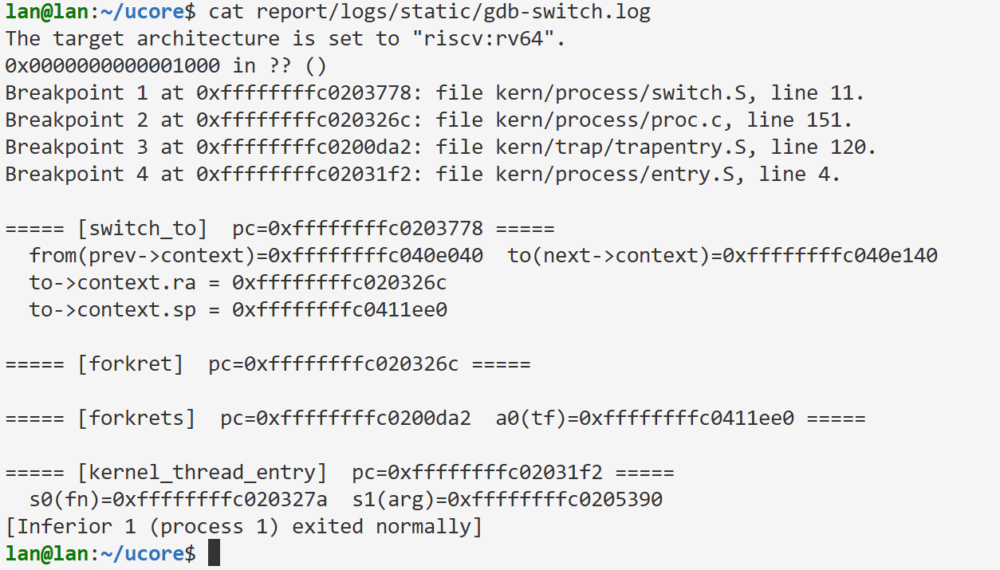

# 操作系统实验报告 · Lab 4：进程管理（内核线程与进程调度）

## 实验基本信息

| 项目 | 内容 |
|------|------|
| 实验名称 | Lab 4：进程管理（内核线程与进程调度） |
| 小组成员 | 2410665 殷佳仪（组长）、2410749 宋秋实、2412090 兰雨杉 |
| 完成日期 | 2026-11-17 |

### 小组分工

| 成员 | 代码 | 文档与证据 |
|------|------|-----------|
| 2410665 殷佳仪（组长） | 模块一 `page_insert()`、`page_remove()` | 分工与架构、模块一 spec/prompt、Challenge 2 主笔、报告统稿 |
| 2410749 宋秋实 | 模块二 `alloc_proc()`、`proc_init()`、`kernel_thread()`、`do_fork()`、`copy_thread()`、`copy_mm()` | 模块二 spec/prompt、bug 记录、构建/运行/GDB/评分日志 |
| 2412090 兰雨杉 | 模块三 `switch_to()`、`schedule()`、`cpu_idle()`、`proc_run()`，Lab2/Lab3 依赖回填 | 模块三 spec/prompt、Challenge 1 主笔、依赖移植说明、截图 |

## 一、实验目的

1. 理解内核线程与进程的核心数据结构（`struct proc_struct`、`struct context`、`struct trapframe`）和生命周期。
2. 掌握进程创建链路（`alloc_proc` → `do_fork` → `copy_thread` → `copy_mm`）以及新线程首次被调度的现场构造。
3. 掌握进程调度与上下文切换（`schedule` → `proc_run` → `switch_to`），理解为什么只切换 callee-saved 寄存器。
4. 理解用 `local_intr_save/restore` 保护临界区的原理，以及它和自旋锁的边界。
5. 练习用 AI 辅助开发操作系统核心功能。

## 二、实验环境

### AI 工具

| 成员 | AI 工具 | 底层模型 |
|------|---------|---------|
| 全组 | dsh（DeepSeek Harness）Web 界面 | DeepSeek-V4-Flash |

### 运行环境

WSL2 Ubuntu 22.04 + riscv64 交叉工具链 + qemu-system-riscv64 7.0.0（OpenSBI `fw_dynamic`）。

## 三、实验整体逻辑分析

本章主线是进程管理。Lab2 完成了物理页管理、Lab3 完成了陷阱处理之后，Lab4 要解决"如何让一个 CPU 在多个内核线程之间切换"。整体按依赖顺序分三步：

1. **先补依赖**：进程的 PCB 和内核栈要 `kmalloc`，新线程首次被调度要走陷阱返回链，所以先回填 Lab2 的物理页分配器和 Lab3 的陷阱恢复（见"依赖移植说明"）。
2. **再创建进程**（模块二）：`alloc_proc` 建 PCB → `do_fork` 复制并登记 → `copy_thread` 摆好新线程首次运行的现场（`context.ra = forkret`）。
3. **最后调度**（模块三）：`schedule` 选出下一个可运行线程 → `proc_run` 换页表根 → `switch_to` 换 callee-saved 寄存器现场。

其中"首次运行链"是理解本章的关键：新线程不是从 `kernel_thread_entry` 直接开始，而是 `switch_to` 的 `ret` 跳到 `forkret`，再走 `forkrets → __trapret → sret`，用陷阱返回机制把栈上预置的 `trapframe` 装回寄存器、跳到 `kernel_thread_entry`。

## 四、实验内容与实现

### 功能模块一：虚拟内存页操作（负责人：殷佳仪）

修改 `kern/mm/pmm.c`，实现 `page_insert()` 和 `page_remove()`，负责把虚拟地址映射到物理页、以及撤销映射。

关键点：

- `page_insert` 对同一地址映射同一物理页时，走"同页快速路径"，只更新权限，**不能先 `page_ref_dec` 再 `page_ref_inc`**，否则单引用页会被瞬间释放。
- 同一地址改映射到另一物理页时，先 `page_remove` 撤销旧映射，再对新页加一次引用。
- `page_remove` 必须幂等：页表不存在或叶项无效时静默返回。
- `page_remove` 不回收空的二级页表页，`check_pgdir()` 对页表页引用有既有断言。
- 两个函数改完页表项都调 `tlb_invalidate`，防止 CPU 命中旧翻译。

完整的 spec、不变量和最终提示词见 [prompts/module1.md](prompts/module1.md)。

### 功能模块二：进程创建与初始化（负责人：宋秋实）

修改 `kern/process/proc.c` 的 function2 区域，实现 `alloc_proc`、`proc_init`、`kernel_thread`、`do_fork`、`copy_thread`、`copy_mm`，完成内核线程的创建。

关键点：

- `alloc_proc` 把 PCB 所有字段清零初始化，`pgdir` 存**物理地址** `boot_pgdir_pa`（供 `satp` 使用），不是内核虚拟地址。
- `idleproc` 不是 fork 出来的：它复用当前执行现场和 `bootstack`，`context` 保持清零（`context.ra == 0`），官方测试断言这一点。
- `do_fork` 严格七步，每步失败回滚：`alloc_proc` → `setup_kstack` → `copy_mm` → `copy_thread` → `get_pid` 后挂链表 → `wakeup_proc` → 返回 pid。**必须先 `get_pid` 再挂链表**，否则 `get_pid` 会把自己当冲突源。
- `kernel_thread` 的 `s0 = fn`、`s1 = arg` 与 `kernel_thread_entry` 的 `move a0, s1; jalr s0` 严格对应。
- `copy_thread` 的 `context.ra` 指向 `forkret`（不是 `kernel_thread_entry`），`context.sp` 指向 `proc->tf`，子线程 `trapframe.gpr.a0 = 0`、`gpr.sp` 有效。

完整的 spec、不变量和最终提示词见 [prompts/module2.md](prompts/module2.md)。

### 功能模块三：进程调度与上下文切换（负责人：兰雨杉）

修改 `kern/process/switch.S`、`kern/schedule/sched.c` 和 `kern/process/proc.c` 的 function3 区域，实现 `switch_to`、`schedule`、`cpu_idle`、`proc_run`。

关键点：

- `switch_to` 只保存/恢复 callee-saved 寄存器 `ra, sp, s0~s11` 共 14 个，字段顺序与 `struct context` 严格一致，最后 `ret` 跳到 `to->context.ra`（首次是 `forkret`）。
- `schedule` 全程关中断（`local_intr_save/restore`），Round-Robin 从"自己下一个"开始环形扫描 `proc_list` 找 `PROC_RUNNABLE`，一圈没有则回退 `idleproc`。
- `proc_run` 必须先设 `current` 和 `satp`、再 `switch_to`——`switch_to` 返回时已经站在新线程栈上。
- `satp` 用 Sv39 编码 `0x8000000000000000`，和 `pmm.c` 的 `enable_paging()` 一致，绕开 `libs/riscv.h` 里那个 SATP32 的 `lsatp()`（骨架实际是三级页表，见 Challenge 2）。

完整的 spec、不变量和最终提示词见 [prompts/module3.md](prompts/module3.md)。

### 依赖移植说明（Lab2/Lab3 回填）

Lab4 的进程调度依赖物理内存管理和陷阱处理，但骨架只给了 Lab4 的文件，缺 Lab2/Lab3 的部分，需要回填：

- **物理页分配器**（`kern/mm/default_pmm.c` + `kern/mm/pmm.c` 的 `page_init`）：补 best-fit 分配器和 `page_init`（从设备树拿物理内存起止，建 `pages[]` 描述符数组、标保留、把空闲区交给分配器）。用 best-fit 是因为官方测试 `best_fit_check` 的断言（`p0+4 == p1`）只有 best-fit 能满足。
- **陷阱恢复与处理**（`kern/trap/trapentry.S` + `kern/trap/trap.c`）：补 `RESTORE_ALL` 宏、`__alltraps` 入口（`mv a0, sp; jal trap; j __trapret`），以及 `interrupt_handler`/`exception_handler`（定时器中断续订下一次事件、计数、到点关机）。

回填保持旧实验语义，但按新骨架接口调整（分配器函数统一成 `default_*`、注册成 `default_pmm_manager`），没有用旧实验整文件覆盖新骨架。

### Challenge 1：`local_intr_save/restore` 如何实现开关中断（主笔：兰雨杉）

`local_intr_save(intr_flag)` 展开成 `intr_flag = __intr_save()`。`__intr_save()` 先读 `sstatus.SIE`，**只有原本开启中断时才**调 `intr_disable()` 关掉，并把"关之前是否开启"作为 `bool` 存进 `intr_flag` 返回。`local_intr_restore(intr_flag)` 展开成 `__intr_restore(intr_flag)`，它**只在 `intr_flag` 为真时**才 `intr_enable()` 重新开中断。

所以它保存的是**调用点的中断状态**，不是简单的"进来关、出去开"。关键在嵌套：外层已经关了中断时 `sstatus.SIE == 0`，内层 `__intr_save()` 返回 `false`，内层退出时 `__intr_restore(false)` 就不开中断——中断状态逐层归还，内层不会擅自把外层关掉的中断打开。`schedule()`/`proc_run()` 用它包住临界区，就是为了防止调度扫描到一半被时钟中断打断。

注意它的边界：`local_intr_save/restore` 只关本 CPU 的局部中断，**不是自旋锁**，解决不了多核间互斥。本实验只跑单核内核线程，"局部关中断"够用；把它当成多核同步手段是不对的。

### Challenge 2：分页模式与 `get_pte()` 的拆分（主笔：殷佳仪）

**1. 三种分页模式的区别**

| 模式 | 页表级数 | 虚拟地址 | 物理地址 | 每级索引宽度 |
|------|---------|---------|---------|-------------|
| Sv32 | 2 | 32 位 | 34 位 | 10 + 10 |
| Sv39 | 3 | 39 位 | 56 位 | 9 + 9 + 9 |
| Sv48 | 4 | 48 位 | 56 位 | 9 + 9 + 9 + 9 |

级别数增加的本质是虚拟地址位宽增加：每一级的页表项结构、索引宽度（Sv39 起固定 9 位）和页大小（4KB）保持同一套，只是多加几级。所以 `get_pte()` 里会出现形式相似的多段"查索引、缺表则建表"代码——每一级做同样的事，只是读的索引字段不同。

**2. 本骨架的材料不一致**

`kern/mm/mmu.h` 顶部注释写着 "RISC-V uses 32-bit virtual address"、"Sv32"，还画了一张 10+10+12 的两级布局图。但实际宏定义是：

```c
#define PDX1SHIFT 30
#define PDX0SHIFT 21
#define PTXSHIFT  12
#define PDX1(la) ((((uintptr_t)(la)) >> PDX1SHIFT) & 0x1FF)  // 9 位
#define PDX0(la) ((((uintptr_t)(la)) >> PDX0SHIFT) & 0x1FF)  // 9 位
#define PTX(la)  ((((uintptr_t)(la)) >> PTXSHIFT)  & 0x1FF)  // 9 位
```

三级索引各 9 位，加 12 位页内偏移，正好 9+9+9+12 = 39 位，是 Sv39。`get_pte()` 也确实是三级遍历：先 `PDX1` 查一级页表（缺则建），再 `PDX0` 查二级，最后 `PTX` 定位叶项。所以注释是旧的，代码是 Sv39，报告不能把旧注释当结论。模块三 `proc_run` 里 `satp` 用 `0x8000000000000000`（模式字段 8 = Sv39）而不是 `lsatp()`（那个写死了 SATP32 模式），依据就是这一点。

**3. `get_pte()` 合并"查"与"建"的取舍**

把"查页表项"和"缺页表时分配"合在一个函数里，优点：调用者少写重复遍历、映射建立集中；缺点：查询接口带副作用，错误路径和测试注入更难，`create` 参数使一个函数同时承担"只查"和"查+建"两种语义。更清晰的设计是拆成 `walk_pte()`（只查找）和 `alloc_pte_table()`（只在遍历失败时建表），再由 `get_pte()` 或更高层组合。本实验为保持骨架兼容保留合并接口，但这是工程折中，不是唯一正确写法。

Challenge 1/2 都不修改默认评分路径，不把答案代码塞进 `pmm.c` 或 `proc.c`。

## 五、测试与验证

`make grade` 原始输出（见 [logs/run/grade-20261115-0017.log](logs/run/grade-20261115-0017.log)）末尾三行：

```text
  -check PMM:                                OK
  -check Process Create:                     OK
  -check Schedule:                           OK
Total Score: 30/30
```

首次运行链由 GDB 证明（见 [logs/static/gdb-switch.log](logs/static/gdb-switch.log)）：

```text
===== [switch_to]  pc=0xffffffffc0203778 =====
  from(prev->context)=0xffffffffc040e040  to(next->context)=0xffffffffc040e140
  to->context.ra = 0xffffffffc020326c
  to->context.sp = 0xffffffffc0411ee0
===== [forkret]  pc=0xffffffffc020326c =====
===== [forkrets]  pc=0xffffffffc0200da2  a0(tf)=0xffffffffc0411ee0 =====
===== [kernel_thread_entry]  pc=0xffffffffc02031f2 =====
  s0(fn)=0xffffffffc020327a  s1(arg)=0xffffffffc0205390
```

断点依次命中 `switch_to → forkret → forkrets → kernel_thread_entry`，`to->context.ra` 指向 `forkret`，证明新线程经 `forkret → forkrets → __trapret` 恢复现场、跳到 `kernel_thread_entry`。反汇编见 [logs/static/kernel.disasm.txt](logs/static/kernel.disasm.txt)。

T1–T8 边界测试结论见 [tests/boundary_summary.md](tests/boundary_summary.md)。

截图：




## 六、实验总结与收获

### 对操作系统的理解

1. **进程是"资源 + 执行流"两个身份的载体**：PCB 和页表描述资源，`context` 和 `trapframe` 描述执行流。创建进程时两者分别由 `copy_mm`（本实验占位）和 `copy_thread` 准备。
2. **上下文切换只需存 callee-saved**：caller-saved 寄存器由调用约定保证调用者自己保存，所以 `switch_to` 只切 `ra, sp, s0~s11`，对应理论课上"进程现场"的核心。
3. **调度是"选下一个 + 换现场"两件事**：`schedule` 只负责选，`proc_run`/`switch_to` 负责换。换页表根（`satp`）是进程隔离的基础，即使本实验所有内核线程共享同一 boot 页表，这个动作也不能省。
4. **临界区保护有层级**：关中断（局部）保护的是"单核上不被异步打断"，自旋锁保护的是"多核间互斥"，两者不能混为一谈。

### 本实验未覆盖的 OS 原理知识点

抢占式调度与时间片、多核同步（自旋锁/原子指令）、完整的用户态进程与 `wait/exit`、地址空间复制（`copy_mm` 目前是占位）、缺页异常与换页。这些留待后续实验。

### AI 协作开发的经验

1. **spec 先行**：每个函数先写清"输入/成功语义/失败语义/不变量"，再让 AI 生成代码，比直接描述"实现页表插入"少走弯路。三个模块都按这个格式落地（见 `report/prompts/`）。
2. **prompt 里写死"不碰什么"**：明确"只改哪个文件、哪些函数、用哪些既有接口"，比只写"要做什么"更能防住 AI 顺手改了别人的模块。
3. **AI 给的第一版不能直接信**：本实验最典型的是 `satp` 编码——骨架给的 `lsatp()` 写死 Sv32 模式，但页表实际是 Sv39，照抄会把 CPU 切进错误的地址翻译模式。这类"看起来能跑、语义不对"的问题不报错，只能查手册、对反汇编才能发现。
4. **bug 用五行归档**：现象/根因/修复/回归/反思，不写"改好了"。本实验真正影响系统行为的问题集中在页表引用计数、TLB、`status` 位、`switch_to` 字段偏移、调度起点这几类。
